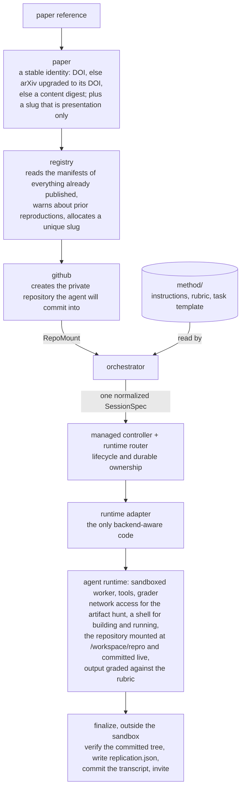
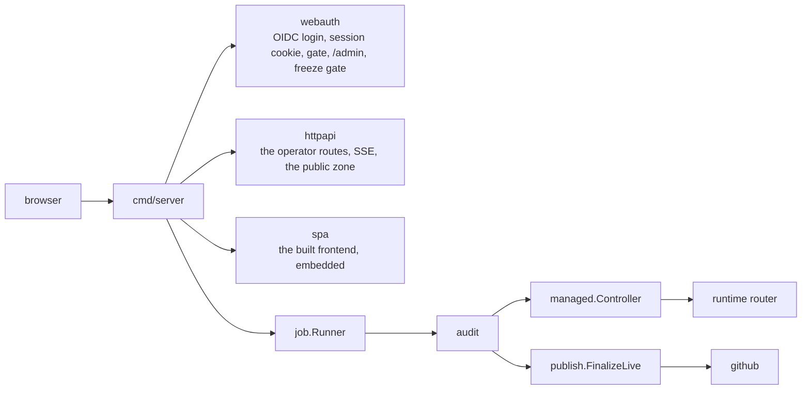
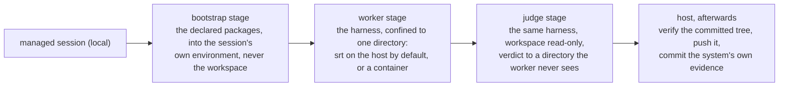

# Architecture

Two programs share one engine: a CLI that runs a single audit, and a web application that runs audits for people who signed in and paid for them. The engine is the same code in both, and it knows about neither.

## The engine

An audit without publishing stops at the agent runtime and collects artifacts into a local directory. Everything above and below the runtime is the publishing path. It is optional per run, not a separate program. The CLI reaches it with `--publish`; the server reaches the same `publish.FinalizeLive` from its worker, so both write the same manifest. The server also commits what a session left in its output directory, through the same `VerifyTree` gate.

## The application

Postgres holds `jobs`, `projects`, `project_papers`, `project_members`,
`access_grants`, `freeze_overrides`, `platform_settings`, `profiles`, and the
ledger's `ledger_entries`, whose schema `latere.ai/x/pay` owns. The older
`credit_entries` is kept, unread, until the copied balances are trusted.

One binary. The HTTP server and the worker run in the same process; the database lets a session outlive the request, the connection, and a restart. A submitted session becomes a row before anything is spent, and the worker claims it with `SELECT … FOR UPDATE SKIP LOCKED`, so two pods do not run the same audit twice.

## Layers

**Paper identity** (`internal/paper/`) answers the question "is this the same paper we already audited?". Identity is a resolved external identifier: a DOI, else an arXiv ID upgraded to its published DOI, else a digest of the fetched content. It is never the title, which changes between preprint and camera-ready. The slug answers "what should the repository be called?" and never feeds identity. An arXiv lookup that cannot complete returns an error rather than guessing, so identity does not depend on connectivity. The network is reached through a `Fetcher` seam the caller supplies, which keeps the package testable without one.

**Orchestrator** (`internal/audit/`) describes one session: model preference, instructions, task, sandbox, resources, and optional evaluation. `managed.Controller` owns start, polling, retry, cancellation, evidence retention, and release. Audit and experiment code never names a vendor workspace, agent, container, or response.

**Managed-session contract** (`internal/managed/`) is the seam: one `SessionSpec` starts one session and returns a provider-tagged, versioned `SessionRef`. That complete reference is persisted before the first poll and routes every later poll, transcript, artifact, cancel, and release back to its owning runtime, even after a restart or a change of default.

**Runtime adapters and routing** (`internal/runtimes/`) are composed explicitly; there is no global registry or `init` registration. Three runtimes ship today: `anthropic-managed`, which adapts the existing Managed Agents backend; `memory`, a deterministic reference runtime; and `local`, which runs a session on the operator's own machine. Vendor wire payloads and usage fields are translated inside the adapter; HTTP and billing consume only normalized events, model references, and meters.

Every operation that can block takes a `context.Context` and honors cancellation. Adding a runtime means implementing the managed contract and registering it at the composition boundary; consumers do not change. Direct OpenAI and Latere adapters are designed separately and are not built.

**The local runtime** (`internal/runtimes/local/`) is the same engine on the operator's own machine. It is a peer of `anthropic-managed` behind the same contract, passes the contract tests in `internal/managed/contracttest` as the memory runtime does, and the choices that vary inside it are not part of its name:

- **The sandbox is a driver** (`sandbox/`, `host/`, `container/`). The default is `srt` (Seatbelt on macOS, bubblewrap with seccomp on Linux) around the harness already installed and logged in on the machine: no image, no virtual machine, and an allow-only network policy that the container driver cannot enforce. The container driver is opt-in, for a toolchain pinned identically everywhere.
- **The harness is an adapter** (`harness/`). Claude Code and Codex contribute argv, environment, configuration and a decoder from their own stream to normalized events. Neither owns any lifecycle.
- **The model is an endpoint** (`catalog.go`). The operator declares gateways and models in `models.yaml`; with no file, the default is the harness's own login. An open-weights model behind an OpenAI-compatible gateway is a row in that file.
- **The session directory is the durable state.** `workspace/` becomes the repository; `inputs/` is what the session was handed to read, such as a study's copy of the paper and its snapshots of the released artifacts, mounted read-only into every stage; `tmp/` and `venv/` are what the agent needs and must not publish; `session/` is host-authored evidence no stage can write, including each grading round's findings as the round left them. A detached run is recovered from the directory and a process handle alone.
- **Nothing local touches the ledger.** The compute was bought from the vendor by the person who ran it.

**Batching** (`internal/batch/`) runs a whole project: a list of papers, a concurrency cap, one isolated session each, resumable state, and a report. Preparation is serialized and execution is not, because allocating a repository name is a read of what exists followed by a decision.

**The terminal's identity** (`internal/cloud/`) is the device-code flow against `auth.latere.ai`, with its own client and its own credential file. `internal/webauth`'s bearer middleware is the other half: one principal, two credential sources, and a request carrying a bearer never consults a cookie. A locally executed session reaches the app as an ordinary `jobs` row with `origin = local`, filed through `ImportLocal`, which has no path to the credit ledger.

**Publishing** (`internal/publish/`) owns the manifest, the redistribution gate, repository naming, and the transcript rendering. It is split so that everything decidable without a network is pure: `Classify` and `PlanPublication` touch no repository and no clock; `Publish` and `FinalizeLive` are the only parts that create anything, and they do so through `Forge`, a seam over repository hosting that mirrors the provider seam.

**The registry** (`internal/registry/`) derives the set of published reproductions by reading their manifests, so there is no second source of truth to drift. It answers three questions: has this paper been reproduced before, what slug did its first reproduction fix, and what unique name should the next one get. Reproductions of one paper are related by identity, never by slug or title. It reads through a `Source`: an organization on GitHub, or a directory on disk.

**GitHub** (`internal/github/`) is a small hand-written client for the few operations publishing needs: create a private repository, read the head commit and its tree, put a file, invite a collaborator, change visibility, and mint or revoke a token for one repository. It runs on the server and in the CLI's push from the host, and none of it belongs inside the sandbox.

**The findings as data** (`internal/verdict/`, `internal/instrument/`) are the two schemas the agent writes beside its prose. `verdict.json` carries the boundary rows, the hidden decisions, the open-science scorecard, and what the authors released: the same content as `REPRODUCIBILITY.md`, but readable by a program. `instrument.json` carries the study protocol, the analysis entrypoint contract for `src/`, and a per-component servability assessment. Both are graded by the rubric. The app renders the verdict screen from `verdict.json` alone (`GET /jobs/{id}/verdict`), never from markdown; `instrument.json` is published with the reproduction and nothing in the app reads it yet.

**Experiments** (`internal/experiment/`) run a reproduction's declared analysis on new data: one experiment binds one instrument to one data source. It is the executor the instrument implies, and `audit` never imports it, so an audit cannot become a way to run the outer loop.

**Method** (`method/`) is data, not code. Four documents, loaded at run time:

| File | Role |
|---|---|
| `instructions.md` | The worker's standing instructions: the inner/outer doctrine, the search procedure, the prohibited actions, the two JSON schemas |
| `rubric.md` | The binary criteria the grader scores every run against; the file is the source for how many there are and in what order |
| `task-template.md` | The per-run task, with `{{PAPER}}` substituted |
| `experiment.md` | The experiment runner's doctrine, read by `internal/experiment` through `method.LoadExperiment`. Deliberately outside the method digest: the experiment worker is graded by nothing, and editing its doctrine must not change what an audit is comparable against |

Keeping the rubric out of the worker definition is deliberate: the rubric travels with each run, so sharpening it costs a text edit rather than a redefinition of the worker. Iterating on the bar is the cheapest operation in the system, and it should stay that way.

`{{OUTPUT_DIR}}` in the instructions is filled in by the provider, so the method never hard-codes one runtime's filesystem layout. When a repository is mounted, the mount path is the output directory: the reproduction is written where it will be committed from.

## The application's layers

**Sessions** (`internal/job/`) are the one place the product keeps mutable state. A submission becomes a durable job with a phase, and a single `CanTransition` function is the only writer of that phase, so an illegal move is caught at compile and test time rather than in production. The store is a contract with two implementations, in-memory for tests and Postgres for everything else, and the worker claims work from it rather than being handed it.

**Projects** (`internal/project/`) are what a person owns and works inside: a container holding papers, and per paper the replication sessions run against it. A paper is a row a project holds, keyed by the paper identity a session already carries; starting a session is a separate act from filing the paper, and each act meets its own credit check.

**Access** (`internal/access/`) is this deployment's own authorization (who may sign in, who may operate, at what tier), decided against a table and never read out of a token. Signing in self-grants the ordinary user tier; what limits a person is the meter, not a guest list. Revocation is recorded state rather than a deleted row, because a self-granting sign-in would re-create a deleted row and turn a ban into a logout.

**Web auth** (`internal/webauth/`) wires that model to HTTP: the OIDC login and the session cookie holding only the subject and email, the gate policy the API mounts, the admin routes behind a tier guard, the freeze gate that turns a negative wallet into a view-only account, and a dev bypass that refuses to run off loopback. It is the one place that imports both `httpapi` and `access`, so neither imports the other.

**Platform policy** (`internal/platform/`) is the settings row an admin tunes at runtime: the start reserve, the overdraft floor, the rate card. It stores policy and does not enforce it; enforcement lives where the money moves.

**The ledger** (`internal/credit/`) is append-only, in micro-USD, and no balance is stored anywhere: every number in the product is computed by summing the table. A session takes a reserve inside the transaction that inserts it and settles in the transaction that ends it. There is no payment package of its own: the card processor is the shared `latere.ai/x/pay` seam (open a hosted checkout, verify and read a webhook) with its Stripe adapter composed in `cmd/server`. `internal/httpapi/payments.go` holds the checkout and webhook routes. The webhook is the only thing that posts a credit, and it dedupes on an external reference so a retried delivery cannot double it. `internal/webauth/freeze.go` is where a negative wallet turns into a view-only account.

**Profiles** (`internal/profile/`) are who a principal says they are: the researcher identity a public sign-off is published under, and the handle a public page resolves. It is deliberately not part of `access`: a grant is an authorization, a profile is an assertion, and they have different lifetimes.

**Notification** (`internal/notify/`) sends messages to people who are not using the app. A project invitation is the one place the platform asserts something about an absent person, and it needs a way to reach them. Sending is best-effort, because the membership is the durable thing.

**Drafting** (`internal/draft/`) is one short model call: a prompt in, a paragraph and a token count out. It is deliberately not a `provider.Provider`: that contract is about sessions somebody can rejoin, and drafting a sentence is not one.

**The HTTP surface** (`internal/httpapi/`) translates HTTP to the job model and back and adds no engine logic. Every handler depends on an interface (the job store, a registry reader, the gate), never on `internal/audit`, its method, or a provider adapter, so the whole surface tests against fakes with no database and no network. Routes are registered through one of two helpers, gated or open, and both sets are enumerable from the router, so a test asserts that every operator route refuses an ungranted principal and that no route was registered outside the gate by mistake.

**What a crawler reads** (`internal/seo/`) writes the HTML head server-side, because a single-page app that sets `document.title` after boot says nothing to a reader who never runs the script. It owns the address vocabulary Go has to know (the project, session, and profile path shapes), so the server can tell a real address from a typo and answer the second with a 404 rather than the shell. Operator screens are marked `noindex`; only what an owner published reaches the sitemap.

**The frontend** (`internal/spa/`, `frontend/`) is a bun + React + Vite app built into `internal/spa/dist` and embedded in the server binary. The bundle is public: it holds no secrets, and every data call it makes goes through the gated API. A committed placeholder keeps the embed non-empty so `go build` and `go test` work without a frontend build. The address bar is the state: one path/view bijection means a screen cannot exist without an address.

**Composition roots** (`cmd/`) are where the vendor adapter is imported and the pieces are wired. `cmd/replichai` is the CLI: `audit` and `run` for one paper or a whole project; `resolve`, `publish` and `finish` for the publishing path; `providers` and `rates` for what the build knows; `login`, `whoami`, `logout` and `org` for the terminal's identity; `sessions`, `project` and `push` for the session directories on this machine and filing them in the app; and `help`. `--runtime` overrides `REPLICHAI_RUNTIME`, which overrides the per-command default. `cmd/server` wires the stores, the gate, the worker, and the HTTP surface, and holds the runner that turns a claimed job into an audit and a published repository.

## Grading

Grading is not a post-processing step; it runs inside the loop. Each run carries its rubric and a revision budget. The runtime grades the worker's output, and if it falls short the worker revises and is graded again, up to the budget. The result is a verdict, not only a deliverable.

This is why the rubric criteria are written as binary checks with stated evidence requirements. "A useful report" cannot be graded. "A per-component reproduction table, each inner-loop component marked reproduced / partial / blocked with evidence, or it fails" can.

## Claim, evidence, verdict

A published reproduction is three things, each with a different author. The separation matters because the subject of an audit never writes its own grade.

| Layer | Author | Artifact |
|---|---|---|
| Claim | the agent, inside the sandbox | the reproduction: code, commit history, `REPRODUCIBILITY.md`, `verdict.json` |
| Evidence | the backend's own event log, fetched by the system | `transcript.jsonl` and `TRANSCRIPT.md` |
| Verdict | the system, outside the sandbox | `replication.json` |

The transcript is rendered from the same events into two forms. `transcript.jsonl` is canonical and machine-readable: one normalized event per line, typed fields first and the backend's original event nested under `raw`, so it is both consistent to parse and lossless. The narrative is chunked: `TRANSCRIPT.md` is an index over `transcript/NNN.md` parts of forty events each, linked previous/index/next, with per-event content capped. A full run produces many megabytes, and one file that size is neither readable nor committable through an ordinary contents API.

The whole set is committed in a single commit through the Git Data API (blob, tree, commit, ref), so the evidence lands atomically rather than as many per-file commits, with no inline size limit. It is idempotent by blob sha: re-finishing a reproduction whose transcript has not changed commits nothing.

## Two publish paths, on purpose

**The mount path** is the real one, and both the CLI and the server use it. The repository is created before the run and mounted into the sandbox, and the agent commits and pushes its own history as it works. Because nothing can be filtered before the push, the gate becomes a post-run verifier: `VerifyTree` reads what was actually committed and flags what is almost certainly third-party (the paper, a dataset, model weights, an archive, a leaked secret). It cannot use an allow-list, because an agent-authored repository is a real software project, not a fixed set of report files. So the method is the primary control (keep downloads out of the repository) and the verifier is the backstop.

**The filesystem path** remains as the offline way to exercise publishing with no backend at all: `Classify`'s allow-list, `PlanPublication`, `FSForge`, and the `publish` subcommand, which previews by default and writes only with `--live`. It is how the gate is tested and how the manifest shape is checked without touching GitHub.

## Trust boundaries

Artifact paths and file contents come out of a sandbox that has just executed code found on the internet. They are untrusted input:

- collection refuses any path that resolves outside the destination directory (absolute paths, `..` traversal);
- compiled residue (`.pyc`, `__pycache__/`) is dropped; it is machine-specific, and a reproduction repository should hold sources;
- silence from the grader is never success. The backend is in the same resting state both before a run starts and after it ends, so a resting state with no grader record means **pending**, not finished; calling it terminal would abort a healthy run polled between kickoff and pickup. Either way it does not pass.

Publication fails closed. A repository is created private and stays private. A tree carrying third-party paths is recorded in the manifest as a redistribution that did not clear; a transcript carrying a foreign secret blocks the change to public under a `secret_in_transcript` review. A project goes public only as the owner's deliberate act, with a responsibility sign-off snapshotted onto the project so a later profile edit cannot rewrite a published attestation, and a publication can be withdrawn back to private with the retraction recorded beside the sign-off rather than erasing it.

Ownership is granted by invitation (the organization invites a GitHub login as a collaborator), so the service never holds anyone's repository credentials.

The backend credential is read from the environment and travels only in a request header. It is never placed in a URL, a log line, or a payload, and a test asserts that. Every server-side GitHub operation runs as a GitHub App installation rather than an organization PAT. The one remaining exception is the mount credential the sandbox itself holds: an installation token lives at most an hour, shorter than a long run, so the mount keeps a non-expiring token until runs are bounded under that or the backend can refresh one mid-session. That is [009](../specs/009-secret-containment-when-the-agent-commits-live.md)'s open commitment, and it is recorded rather than assumed away.

The app fails closed by the same rule. A request with no grant behind it is refused, the gate resolves per request, and the router's own gated set is asserted in a test so a new route cannot ship open. The release smoke (`test/release-smoke.sh`) drives the deployed gate after every tagged deploy and fails if `/projects` answers anything but a refusal, so the dev bypass reaching production is a failed release rather than a silent hole.

## What is not here

Reproduction artifacts are not committed to this repository. An audit's output is the paper's reproduction, not this tool's source, and the two have different lifecycles, different licenses, and different audiences. That is why each reproduction gets its own repository under its own organization.

What is designed but not built is the replication track past the inner loop as a product: the engine for experiments over instruments exists and nothing user-facing reaches it ([`specs/023`](../specs/023-the-outer-loop-as-a-product.md) and its children), and hosting a study with real participants ([`specs/007d`](../specs/007d-hosting-a-study.md)) is blocked on corpus rather than on code. [`specs/README.md`](../specs/README.md) is the map of what is built and what is not.
