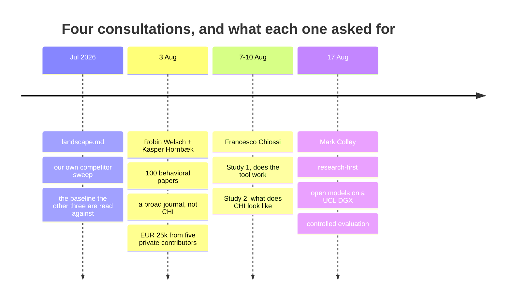
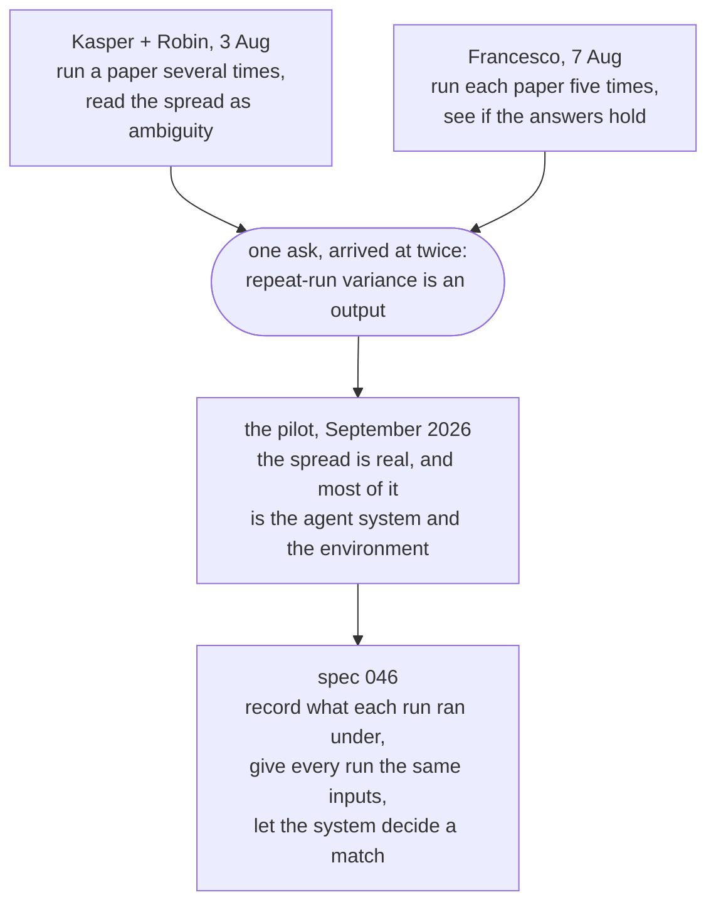
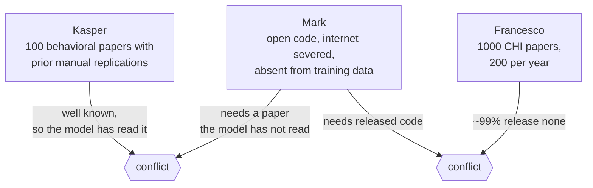
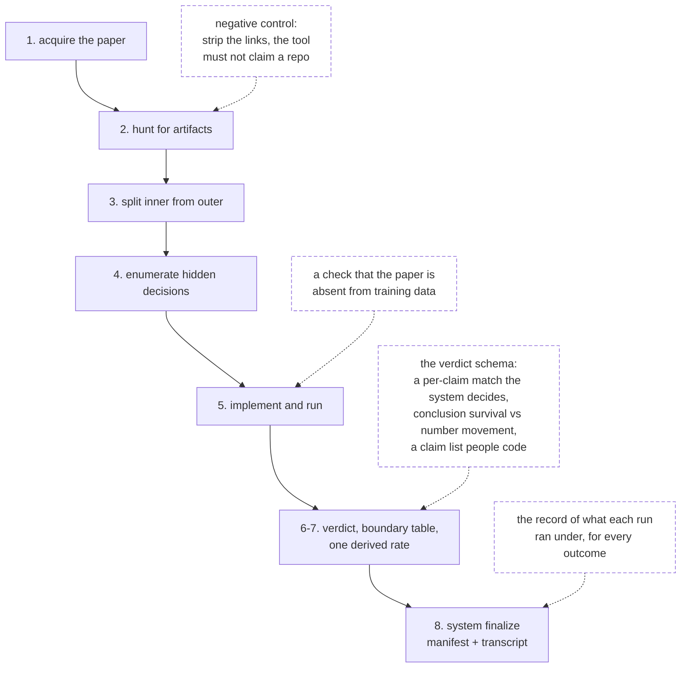
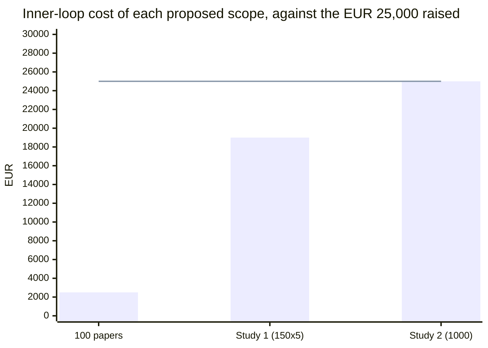
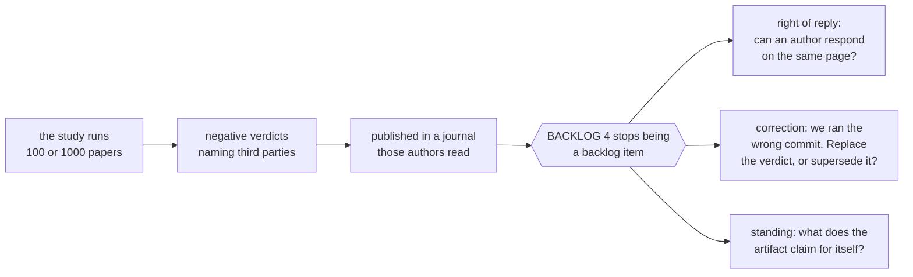
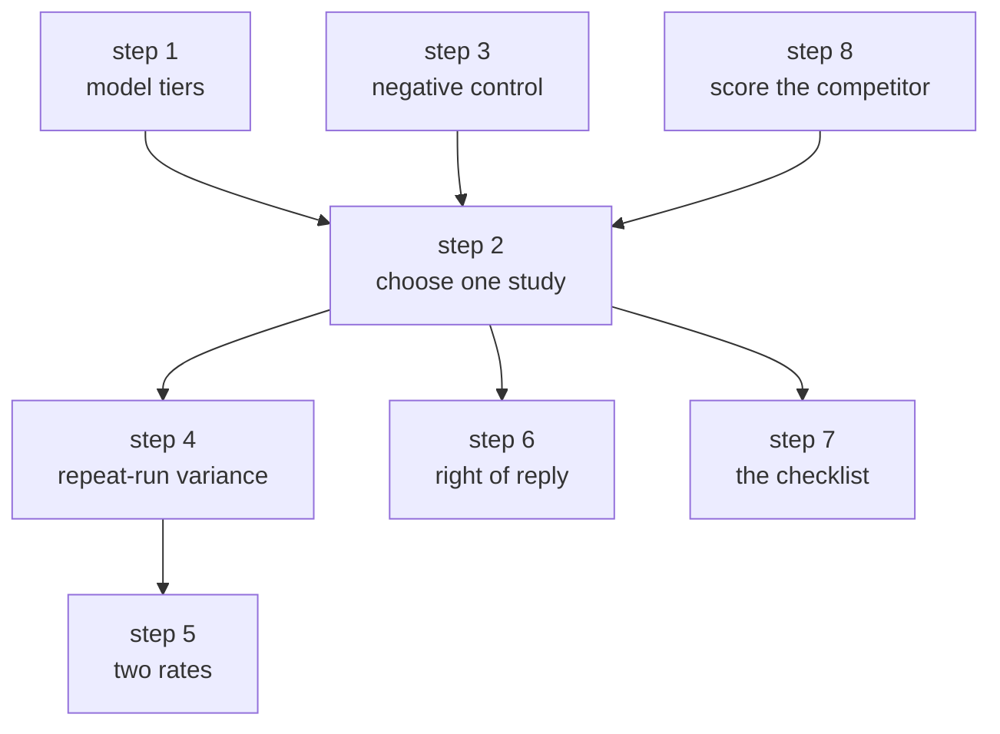
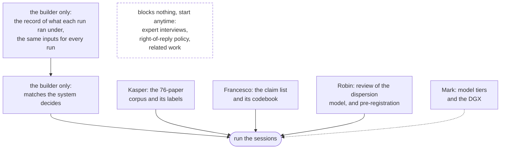
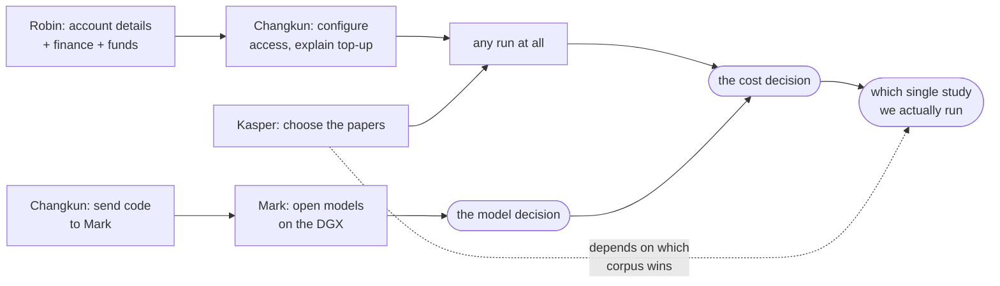

# Consultations

What four sets of researchers said about replichai in August 2026, and the
decisions their advice leaves open. Sections 1 to 6 are the record of that
advice. Sections 4 and 7 to 9 were brought up to date on 9 October 2026, after
a pilot tested the main idea the advice pointed to.

Read the four together. Read separately, each is encouragement. Read together,
they amount to **three study designs, three corpora, three venue targets, and a
budget that funds one of them**.

## Summary

| | |
|---|---|
| **The strongest agreement** | Repeat-run variance should be an *output*, not a caveat. Two sources asked for this independently. |
| **The strongest offer** | Kasper co-authored a CHI 2026 paper with hand-verified reproduction outcomes for 76 HCI papers ([R2](#references)). Ground truth at no cost. |
| **The hardest constraint** | €25k raised; about €25 per paper. Any one proposed study fits the budget. Any two do not. |
| **The unasked question** | A 100–1000 paper study publishes negative verdicts naming third parties. Nothing in the design handles reply, correction, or standing. |
| **The surprise** | `doesitreproduce.com` is a live agentic-reproduction service, with 1,286 papers assessed on 26 Aug 2026. It was found while checking these notes. |
| **What happened next** | The variance idea was tested on 49 runs in September. The spread is real, but most of it came from the agent system and the environment, not the paper. [§8](#8-the-variance-idea-tested). |

**Top three next steps, as ranked in August** (full ranking and current status in
[§7](#7-ranked-next-steps)). These are a recommendation drawn from the notes, not
a decision anyone in them has taken, and the repository shows none of the three
done yet:

| # | Do | Because |
|---|---|---|
| 1 | Measure model degradation across tiers on `evals/` | This is the only step that turns "Opus is best" into a number. It settles the budget and the DGX plan at the same time. |
| 2 | Choose one study, one venue, one corpus | The three plans are not a program, and the money funds one. |
| 3 | Add a negative-control case to `evals/` | One file. It guards against the failure mode that would most damage credibility. |

Two linked artifacts, the cost estimation and the outer-loop design, could not
be opened, so [§5](#5-the-money) is incomplete.

## 1. The sources

| Date | Who | Form | Asked for |
|---|---|---|---|
| Jul 2026 | the team | [`landscape.md`](landscape.md) | (our own sweep, a July snapshot; see [below](#a-note-on-landscapemd)) |
| 3 Aug | Robin Welsch (Aalto), Kasper Hornbæk (Copenhagen) | meeting | 100 behavioral papers, a broad journal, €25k privately raised |
| 7–10 Aug | Francesco Chiossi (Nestlé), Robin Welsch | email | Study 1: does the tool work. Study 2: what does CHI look like |
| 17 Aug | Mark Colley (UCL) | meeting | Research-first, open models on a UCL DGX, controlled evaluation |

Both meeting notes are machine-generated and flagged as needing review. Two
transcription errors are corrected throughout: **KAI** is CHI; **M Col** is Mark
Colley. One item is still open: a "Stephen" who owes replication results (3 Aug)
is not identified anywhere in the notes.

## 2. What they agree on

Five points, each made by people who did not talk to each other.

| # | Agreement | Said by |
|---|---|---|
| 1 | **Repeat-run variance is the measurement, not the noise** | Kasper + Robin (3 Aug), Francesco (7 Aug) |
| 2 | **The value is error detection, not a binary verdict** | Robin, Kasper (3 Aug), Francesco (7 Aug) |
| 3 | **About €25 and about 1 hour per paper**, the only number every plan shares | both meetings |
| 4 | **Cheaper models are the way out of the cost**; nobody had measured the cost in quality | both meetings |
| 5 | **The audience is authors before submission and reviewers with no time** | every source; Francesco adds PhD students |

Point 1 has the largest consequences, and it has since been tested.

In September 2026 three papers were run ten to twenty-one times each. The
spread between runs is real and large. Most of what could be traced came from
the agent system, the network and the agent's own labels, not from the paper
([`repeat-runs-pilot.md`](repeat-runs-pilot.md)). The spread can be the output
they asked for only once the platform records and controls what each run ran
under, which is [spec 046](../specs/046-one-run-is-one-draw.md).

> **A human baseline exists, for a matched task.** Aczel et al.
> ([R1](#references)) put at least 5 independent re-analysts on one claim from
> each of 100 studies: **34% of re-analyses matched the original numbers; 74%
> reached the same conclusion.** That is Francesco's hypothesis, that numbers
> move often and conclusions rarely, already confirmed for humans. It is a
> baseline for agents only when the agent gets the same task: the same claims
> and data, without the authors' code. The pilot's agents mostly re-ran the
> authors' code. As we read R1, its re-analysts worked from the data and the
> claim.

## 3. What they disagree on

| Decision | Option A | Option B | Option C |
|---|---|---|---|
| **Venue** | Nature/Science, explicitly away from CHI (3 Aug) | CHI in three weeks, "rushed but feasible" (17 Aug) | none |
| **Corpus** | 100 behavioral papers with prior manual replications (Kasper) | 1000 CHI papers, 200/year (Francesco) | Open code, absent from training data, internet severed (Mark) |
| **Ground truth** | Olga's paper (Robin) | Prior manual replication reports (Kasper) | Two coders + ICC (Francesco) |
| **Model** | Opus: "highest quality" (17 Aug) | Open models self-hosted on a DGX (17 Aug) | Any cheaper model (3 Aug) |
| **Posture** | Research-first, pivot later (Mark) | Private money buying runs on a deployed product (3 Aug) | none |

The three-week CHI deadline named on 17 Aug has passed.

### The corpora are mutually exclusive

### The ground truth is closer to settled than the notes suggest

Checking the DOI collapses two of the three options into one.

`10.1145/3772318.3791129`, "Olga's paper", is Iarygina, Hornbæk & Mottelson,
*On the Computational Reproducibility of Human-Computer Interaction*, CHI 2026
([R2](#references)). It is the **source of the CHI numbers already in our own
`landscape.md`**, and **Kasper is a co-author**. So the offer is not one known
case: it is hand-verified reproduction outcomes for 76 HCI papers, from people in
these conversations.

**It supplies the checklist too**, which we had assumed it would not. Their
Table 1 defines ten dimensions for analyzing a repository: locate repository,
documentation, data availability, data format, codebook, data clarity,
programming language, analysis executability, reproducibility, reproduction
time. Each has its successful outcome and its pitfalls. That is the artifact the
ICC half of Study 1 needed, already in print. The human and the machine can
answer identically worded questions, and the human instrument is not one we
designed to favor our own.

It also states a **45-minute** troubleshooting budget per repository, which
gives an effort-matched comparison against our roughly hour-long runs.

Kasper's "papers from previous behavioral science replication studies" most
plausibly means the Aczel et al. sample ([R1](#references)): 100 studies,
2009–2018, at least 5 re-analyses each. **That is an inference, not something
either meeting stated.** Confirm it before anyone selects papers.

### Study 2's denominator is tens, not a thousand

This does not rule Study 2 out. `landscape.md` already argues that for most CHI
papers *the audit's product is the absence*, and a five-year trend in what a
field releases is a finding. But Study 2 must be designed as a census of absence
with a reproduction sub-study inside it. Deciding that now is much cheaper than
discovering it after the money is spent.

## 4. What the product lacks

| Ask | From | As of 9 Oct 2026 | Home |
|---|---|---|---|
| Repeat-run variance as an output | Kasper, Robin, Francesco | a project file runs one paper several times, and the September runs are analyzed; the record of what each run ran under is designed, not built | [046](../specs/046-one-run-is-one-draw.md) |
| Second rate: how many numbers matched | Francesco | not built; 046 designs a per-claim match that the system decides | [BACKLOG 1](../specs/BACKLOG.md), [046](../specs/046-one-run-is-one-draw.md) |
| Conclusion survival vs number movement | Francesco | not built; each disagreement now carries its two numbers in `verdict.json` | no spec |
| Negative control: strip the links, expect *nothing found* | Francesco | not built; two eval cases, neither tests it | `evals/` |
| A checklist a human fills in the same shape | Francesco | not built; 046 asks for a claim list coded by two people | [046](../specs/046-one-run-is-one-draw.md) |
| Internet severed, paper absent from training data | Mark | the container sandbox can run with no network; nothing checks that a paper is absent from training data | [045c](../specs/045c-the-container-sandbox.md) |
| Open or self-hosted model runtime | Mark, 3 Aug | built for runs on your own machine, through any OpenAI-compatible gateway; the hosted adapters are designed, not built | [045e](../specs/045e-the-model-is-an-endpoint.md), [041f](../specs/041f-openai-responses-runs-a-session.md)/[041g](../specs/041g-latere-runs-a-session.md) |
| Practitioner wedge: unreviewed internal UX studies | Francesco | not specced | none |
| Re-implementing proprietary research for companies | Mark | not specced | none |

The gaps at steps 2 and 5 are small. The ones at steps 6 to 8 are the platform
work in [046](../specs/046-one-run-is-one-draw.md). A set of runs over one paper
is now a unit the project file holds (`runs: N`); the hosted job model does not
represent it yet.

The last two rows are commercial theses that differ from the current
positioning, which is a wedge into one field and not a category. Both come from
people outside the project.

## 5. The money

€25,000 was proposed on 3 Aug (five contributors × €5,000), chosen because a
grant round is too slow. At the roughly €25 per session both meetings agreed on:

| Scope | Sessions | Inner-loop cost |
|---|---|---|
| 100 behavioral papers, once | 100 | ~€2,500 |
| Study 1: 150 papers × 5 repeat runs | 750 | ~€19,000 |
| Study 2: 1000 CHI papers, once | 1,000 | ~€25,000 |
| Outer-loop subset | none | no defensible figure |

**Any one fits. Any two do not.** Study 2 alone consumes the whole budget and
leaves nothing for the outer loop, which is the half the money was raised for.
The only published per-paper cost of manual replication is $52,500–75,000
([R3](#references)). That prices the process we replace, not the one we build.

This is why Mark's DGX offer is decisive, and why "smaller models often fail to
complete tasks" is a blocking risk rather than a caveat.

**Incomplete.** The cost-estimation artifact (3 Aug) and the outer-loop design
would not open. The first is also Changkun's own *Analyze Replication Costs*
action item.

## 6. Risks nobody raised

| Risk | Why it matters now |
|---|---|
| **Publishing negative verdicts at scale, naming third parties** | [BACKLOG 4](../specs/BACKLOG.md) says this blocks "the first time a run naming a third party leaves the owner's project". The study *is* that moment, at scale. |
| **Authorship, credit, IP** | Four institutions (Aalto, Copenhagen, UCL, Nestlé), a commercial platform, five private funders. No source discusses author order or who owns the output. |
| **What €5,000 buys a contributor** | The product meters spending per project against a ledger ([011](../specs/011-what-a-session-costs.md), [022](../specs/022-money-comes-in-without-an-admin.md)). A study contribution is not obviously a wallet top-up. |

`landscape.md` found the first risk twice, from independent directions: frontier
labs avoid audit products because a lab cannot be both the researcher's
co-pilot and the researcher's auditor, and the incumbents' real advantage is
**mandate**, not technology.

## 7. Ranked next steps

Ordered in August by how much each step unblocks for how little. The last
column is what the repository shows on 9 October 2026.

| # | Step | Unblocks | Status |
|---|---|---|---|
| 1 | Measure model degradation across tiers on `evals/` | the budget **and** the DGX plan | no result recorded |
| 2 | Choose one study, one venue, one corpus | everything below | not decided; what a study measures is the open question in [046](../specs/046-one-run-is-one-draw.md) |
| 3 | Add a negative-control case to `evals/` | credibility at any venue | not done |
| 4 | Make repeat-run variance an output | what three people asked for | partly: runs per paper and the pilot analysis; the rest is [046](../specs/046-one-run-is-one-draw.md) |
| 5 | Split the rate; separate conclusion survival from number movement | Study 2's real result | not done; 046 designs the per-claim match |
| 6 | Spec author right-of-reply and correction | publishing safely | not done ([BACKLOG 4](../specs/BACKLOG.md)) |
| 7 | Build the checklist people fill in | Study 1's human half | not done; it is the claim list coded by two people in 046 |
| 8 | Repair `landscape.md` | knowing who we compete with | done from the corrections recorded here; not swept again |

Notes on the three steps that need one:

- **1** is the only item that converts "Opus is best" from anecdote into a
  number. It needs a runner; today `evals/` is graded by reading. The pilot adds
  a caution: it mixed two agent systems, and the system moved the result, so a
  tier comparison has to hold everything else fixed.
- **2** has an evidence-backed answer for the corpus: Olga's 76-paper set
  ([R2](#references)) is hand-labeled, HCI, and co-authored by people in these
  conversations. It is the cheapest defensible ground truth we will be offered.
  Study 2 and the behavioral sample are the follow-up.
- **6** turns from a design question into an incident on the day the study
  publishes. Doing it afterwards means doing it in public, under pressure, with
  named authors already emailing.

Deliberately **not** ranked: the outer loop. It has no cost floor and no
servable study in the corpus (BACKLOG 3; 0/26 servable components at the last
census). That is a reason to cost it properly, not to start it first.

## 8. The variance idea, tested

This section is not from the notes. It records an idea of our own, what a pilot
showed about it, and what replaced it.

### What was proposed in August

The objection inside the project was that a reproducibility rate is vague and
changes from run to run. The proposal was to stop reporting a rate and read the
spread between repeat runs of one paper as a measure of what the paper left
unspecified. Its parts were a variance decomposition over paper, prompt and run;
a claim list extracted once per paper to fix the denominator; and a study of 76
papers at three to five runs each.

### What the pilot showed

Forty-nine runs of three papers, made on 10 and 11 September 2026 and analyzed
on 9 October ([`repeat-runs-pilot.md`](repeat-runs-pilot.md)):

- Two agent systems ran every paper under one method. The system changed how
  much the runs varied and where they drew the inner/outer boundary.
- Which copy of the paper a run could read depended on what its agent system
  could fetch through the sandbox, so the same computed number was compared
  against different reported values.
- The same disagreement with the paper was labeled *verified* by one run and
  *partial* by another.
- Holding the denominator fixed left the spread as large as before.
- Each run's own list of the paper's reported results differed from the next
  run's, so one extraction would freeze an arbitrary draw.

The spread is therefore not yet a measure of the paper. It measures the paper,
the agent system and the environment together.

### What did not survive

- **Spread as a property of the paper.** It has to be tested, not assumed. The
  tests are in [`dispersion-model.md`](dispersion-model.md).
- **A plain variance decomposition.** It gives one run variance for the whole
  corpus, so it cannot say that one paper's runs disagree more than another's.
- **Three runs per paper.** Enough for averages over the corpus, not for one
  paper's spread.
- **A claim list from one model call.** People have to code it, and report their
  agreement.
- **Run variance tracking the number of hidden decisions.** The count comes from
  the same runs and followed the agent system, not the paper.
- **The draft title and abstract** built on these.

### What stands

- No single reproducibility rate.
- The model held fixed inside a study. The pilot adds the agent system to that,
  and asks that both be recorded.
- A pilot before the budget is committed.
- Olga's 76-paper set ([R2](#references)) as the corpus with human labels.
- The inner/outer boundary and the claim, evidence and verdict record as what
  the product delivers.

### Where the plan is now

- [`dispersion-model.md`](dispersion-model.md): how to measure disagreement per
  claim and per paper, how many runs that needs, and the tests that would show
  it describes the paper.
- [Spec 046](../specs/046-one-run-is-one-draw.md): what the platform has to
  record and control first. Runs per paper and a findings schema that fits what
  agents write are built; the rest is designed.
- **Open:** what a study measures. The proposal in 046 is per-claim
  reproducibility given the released materials, with the environment as a
  recorded and varied facet. A paper's framing depends on that decision, so none
  is drafted here.

## 9. What to delegate

The platform is the only part that must be built by one person. Everything else
a study needs ([§8](#8-the-variance-idea-tested)) is corpus, protocol,
statistics, or writing. None of it is code, and none of it is blocked on the
build.

### By person

| Owner | Package | Done when | Blocks |
|---|---|---|---|
| **Kasper** | Corpus and labels: Olga's 76-paper set with per-paper reproduction outcomes in usable form, plus the arrangement with Iarygina and Mottelson | A file of papers, eligibility flags, and human outcomes exists | The whole study |
| **Francesco** | The **claim list**: a codebook for listing a paper's reported quantitative results, each tagged by kind (a test, a descriptive figure, a ranking), coded by two people with their agreement reported | Codebook frozen; a pilot set coded twice | The measurement itself |
| **Robin** | Statistical design: a review of [`dispersion-model.md`](dispersion-model.md), the match tolerance per kind of claim, and the run counts from the internal pilot | A pre-registration draft | Interpreting anything |
| **Mark** | The model and environment axis: tier comparison protocol, DGX environment ready, and the "internet severed, not in training data" condition. The pilot makes this a facet of the study, not only a cost question | A protocol and a prepared machine | [§7 step 1](#7-ranked-next-steps) |
| **Robin + Kasper** | Right-of-reply and correction policy, a question of standing and field norms rather than code ([§6](#6-risks-nobody-raised)) | A stated position | Publishing anything naming third parties |
| **Francesco + Mark** | Expert and practitioner interviews (agreed 17 Aug) | Transcripts and a coded summary | Nothing; fully parallel |
| **Anyone with time** | Related work: turn [`landscape.md`](landscape.md) into a related-work section, and look at how `doesitreproduce.com` authors its score and what it publishes per paper | A drafted section | The write-up |

### What stays with the builder

The platform work in [046](../specs/046-one-run-is-one-draw.md), the runs, and
the money. That is the critical path, and it does not parallelize. Running one
paper several times from a project file is already built.

### Three cautions

1. **Two packages are blocking; the rest are not.** The corpus (Kasper) and the
   claim list (Francesco) gate the measurement. Follow up on those two; the
   others can run late without consequence.
2. **Do not start Kasper's original task yet.** "Choose 100 behavioral papers"
   presumes a corpus decision nobody has taken ([§3](#3-what-they-disagree-on)),
   and is the item most likely to be redone. Ask for the 76-paper set instead.
3. **Settle authorship before the work goes out, not after.** Four institutions,
   a commercial platform, and five private funders, with nothing on the record
   ([§6](#6-risks-nobody-raised)). Each package above is a claimable
   contribution; say so when handing it over, and academics will take it.

## 10. Commitments outstanding, as of 17 August 2026

Not updated since. Check with each person before relying on a row.

| Person | Owed |
|---|---|
| Robin Welsch | Account details; a DOI to reproduce; budget; contact finance |
| Kasper Hornbæk | Choose 100 behavioral papers with prior manual replications |
| Mark Colley | Test open models on the DGX; run the code sent to them |
| Changkun Ou | Outer-loop cost analysis; explain top-up; configure access; send code to Mark; add Mark to Slack; follow up with "Stephen" |
| The group | Run on open-code papers; interview researchers; select papers; schedule the follow-up |

**These commitments form a loop.** Choosing papers depends on which study we
run, which depends on cost, which depends on the model. Kasper's paper selection
is the earliest item on the list and the one most likely to be redone.

## References

Checked against a live source on 25 Aug 2026.

| | Work | Why it is here |
|---|---|---|
| **R1** | Aczel, Szaszi, Clelland, Kovacs, Holzmeister, van Ravenzwaaij et al. (494 authors). *Investigating the analytical robustness of the social and behavioral sciences.* **Nature** 652(8108), 135–142, 1 Apr 2026. [`10.1038/s41586-025-09844-9`](https://doi.org/10.1038/s41586-025-09844-9) | The 3 Aug paper. 100 studies (2009–2018), at least 5 re-analysts each, peer-evaluated. **34% matched the numbers; 74% matched the conclusion.** A human baseline, comparable only on a matched task ([§2](#2-what-they-agree-on)). |
| **R2** | Iarygina, O., Hornbæk, K., & Mottelson, A. *On the Computational Reproducibility of Human-Computer Interaction.* **CHI 2026**, pp. 1–16, Barcelona, 13 Apr 2026. [`10.1145/3772318.3791129`](https://doi.org/10.1145/3772318.3791129) | "Olga's paper". Source of the CHI numbers in `landscape.md`: 76 papers ever shared data + code, 37 (49%) fully reproduced, ~1% share materials. Kasper is a co-author. |
| **R3** | Reproducibility Project: Cancer Biology. About $52,500–75,000 per paper over 8 years; scope cut from 53 to 23 papers on author non-cooperation | The only published per-paper cost of manual replication. Via `landscape.md`; primary source not re-verified. |
| **R4** | [doesitreproduce.com](https://doesitreproduce.com/), operated by Brainarbeit | See below. |
| **R5** | Liu, H., Tjiaranata, F. A., & Tan, C. *VERITAS: Towards a General-Purpose Replication Tool for Scientific Research.* arXiv:[2607.02931](https://arxiv.org/abs/2607.02931), 3 Jul 2026, U. Chicago | Closest architectural comparison. 65 papers across CS, social science, medicine, astrophysics; importance-weighted Replication Score, severity-rated fix log, patched codebase. Beats a baseline Claude Code implementation on every metric. |
| **R6** | Nguyen, Soós, Ma, Obadage, Ranjan, Koneru, Errington, Nematova, Rajtmajer, Wu & Jiang. *ReplicatorBench.* arXiv:[2602.11354](https://arxiv.org/abs/2602.11354), 11 Feb 2026 (v3 29 Jun) | Human-verified **replicable and non-replicable** claims in social/behavioral science, evaluating the *process* and not only the outcome. If the 100-paper study runs, this is what it is compared against. |
| **R7** | Hullman, J., Broska, D., Sun, H., & Shaw, A. *This human study did not involve human subjects.* arXiv:[2602.15785](https://arxiv.org/abs/2602.15785), 17 Feb 2026 | Heuristic substitution vs calibrated validation: the distinction 007's "synthetic pilot, never evidence" rule rests on. |
| **R8** | Yeykelis, Pichai, Cummings & Reeves. *Using LLMs to Create AI Personas…* arXiv:[2408.16073](https://arxiv.org/abs/2408.16073), 28 Aug 2024 (v2 24 Apr 2025) | The empirical case for 007's synthetic-pilot rule; see below. |
| **R9** | `reprobe` (Mark Colley): local LLMs analyzing code in Docker to check reproducibility | **Unverified.** No public trace; absent from [m-colley.github.io](https://m-colley.github.io/) and from search. Ask them. |

### A note on `landscape.md`

It is cited throughout this page. It is a July 2026 snapshot, and five of its
claims were checked on 25 Aug 2026 while writing this. Two held: the CHI numbers
(76 / 37 / ~1%, which are [R2](#references)'s) and the VERITAS description. Three
did not, and `landscape.md` was repaired on 9 October 2026 to say what was found:

- it had recorded that no service reproduces papers in production;
  [R4](#r4-doesitreproducecom) does;
- it had cited [R8](#r8-what-yeykelis-et-al-report) with two wrong figures;
- it had read Code Ocean's Aqua as close to a replication agent, which it is not.

It has not been swept again. Its arguments (why frontier labs avoid audit
products, why the incumbents' advantage is mandate rather than technology, why
for most CHI papers the audit's product is the absence) do not go stale the way
its list of who exists does. [BACKLOG 4](../specs/BACKLOG.md) and
[§6](#6-risks-nobody-raised) rest on those arguments. Before a decision rests on
an absence it records, check that absence again.

### R4: doesitreproduce.com

Autonomous AI re-runs of published computational biomedical pipelines, "end to
end, without a human in the loop", scoring 0–100. As of 26 Aug 2026: **1,286
papers assessed, 648 scoring ≥75**, 7,716 indexed. It states it is "not peer
review, not an audit". No paper or preprint was found.

This is a production system doing agentic reproduction at a scale we have not
reached, and it takes the **opposite position on both axes we defend**: no human
in the loop, and a scalar score as the headline output. `landscape.md` now lists
it. How it authors its score, and what it publishes per paper, were not recorded
and still need a look.

### R8: what Yeykelis et al. report

Checked against the PDF on 25 Aug 2026. Personas reproduced 76% of main effects
(84/111) and 68% overall (90/133), and accuracy tracks the strength of the
original effect: 83% at p < 0.001 (54 of 65), 55% (6/11) where the original was
null (p > 0.5), 76% for main effects against **27% for interactions**. The
authors warn that personas risk "both false positives and false negatives" on
"less pronounced effects".

A synthetic cohort is therefore most reliable where it is least needed, and
least reliable on weak effects, nulls, and interactions, which is what a pilot
exists to find. An earlier citation of this paper in `landscape.md` carried two
wrong figures; they were removed.
