# Consultations

What four sets of researchers said about replichai in August 2026, and the
decisions their advice leaves open.

Read the four together. Read separately, each is encouragement. Read together,
they amount to **three study designs, three corpora, three venue targets, and a
budget that funds one of them**.

## Summary

| | |
|---|---|
| **The strongest agreement** | Repeat-run variance should be an *output*, not a caveat. Two sources asked for this independently. |
| **The strongest offer** | Kasper co-authored a CHI 2026 paper with hand-verified reproduction outcomes for 76 HCI papers ([R2](#references)). Ground truth at no cost. |
| **The hardest constraint** | €25k raised; about €25 per paper. Any one proposed study fits the budget. Any two do not. |
| **The unasked question** | A 100–1000 paper study publishes negative verdicts naming third parties. Nothing in the design handles reply, correction, or standing. |
| **The surprise** | `doesitreproduce.com` is a live agentic-reproduction service with 1,286 papers assessed. `landscape.md` says no such service exists. |
| **The paper it implies** | Stop reporting a reproducibility rate. Report the variance, and treat it as a property of the paper. [§8](#8-the-paper-if-we-write-one). |

**Top three next steps** (full ranking in [§7](#7-ranked-next-steps)). These are a
recommendation drawn from the notes, not a decision anyone in them has taken:

| # | Do | Because |
|---|---|---|
| 1 | Measure model degradation across tiers on `evals/` | This is the only step that turns "Opus is best" into a number. It settles the budget and the DGX plan at the same time. |
| 2 | Choose one study, one venue, one corpus | The three plans are not a program, and the money funds one. |
| 3 | Add a negative-control case to `evals/` | One file. It guards against the failure mode that would most damage credibility. |

Two linked artifacts, the cost estimation and the outer-loop design, could not
be opened, so [§5](#5-the-money) is incomplete.

## 1. The sources

| Date | Who | Form | Asked for |
|---|---|---|---|
| Jul 2026 | the team | [`landscape.md`](landscape.md) | (our own sweep, a July snapshot, partly stale; see [below](#a-note-on-landscapemd)) |
| 3 Aug | Robin Welsch (Aalto), Kasper Hornbæk (Copenhagen) | meeting | 100 behavioral papers, a broad journal, €25k privately raised |
| 7–10 Aug | Francesco Chiossi (Nestlé), Robin Welsch | email | Study 1: does the tool work. Study 2: what does CHI look like |
| 17 Aug | Mark Colley (UCL) | meeting | Research-first, open models on a UCL DGX, controlled evaluation |

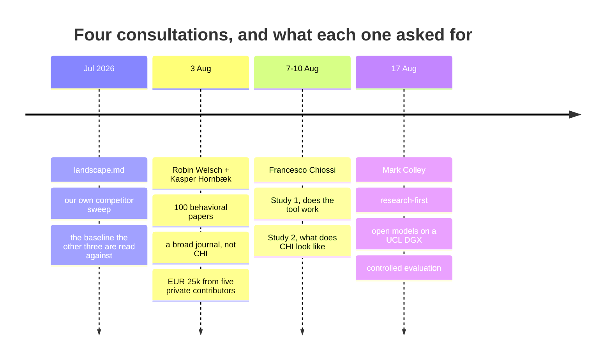

Both meeting notes are machine-generated and flagged as needing review. Two
transcription errors are corrected throughout: **KAI** is CHI; **M Col** is Mark
Colley. One item is still open: a "Stephen" who owes replication results (3 Aug)
is not identified anywhere in the notes.

## 2. What they agree on

Five points, each made by people who did not talk to each other.

| # | Agreement | Said by |
|---|---|---|
| 1 | **Repeat-run variance is the measurement, not the noise** | Kasper + Robin (3 Aug), Francesco (7 Aug) |
| 2 | **The value is error detection, not a binary verdict** | Robin, Kasper (3 Aug), Francesco (7 Aug) |
| 3 | **About €25 and about 1 hour per paper**, the only number every plan shares | both meetings |
| 4 | **Cheaper models are the way out of the cost**; nobody had measured the cost in quality | both meetings |
| 5 | **The audience is authors before submission and reviewers with no time** | every source; Francesco adds PhD students |

Point 1 has the largest consequences.

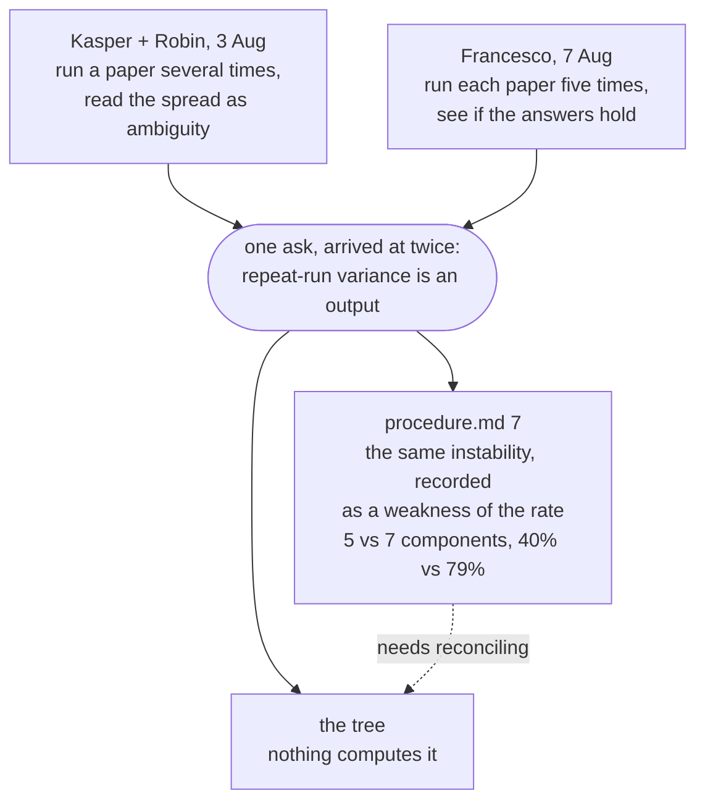

[`procedure.md` §7](procedure.md) records exactly this instability as a
**weakness**: five components in one run, seven in another, the rate swinging
from 40% to 79%. That is why the rate is a footnote and is never compared across
runs. The consultations read the same fact as the product. Both readings can
hold, but they must be reconciled before either appears in a paper.

> **The human baseline already exists.** Aczel et al. ([R1](#references)) put
> at least 5 independent re-analysts on one claim from each of 100 studies:
> **34% of re-analyses matched the original numbers; 74% reached the same
> conclusion.** That is Francesco's hypothesis, that numbers move often and
> conclusions rarely, already confirmed for humans. The agent version therefore
> has a baseline to compare against rather than a claim to establish.

## 3. What they disagree on

| Decision | Option A | Option B | Option C |
|---|---|---|---|
| **Venue** | Nature/Science, explicitly away from CHI (3 Aug) | CHI in three weeks, "rushed but feasible" (17 Aug) | none |
| **Corpus** | 100 behavioral papers with prior manual replications (Kasper) | 1000 CHI papers, 200/year (Francesco) | Open code, absent from training data, internet severed (Mark) |
| **Ground truth** | Olga's paper (Robin) | Prior manual replication reports (Kasper) | Two coders + ICC (Francesco) |
| **Model** | Opus: "highest quality" (17 Aug) | Open models self-hosted on a DGX (17 Aug) | Any cheaper model (3 Aug) |
| **Posture** | Research-first, pivot later (Mark) | Private money buying runs on a deployed product (3 Aug) | none |

### The corpora are mutually exclusive

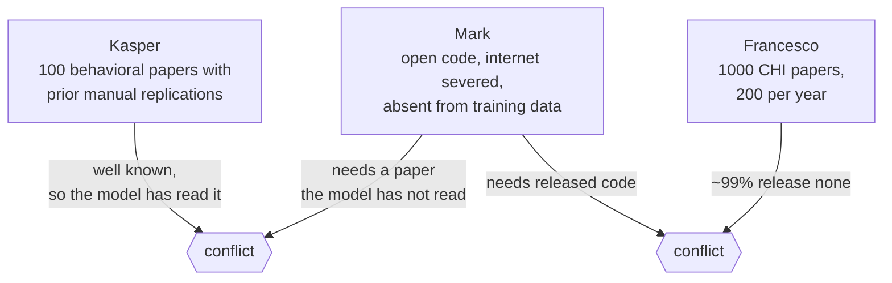

### The ground truth is closer to settled than the notes suggest

Checking the DOI collapses two of the three options into one.

`10.1145/3772318.3791129`, "Olga's paper", is Iarygina, Hornbæk & Mottelson,
*On the Computational Reproducibility of Human-Computer Interaction*, CHI 2026
([R2](#references)). It is the **source of the CHI numbers already in our own
`landscape.md`**, and **Kasper is a co-author**. So the offer is not one known
case: it is hand-verified reproduction outcomes for 76 HCI papers, from people in
these conversations.

**It supplies the checklist too**, which we had assumed it would not. Their
Table 1 defines ten dimensions for analyzing a repository: locate repository,
documentation, data availability, data format, codebook, data clarity,
programming language, analysis executability, reproducibility, reproduction
time. Each has its successful outcome and its pitfalls. That is the artifact the
ICC half of Study 1 needed, already in print. The human and the machine can
answer identically worded questions, and the human instrument is not one we
designed to favor our own.

It also states a **45-minute** troubleshooting budget per repository, which
gives an effort-matched comparison against our roughly hour-long runs.

Kasper's "papers from previous behavioral science replication studies" most
plausibly means the Aczel et al. sample ([R1](#references)): 100 studies,
2009–2018, at least 5 re-analyses each. **That is an inference, not something
either meeting stated.** Confirm it before anyone selects papers.

### Study 2's denominator is tens, not a thousand

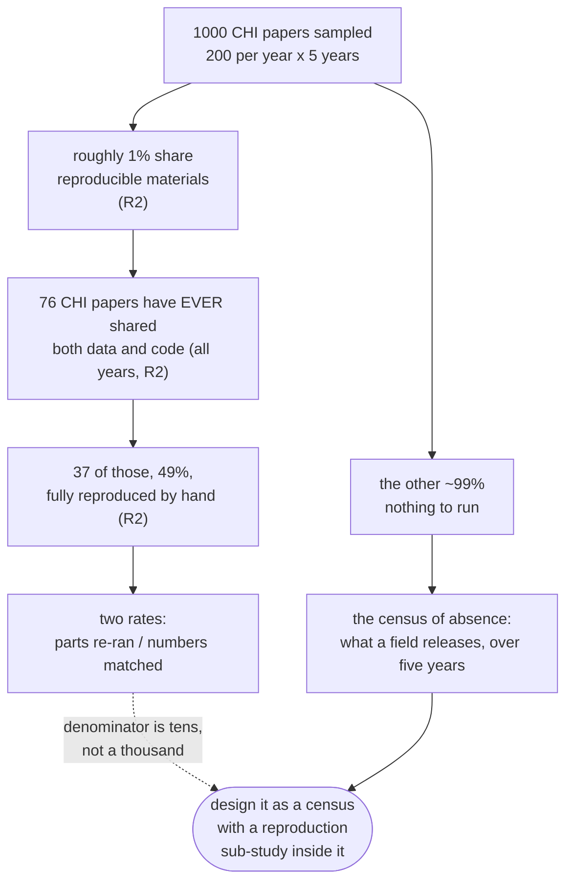

This does not rule Study 2 out. `landscape.md` already argues that for most CHI
papers *the audit's product is the absence*, and a five-year trend in what a
field releases is a finding. But Study 2 must be designed as a census of absence
with a reproduction sub-study inside it. Deciding that now is much cheaper than
discovering it after the money is spent.

## 4. What the product lacks

| Ask | From | Today | Home |
|---|---|---|---|
| Repeat-run variance as an output | Kasper, Robin, Francesco | nothing; §7 calls it a weakness | no spec |
| Second rate: how many numbers matched | Francesco | one scalar over components | [BACKLOG 1](../specs/BACKLOG.md) |
| Conclusion survival vs number movement | Francesco | not in `verdict.json` | no spec |
| Negative control: strip the links, expect *nothing found* | Francesco | two eval cases, neither tests it | `evals/` |
| A checklist a human fills in the same shape | Francesco | none | no spec |
| Internet severed, paper absent from training data | Mark | no such run mode | no spec |
| Open or self-hosted model runtime | Mark, 3 Aug | designed, not built | [041f](../specs/041f-openai-responses-runs-a-session.md)/[041g](../specs/041g-latere-runs-a-session.md) |
| Practitioner wedge: unreviewed internal UX studies | Francesco | not specced | none |
| Re-implementing proprietary research for companies | Mark | not specced | none |

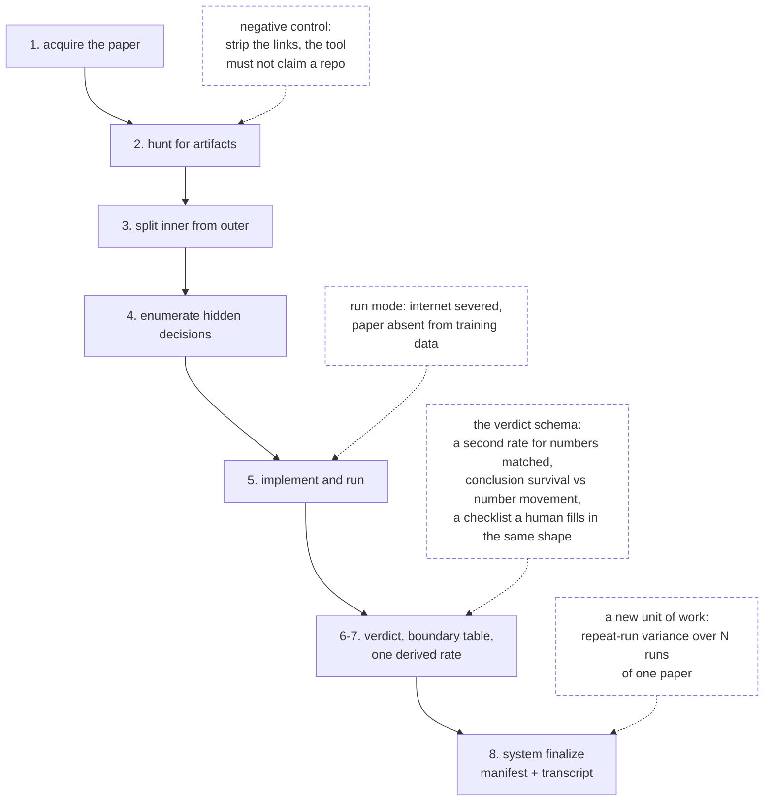

Four of the gaps attach to one step each and are small. The two at step 6–7
change the verdict schema. The one at step 8 is a **new unit of work**: a *set*
of runs over one paper, which the job model does not represent.

The last two rows are commercial theses that differ from
`positioning-wedge-not-category`. Both come from people outside the project.

## 5. The money

€25,000 was proposed on 3 Aug (five contributors × €5,000), chosen because a
grant round is too slow. At the roughly €25 per session both meetings agreed on:

| Scope | Sessions | Inner-loop cost |
|---|---|---|
| 100 behavioral papers, once | 100 | ~€2,500 |
| Study 1: 150 papers × 5 repeat runs | 750 | ~€19,000 |
| Study 2: 1000 CHI papers, once | 1,000 | ~€25,000 |
| Outer-loop subset | none | no defensible figure |

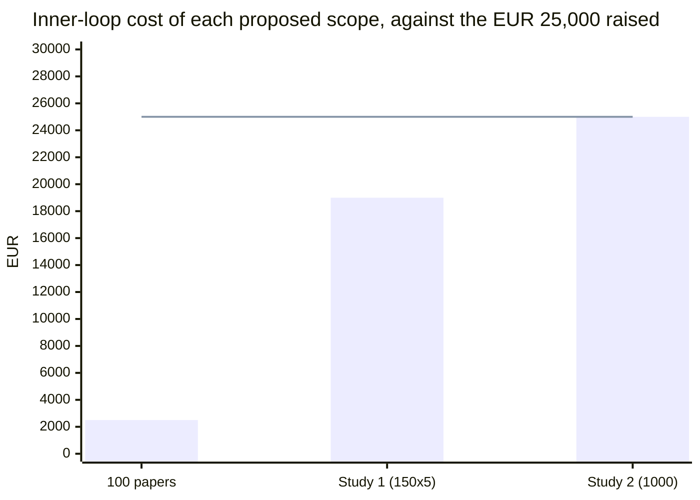

**Any one fits. Any two do not.** Study 2 alone consumes the whole budget and
leaves nothing for the outer loop, which is the half the money was raised for.
The only published per-paper cost of manual replication is $52,500–75,000
([R3](#references)). That prices the process we replace, not the one we build.

This is why Mark's DGX offer is decisive, and why "smaller models often fail to
complete tasks" is a blocking risk rather than a caveat.

**Incomplete.** The cost-estimation artifact (3 Aug) and the outer-loop design
would not open. The first is also Changkun's own *Analyze Replication Costs*
action item.

## 6. Risks nobody raised

| Risk | Why it matters now |
|---|---|
| **Publishing negative verdicts at scale, naming third parties** | [BACKLOG 4](../specs/BACKLOG.md) says this blocks "the first time a run naming a third party leaves the owner's project". The study *is* that moment, at scale. |
| **Authorship, credit, IP** | Four institutions (Aalto, Copenhagen, UCL, Nestlé), a commercial platform, five private funders. No source discusses author order or who owns the output. |
| **What €5,000 buys a contributor** | The product meters spending per project against a ledger ([011](../specs/011-what-a-session-costs.md), [022](../specs/022-money-comes-in-without-an-admin.md)). A study contribution is not obviously a wallet top-up. |

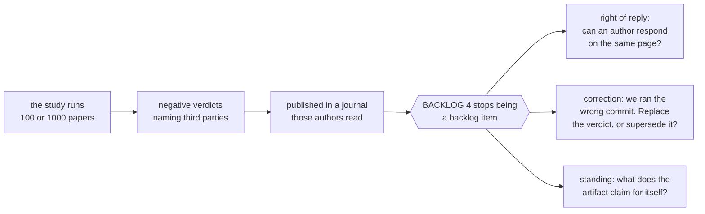

`landscape.md` found the first risk twice, from independent directions: frontier
labs avoid audit products because a lab cannot be both the researcher's
co-pilot and the researcher's auditor, and the incumbents' real advantage is
**mandate**, not technology.

## 7. Ranked next steps

Ordered by how much each step unblocks for how little.

| # | Step | Cost | Unblocks |
|---|---|---|---|
| 1 | Measure model degradation across tiers on `evals/` | days | the budget **and** the DGX plan |
| 2 | Choose one study, one venue, one corpus | a decision | everything below |
| 3 | Add a negative-control case to `evals/` | one file | credibility at any venue |
| 4 | Make repeat-run variance an output | a spec | what three people asked for |
| 5 | Split the rate; separate conclusion survival from number movement | a spec | Study 2's real result |
| 6 | Spec author right-of-reply and correction | a spec | publishing safely |
| 7 | Build the ICC checklist | small | Study 1's human half |
| 8 | Repair `landscape.md`: score `doesitreproduce.com`, add ReplicatorBench, resolve [R8](#r8-a-citation-that-was-wrong-now-corrected), date the absence claims | hours | knowing who we compete with |

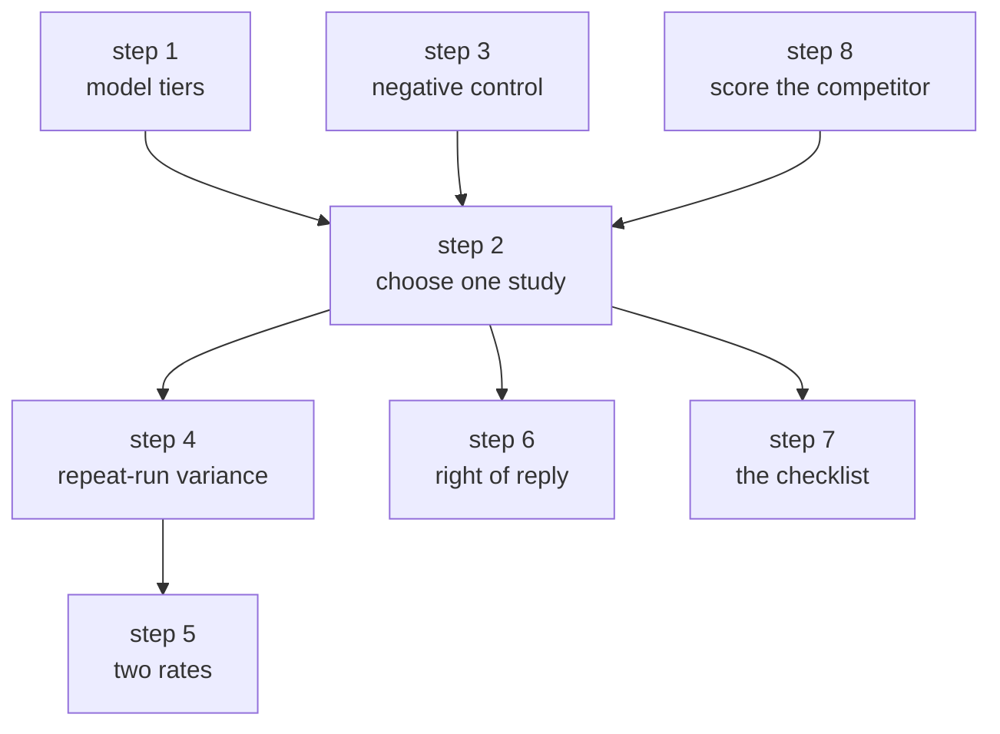

Notes on the three steps that need one:

- **1** is the only item that converts "Opus is best" from anecdote into a
  number. It needs a runner; today `evals/` is graded by reading.
- **2** has an evidence-backed answer: Olga's 76-paper set ([R2](#references))
  is hand-labeled, HCI, and co-authored by people in these conversations. It is
  the cheapest defensible ground truth we will be offered. Study 1 on that set
  is fundable, fast enough for a CHI-scale venue, and a prerequisite for any
  claim made in a broader one. Study 2 and the behavioral sample are the
  follow-up.
- **6** turns from a design question into an incident on the day the study
  publishes. Doing it afterwards means doing it in public, under pressure, with
  named authors already emailing.

Deliberately **not** ranked: the outer loop. It has no cost floor and no
servable study in the corpus (BACKLOG 3; 0/26 servable components at the last
census). That is a reason to cost it properly, not to start it first.

## 8. The paper, if we write one

This section is not from the notes. It is a proposed framing, written to answer
one objection raised in the project itself: **"reproducibility rate" is vague
and non-deterministic when an agent one-shots a paper, and the system prompt has
a crucial effect.**

### The diagnosis

A reproducibility rate conflates two things: how capable the agent is, and how
well specified the paper is. That is why it appears non-deterministic. The fix
is not to stabilize the number. It is to stop reporting a scalar and to relabel
what is being measured: **the dispersion is a property of the paper, not a
defect of the tool**.

### The reframe

Agents make many-analysts studies affordable. Human many-analysts work, Aczel
et al. ([R1](#references)) and its lineage, is the gold standard for this
question and needs dozens of independent analyst teams per claim. An agent
supplies an arbitrarily large analyst pool at about €25 each.

| The objection | Under this framing |
|---|---|
| Non-deterministic one-shot results | The estimator. Dispersion over runs *is* the measurement. |
| The system prompt has a crucial effect | An experimental facet we can manipulate. Human analyst studies cannot randomize an analyst's priors; we can randomize a prompt. |
| "Reproducibility rate" is vague | Replaced by a variance decomposition over named facets. |

The statistical frame is **generalizability theory**: variance components across
paper × prompt × run. It is an established HCI methods tradition, it yields the
ICC Francesco asked for directly, and it turns prompt sensitivity into a result
rather than a limitation.

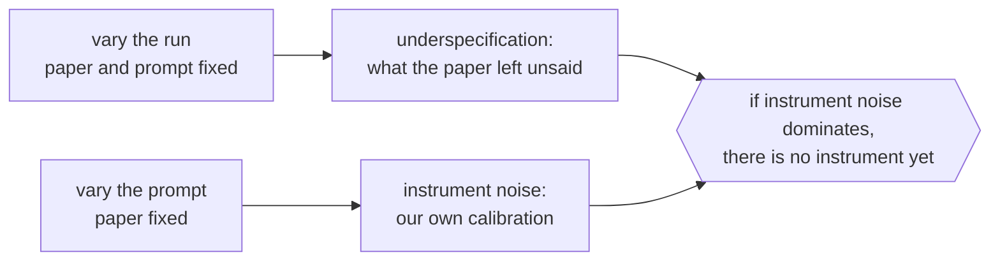

The last branch must be stated: if prompt-level variance exceeds run-level
variance, we do not yet have an instrument. That result is publishable too.

### Can we measure the variation today? No.

This has to be stated plainly, because the framing above is worthless without
it. Two runs produce two repositories of prose and code. Nothing compares them.

| Exists | Missing |
|---|---|
| `verdict.json`, the findings as structured data (021a) | A **fixed unit of analysis**. The agent chooses its own components. |
| The committed transcript (005) | A **comparison harness** across runs of one paper. |
| `evals/`, two cases | The **multi-run unit of work** ([§4](#4-what-the-product-lacks)). |

### The move that makes variance computable

The rate is unstable because **the agent picks its own denominator**: five
components in one run, seven in another. Aligning run A's components to run
B's after the fact would need a second model to judge the match, which adds an
instrument to measure an instrument.

Fix the denominator to something the *paper* supplies: **each reported
statistical claim**, meaning a test carrying a number (t, F, p, β, a CI).
Extract that list once per paper, freeze it, and reuse it for every run of that
paper.

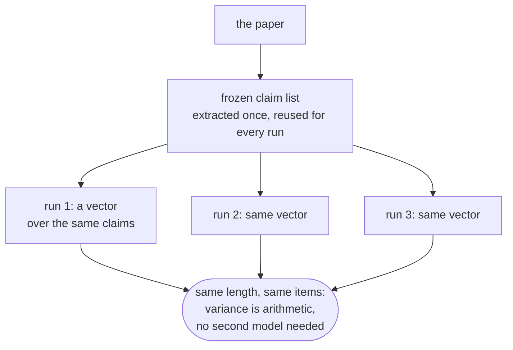

Three things follow from this one change:

1. The 40%/79% swing is removed at its cause: the denominator no longer moves.
2. Francesco's two rates come at no extra cost: *claims re-run* and *claims
   matched*, over the same denominator. Conclusion survival is sign plus
   significance per claim, which needs no extra judgment.
3. **The frozen claim list is the same artifact as the human checklist** the ICC
   half of Study 1 needs ([§3](#the-ground-truth-is-closer-to-settled-than-the-notes-suggest)).
   One artifact, two uses.

### Quantifying it cheaply

The analysis is post-processing over JSON. Almost none of the cost is analysis;
nearly all of it is runs.

| Tier | What it measures | Marginal cost |
|---|---|---|
| **0** | Component count, hidden-decision count, open-science items, artifact-found booleans; dispersion and Fleiss' κ across runs | **€0.** Already in `verdict.json`. |
| **1** | Per claim: re-run, matched within tolerance, sign and significance preserved | One short extraction call per **paper**, not per run: cents, in the shape `internal/draft` already uses |
| **2** | Variance components across paper × prompt × run | **€0.** Deterministic arithmetic. |

Tier 0 alone is a result: it is exactly the 5-vs-7 instability, measured
instead of anecdotal, and it costs nothing beyond the runs.

### Size the study with a pilot, not a guess

Do not commit €14,000 before knowing the variance magnitude. A variance estimate
is what powers the design.

| Step | Runs | Cost | Buys |
|---|---|---|---|
| Pilot | 10 papers × 5 runs | ~€1,250 | Whether run-level variance is detectable at all, and how large it is |
| Main study, if the pilot says go | 76 papers × 3 runs | ~€5,700 | The paper facet |
| Prompt facet | 20 papers × 3 prompts × 3 runs | ~€4,500 | Calibration |

Two cost levers are worth taking. Beyond about three runs per paper, extra runs
add little to a variance-component estimate, so **put the money into papers, not
repeats**. That is why the table above is cheaper than the 5-run design below.
And one run yields every Tier 0 and Tier 1 measure at once, so measures cost
nothing after the first.

One thing not to do: run the variance study on a cheaper model tier to save
money. It confounds the facet being measured. Hold the model fixed; decide the
tier separately, from [step 1](#7-ranked-next-steps).

### Title and abstract

**Title:** *Ask the Agent Twice: Replication Variance as a Measure of What HCI
Papers Leave Unsaid*

More formal variant: *The Variance Is the Measurement: Agent-Based Replication as
an Instrument for Underspecification in HCI Research*.

Bracketed values are placeholders. The study has not run.

> Automated replication agents are evaluated as though reproducing a paper were a
> test the agent passes or fails, summarized as a reproducibility rate. We argue
> that this number confounds two things, the agent's competence and the paper's
> specification, and that collapsing them discards the signal. Run one paper
> through the same agent repeatedly and it decomposes the work differently, makes
> different implementation choices, and reports different numbers, because the
> paper does not determine them. We present [system], which audits a paper by
> separating the machine-runnable inner loop from the outer loop that required
> human participants, implements and runs the inner loop, and records every
> decision the paper left unwritten. We then use it as a measurement instrument
> rather than a judge: across [76] CHI papers with human-verified reproduction
> outcomes, we run [k] independent replications per paper and decompose outcome
> variance into three facets: paper, agent system prompt, and run. [Finding:
> run-level variance tracks the number of undocumented decisions; prompt-level
> variance is smaller.] We separate two rates the literature conflates, how many
> analyses re-ran and how many reported numbers matched, and find [conclusions
> survive where individual numbers move]. We argue that a single reproducibility
> rate is not merely imprecise but measures the wrong object.

### The contributions

This table is also the answer to the "how is this not an LLM wrapper" objection
(17 Aug): none of these is a wrapper claim.

| # | Contribution |
|---|---|
| 1 | **Underspecification as a measurable construct**, with an estimator and a variance decomposition. The number describes the paper. |
| 2 | **The inner/outer boundary as a first-class, defended output.** No benchmark draws it; they avoid it by working in ML, where studies have no participants. HCI-native, and our thesis. |
| 3 | **Claim / evidence / verdict as a delivered artifact**: a system-authored verdict over an agent-authored claim, transcript published. `landscape.md` is right that among *benchmarks* a system-authored verdict is the baseline; the combination for one real, owned paper is not. |
| 4 | **Validation against human ground truth**, negative controls included. |

### The study that fits the budget

Olga's set ([R2](#references)): hand-verified labels, HCI, co-authored by people
already in these conversations.

| Design | Runs | Cost |
|---|---|---|
| 76 papers × 5 runs, one prompt | 380 | ~€9,500 |
| Prompt facet: 20 papers × 3 prompts × 3 runs | 180 | ~€4,500 |
| **Total** | **560** | **~€14,000** |

This leaves about €11k of the €25k, covers both facets, and yields human-vs-agent
agreement on the same 76 papers.

**Two feasibility constraints.** The runs set the schedule: 560 sessions at
about 1h each is a parallelism problem, not a writing problem. And "N runs over
one paper" is a unit of work the job model does not represent today
([§4](#4-what-the-product-lacks)); that machinery must exist before any of this
starts. Three weeks was tight when it was proposed on 17 Aug.

### CHI and Nature do not compete

| Venue | Carries | Why in this order |
|---|---|---|
| **CHI** | The instrument: design, validation against human labels, calibration via the prompt facet, HCI as the first field | It is the methods paper the Nature paper cites for instrument validity, which a Nature reviewer will demand |
| **Nature** | The finding about science: underspecification across the behavioral literature at scale, calibrated against Aczel et al.'s human baseline | Needs the instrument established first |

**Hold back from CHI:** any cross-field claim, and any behavioral-science corpus
result. Publishing "here is how underspecified science is" at CHI spends the
Nature contribution for a fraction of its value.

### Two alternate framings, both weaker

| Framing | Trade |
|---|---|
| **"The audit's product is the absence"**: center the ~1% of CHI papers sharing materials; contribute a census plus the boundary argument | Safer and cheaper, but does not set up the second paper |
| **"Agent as the reviewer's instrument"**: center the reviewer and pre-submission use cases | Strong CHI fit and a clear user story, but it becomes a systems paper and non-determinism reverts to a limitations section |

The recommended framing is the only one that turns the stated objection into the
contribution rather than a threat to validity.

## 9. What to delegate

The platform is the only part that must be built by one person. Everything else
the measurement in [§8](#8-the-paper-if-we-write-one) needs is corpus, protocol,
statistics, or writing. None of it is code, and none of it is blocked on the
build.

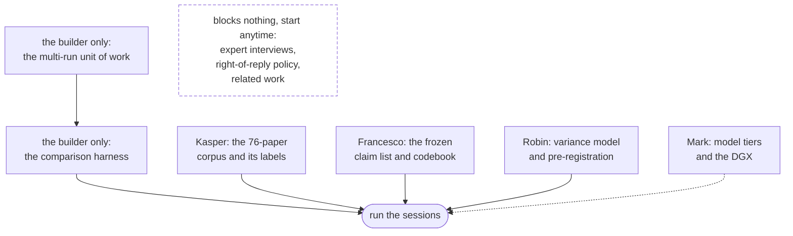

### By person

| Owner | Package | Done when | Blocks |
|---|---|---|---|
| **Kasper** | Corpus and labels: Olga's 76-paper set with per-paper reproduction outcomes in usable form, plus the arrangement with Iarygina and Mottelson | A file of papers, eligibility flags, and human outcomes exists | The whole study |
| **Francesco** | The **frozen claim list**: a codebook for enumerating a paper's reported statistical claims, two coders, agreement reported | Codebook frozen; a pilot set coded twice with κ | The measurement itself |
| **Robin** | Statistical design: the variance-components model, the ICC specification, the match tolerance, the power analysis from the pilot | A pre-registration draft | Interpreting anything |
| **Mark** | The model axis: tier comparison protocol, DGX environment ready, and the "internet severed, not in training data" condition | A protocol and a prepared machine | [§7 step 1](#7-ranked-next-steps) |
| **Robin + Kasper** | Right-of-reply and correction policy, a question of standing and field norms rather than code ([§6](#6-risks-nobody-raised)) | A stated position | Publishing anything naming third parties |
| **Francesco + Mark** | Expert and practitioner interviews (agreed 17 Aug) | Transcripts and a coded summary | Nothing; fully parallel |
| **Anyone with time** | Related work: turn [`landscape.md`](landscape.md) into a related-work section; score `doesitreproduce.com`; resolve the [R8](#r8-a-citation-that-was-wrong-now-corrected) citation | A drafted section | The write-up |

### What stays with the builder

The multi-run unit of work, the comparison harness, the runs, and the money.
That is the critical path, and it does not parallelize.

### Three cautions

1. **Two packages are blocking; the rest are not.** The corpus (Kasper) and the
   claim list (Francesco) gate the measurement. Follow up on those two; the
   others can run late without consequence.
2. **Do not start Kasper's original task yet.** "Choose 100 behavioral papers"
   presumes a corpus decision nobody has taken ([§3](#3-what-they-disagree-on)),
   and is the item most likely to be redone. Ask for the 76-paper set instead.
3. **Settle authorship before the work goes out, not after.** Four institutions,
   a commercial platform, and five private funders, with nothing on the record
   ([§6](#6-risks-nobody-raised)). Each package above is a claimable
   contribution; say so when handing it over, and academics will take it.

## 10. Commitments outstanding

| Person | Owed |
|---|---|
| Robin Welsch | Account details; a DOI to reproduce; budget; contact finance |
| Kasper Hornbæk | Choose 100 behavioral papers with prior manual replications |
| Mark Colley | Test open models on the DGX; run the code sent to them |
| Changkun Ou | Outer-loop cost analysis; explain top-up; configure access; send code to Mark; add Mark to Slack; follow up with "Stephen" |
| The group | Run on open-code papers; interview researchers; select papers; schedule the follow-up |

**These commitments form a loop.** Choosing papers depends on which study we
run, which depends on cost, which depends on the model. Kasper's paper selection
is the earliest item on the list and the one most likely to be redone.

## References

Checked against a live source on 25 Aug 2026.

| | Work | Why it is here |
|---|---|---|
| **R1** | Aczel, Szaszi, Clelland, Kovacs, Holzmeister, van Ravenzwaaij et al. (494 authors). *Investigating the analytical robustness of the social and behavioral sciences.* **Nature** 652(8108), 135–142, 1 Apr 2026. [`10.1038/s41586-025-09844-9`](https://doi.org/10.1038/s41586-025-09844-9) | The 3 Aug paper. 100 studies (2009–2018), at least 5 re-analysts each, peer-evaluated. **34% matched the numbers; 74% matched the conclusion.** The human baseline for repeat-run variance. |
| **R2** | Iarygina, O., Hornbæk, K., & Mottelson, A. *On the Computational Reproducibility of Human-Computer Interaction.* **CHI 2026**, pp. 1–16, Barcelona, 13 Apr 2026. [`10.1145/3772318.3791129`](https://doi.org/10.1145/3772318.3791129) | "Olga's paper". Source of the CHI numbers in `landscape.md`: 76 papers ever shared data + code, 37 (49%) fully reproduced, ~1% share materials. Kasper is a co-author. |
| **R3** | Reproducibility Project: Cancer Biology. About $52,500–75,000 per paper over 8 years; scope cut from 53 to 23 papers on author non-cooperation | The only published per-paper cost of manual replication. Via `landscape.md`; primary source not re-verified. |
| **R4** | [doesitreproduce.com](https://doesitreproduce.com/), operated by Brainarbeit | See below. |
| **R5** | Liu, H., Tjiaranata, F. A., & Tan, C. *VERITAS: Towards a General-Purpose Replication Tool for Scientific Research.* arXiv:[2607.02931](https://arxiv.org/abs/2607.02931), 3 Jul 2026, U. Chicago | Closest architectural comparison. 65 papers across CS, social science, medicine, astrophysics; importance-weighted Replication Score, severity-rated fix log, patched codebase. Beats a baseline Claude Code implementation on every metric. |
| **R6** | Nguyen, Soós, Ma, Obadage, Ranjan, Koneru, Errington, Nematova, Rajtmajer, Wu & Jiang. *ReplicatorBench.* arXiv:[2602.11354](https://arxiv.org/abs/2602.11354), 11 Feb 2026 (v3 29 Jun) | Human-verified **replicable and non-replicable** claims in social/behavioral science, evaluating the *process* and not only the outcome. Missing from `landscape.md`. If the 100-paper study runs, this is what it is compared against. |
| **R7** | Hullman, J., Broska, D., Sun, H., & Shaw, A. *This human study did not involve human subjects.* arXiv:[2602.15785](https://arxiv.org/abs/2602.15785), 17 Feb 2026 | Heuristic substitution vs calibrated validation: the distinction 007's "synthetic pilot, never evidence" rule rests on. |
| **R8** | Yeykelis, Pichai, Cummings & Reeves. *Using LLMs to Create AI Personas…* arXiv:[2408.16073](https://arxiv.org/abs/2408.16073), 28 Aug 2024 (v2 24 Apr 2025) | `landscape.md` cited it wrongly; corrected below. |
| **R9** | `reprobe` (Mark Colley): local LLMs analyzing code in Docker to check reproducibility | **Unverified.** No public trace; absent from [m-colley.github.io](https://m-colley.github.io/) and from search. Ask them. |

### A note on `landscape.md`

It is cited throughout this page, so its reliability matters. Five of its claims
were checked on 25 Aug 2026 while writing this:

| Claim | Result |
|---|---|
| The CHI numbers, 76 / 37 / ~1% | Correct, and they are [R2](#references)'s, not the survey's |
| The VERITAS description | Accurate against the abstract |
| "No funded startup whose product is agentic paper reproduction" | **Falsified**: [R4](#r4-a-live-competitor-landscapemd-says-does-not-exist) |
| arXiv 2408.16073 reports 81% / 83% | **Wrong, and inverted the source's meaning**; corrected, see [R8](#r8-a-citation-that-was-wrong-now-corrected) |
| The benchmark list | Incomplete; missing [R6](#references) |

The document opens by promising that "every entry below was checked against a
live source with a date". That promise is the basis for citing it at all, and it
no longer holds everywhere.

Its value has two parts, and mixing them is the problem:

- **The enumeration**, who exists and when, goes stale quickly. It is seven
  weeks old and wrong in two places; both errors are recorded here.
- **The arguments** (why frontier labs structurally avoid audit products, why
  the incumbents' advantage is *mandate* rather than technology, why HCI is
  unclaimed, why for most CHI papers the audit's product is the absence) do not
  go stale the same way. [BACKLOG 4](../specs/BACKLOG.md) exists because of
  them, and [§6](#6-risks-nobody-raised) rests on them.

A reader cannot tell which part a given citation came from, so each part lends
the other credibility it has not earned. The repair is not another full sweep:
date or delete the "Searched, found nothing" section, cite primary sources
wherever one exists, and re-verify only the three claims a decision rests on:
the competitor absence, the funding-line absence, and the 007 synthetic-pilot
citation.

### R4: a live competitor `landscape.md` says does not exist

Autonomous AI re-runs of published computational biomedical pipelines, "end to
end, without a human in the loop", scoring 0–100. As of 26 Aug 2026: **1,286
papers assessed, 648 scoring ≥75**, 7,716 indexed. It states it is "not peer
review, not an audit". No paper or preprint was found.

`landscape.md` (July 2026) records "no funded startup whose product is agentic
paper reproduction" as a finding we depend on. This is a production system doing
agentic reproduction at a scale we have not reached, and it takes the **opposite
position on both axes we defend**: no human in the loop, and a scalar score as
the headline output, which `procedure.md` §7 refuses to do. Score it on the
four axes and add it.

### R8: a citation that was wrong, now corrected

`landscape.md` attributed to this arXiv id: "matched up to 81% of real effects
while also producing significant effects for up to 83% of null findings", and
called it "the empirical case for 007's synthetic-pilot rule ... worth citing by
hand".

**Both figures were wrong, and the second inverted the paper's meaning.**
Checked against the PDF on 25 Aug 2026: **81% appears nowhere** in the text or
figures. **83% is the *success* rate on strongly significant findings**, "with
83% of the findings (54 out of 65) successfully replicated", for p < 0.001. It
is not a false-positive rate on nulls.

What the paper does report is a stronger argument for the rule, because it is a
pattern rather than one figure. Personas reproduced 76% of main effects (84/111)
and 68% overall (90/133), and accuracy tracks the strength of the original
effect: 83% at p < 0.001, 55% (6/11) where the original was null (p > 0.5), 76%
for main effects against **27% for interactions**. The authors warn that
personas risk "both false positives and false negatives" on "less pronounced
effects".

A synthetic cohort is therefore most reliable where it is least needed, and
least reliable on weak effects, nulls, and interactions, which is what a pilot
exists to find. `landscape.md` has been corrected in place with the table and
the quotes.
