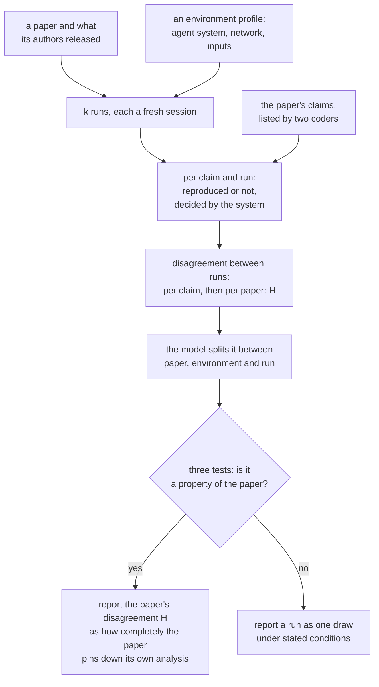
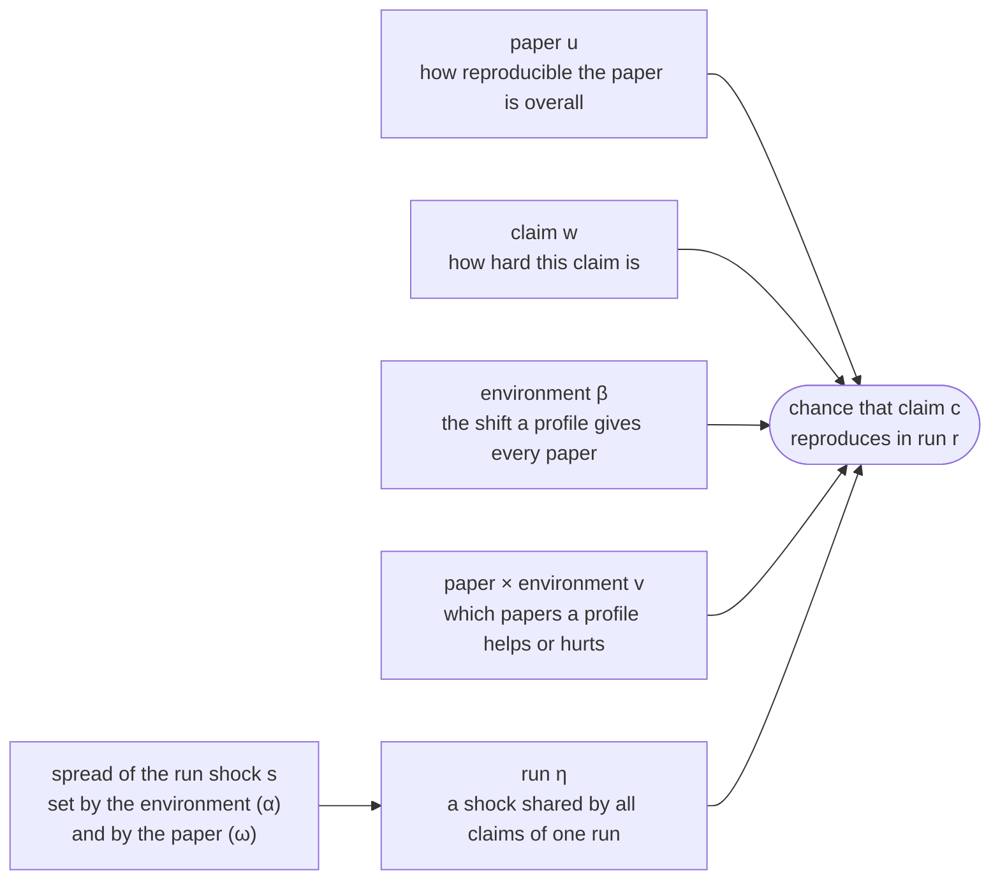

# A per-paper dispersion model

When an AI agent is asked to reproduce the same paper several times, its runs
do not agree with each other. This note proposes how to measure that
disagreement and how to tell what causes it. Nothing here has been estimated
yet. It is written for review before a study is registered.

## Research question

**When repeat runs of one paper disagree about whether its results reproduce,
where does the disagreement come from: the paper, the conditions the run had,
or chance?**

This is not the question of whether a paper reproduces. Each run already
answers that, result by result. The question is how far that answer depends on
which run gave it. The two come apart: a paper whose results fail in every run
shows no disagreement at all, exactly like a paper whose results reproduce in
every run. Disagreement is largest when a result reproduces in about half of
the runs.

Three questions make that precise:

1. **How large is it?** For each result a paper reports, how likely is it that
   two independent runs disagree about whether it reproduced?
2. **What does it belong to?** How much of the disagreement comes from the paper
   and the materials its authors released, how much from the environment of the
   run (which AI agent ran it, what it could reach on the network, which copy of
   the paper it was given), and how much is left as chance between runs under
   the same conditions?
3. **Is it a property of the paper?** Does the amount of disagreement differ
   reliably from paper to paper, does the ranking of papers hold when the
   environment changes, and does disagreement rise on exactly the results
   affected when a stated detail is withheld from a paper?

The answer to the first question, averaged over a paper's results, is the
paper's disagreement. It is written $H$ below: the chance that two runs
disagree about one result of the paper. It is 0 when every run agrees on every
result, and at most 0.5, when each result reproduces in half of the runs.

A low $H$ says a run's outcome is repeatable. It does not say the outcome is
right: every run can agree and be wrong, for instance when all of them are
refused the same page or make the same mistake. Whether outcomes are right is a
separate question, answered by comparing them with outcomes people verified by
hand, which the intended corpus has. Repeatability comes first, because an
outcome that changes from run to run cannot be checked against anything.

The answer to the third question decides what an audit may report. If it is
yes, $H$ can be reported as a measure of how completely the paper and its
materials pin down its own analysis. If not, the disagreement
describes the auditing instrument, and a single run's verdict has to be reported
as one draw under stated conditions.

The estimands and the model-free estimator below answer the first question, the
model the second, and the three tests the third. The study in one picture:

The evidence that prompted the question is a pilot of 49 runs of three papers
([`repeat-runs-pilot.md`](repeat-runs-pilot.md)): the spread between runs is
real and large, and most of it in the pilot came from the agent system, the
network and labeling rather than the paper. The model therefore treats the
environment as a facet to estimate, not as noise, and gives each paper its own
dispersion instead of pooling one.

## Setting

ReplicHAI audits the reproducibility of a research paper with a coding agent.
Given a paper, one **run** finds what the authors released and splits the paper
into components. It places each component in the inner loop, the part a machine
can re-run (the analysis, the model or the pipeline), or in the outer loop, the
study with human participants, which is never re-run or simulated. It re-runs
the inner loop, marks each inner component verified, partial or blocked, records
where its numbers disagree with the paper's, and lists the hidden decisions:
choices a reimplementation has to make that the paper does not state. A second
stage grades the run against a fixed rubric, and a run that falls short is
revised.

Three things can differ between two runs of one paper, and the model keeps them
apart:

- the **paper**, with the materials its authors released;
- the **environment** of the run: the agent system (the coding agent and the
  model behind it), the network it may reach, and the copy of the paper and of
  the artifacts it was given;
- the **run** itself: a fresh session of the same agent on the same inputs does
  not make the same choices twice.

A **claim** is one quantitative result the paper reports, such as a test
statistic, an estimate or a count. Whether a run reproduced a claim is the unit
the model is built on.

## Why not plain generalizability theory

A generalizability study over paper × prompt × run, where the prompt is the
instructions the agent is given and runs are nested in each paper and prompt
cell, estimates one run variance component for the whole
corpus, $\sigma^2_{r:pq}$, and treats it as error around each paper's mean.
That is the right tool for asking how reliably a paper's *mean* outcome is
measured. It cannot say that one paper's runs disagree more than another's,
because it assumes they all disagree by the same amount. The question here is
the opposite one, so the run variance has to be allowed to differ by paper and
to be modeled in its own right.

## Data and notation

| Symbol | Meaning |
|---|---|
| $p = 1, \dots, P$ | papers |
| $c = 1, \dots, m_p$ | claims of paper $p$: the paper's reported quantitative results, frozen per paper by two human coders before any run is scored |
| $e = 1, \dots, E$ | environment profiles: the agent system and model, the network policy, the copy of the paper, the artifact snapshot. A small number of designed levels, crossed with papers |
| $r = 1, \dots, k$ | runs, nested in paper × profile |
| $Y_{pcer} \in \{0, 1\}$ | whether claim $c$ reproduced in run $r$: the run's observed value is within the registered tolerance of the reported value, decided by the system from the run's reported number, never by the agent's label |

A claim the run did not attempt, or could not run, is $Y = 0$ and also carries
a cause (environment, paper, artifacts) recorded by the run, so a blocked claim
can be analyzed by why it was blocked.

## Estimands

**Reproduction probability of a claim.** $q_{pce} = \Pr(Y_{pcer} = 1)$ for a
fresh run under profile $e$.

**Claim instability.** The probability that two independent runs disagree about
claim $c$:

$$h_{pce} = 2\, q_{pce}\,(1 - q_{pce}).$$

It is zero for a claim that always or never reproduces, and largest at
$q = 1/2$.

**Paper instability.** The paper's disagreement $H$ from the research question,
the average over the paper's claims:

$$H_{pe} = \frac{1}{m_p} \sum_{c=1}^{m_p} h_{pce}.$$

This is the primary per-paper dispersion: the chance that two runs disagree
about a claim of this paper, under this environment. It has a plain reading and
a direct estimator, and it does not depend on how an agent decomposes the
paper, because the claims are frozen.

To read a value: if every result of a paper reproduced in the same share of
runs, $H$ would be as follows.

| A result reproduces in | Two runs disagree about it with chance |
|---|---|
| 99% of runs, or 1% | 0.02 |
| 95%, or 5% | 0.10 |
| 90%, or 10% | 0.18 |
| 80%, or 20% | 0.32 |
| 70%, or 30% | 0.42 |
| 50% | 0.50 |

For any paper, a single run agrees with the outcome most runs would give on a
share of the paper's results between $1 - H$ and $1 - H/2$. At $H = 0.10$ that
is 90% to 95% of its results.

No cutoff for a low $H$ is proposed here. It has two anchors, both to be fixed
in the registration before outcomes are seen. One is the $H$ of fully specified
papers, which is what the agent and the environment produce with no help from
the paper (the third test below). The other is the use the number is put to,
for which the share above is the guide.

**Run-shared dispersion.** How much a whole run moves together: a run that
cannot reach the paper, or loses its dependencies, fails many claims at once.
This is $s_{pe}$ in the model below.

**Environment effects.** The shift in reproduction, $\beta_e$, and in run-shared
dispersion, $\alpha_e$, between profiles, and the paper × environment
interaction $v_{pe}$: whether the environment changes *which* papers reproduce.

## A model-free estimator

With $k \ge 2$ runs and $x_{pce}$ successes on claim $c$,

$$\hat h_{pce} = \frac{2\, x_{pce}\,(k - x_{pce})}{k\,(k - 1)}$$

is unbiased for $h_{pce}$, and $\hat H_{pe}$ is the mean of $\hat h_{pce}$ over
claims. Because the claims of a paper act as replicates, it is far more precise
at a small $k$ than a run-level standard deviation. In a simulation with 15
claims, a third of them unstable ($q = 0.5$) and the rest stable ($q = 0.95$),
the 95% range of $\hat H / H$ was:

| Runs per paper $k$ | 95% range of $\hat H / H$ | Spread | Run-level SD, same data |
|---|---|---|---|
| 3 | 0.39 to 1.55 | 4.0× | can be 0; unusable |
| 5 | 0.64 to 1.39 | 2.2× | 0.34 to 1.65 |
| 8 | 0.73 to 1.29 | 1.8× | 0.49 to 1.51 |
| 10 | 0.77 to 1.26 | 1.6× | 0.54 to 1.44 |

For comparison, the 95% interval on a single paper's run standard deviation
from $k$ normal draws is $0.52$ to $6.28$ times the estimate at $k = 3$, $0.60$
to $2.87$ at $k = 5$, and $0.69$ to $1.83$ at $k = 10$.

## The model

A claim-level logistic mixed model in which each paper has its own run-shared
variance:

$$\operatorname{logit} \Pr(Y_{pcer} = 1) = \beta_0 + \beta_e + u_p + v_{pe} + w_{pc} + \eta_{per}$$

$$u_p \sim N(0, \tau_u^2), \qquad v_{pe} \sim N(0, \tau_v^2), \qquad w_{pc} \sim N(0, \tau_w^2)$$

$$\eta_{per} \sim N\!\left(0,\, s_{pe}^2\right), \qquad \log s_{pe} = \alpha_0 + \alpha_e + \omega_p, \qquad \omega_p \sim N(0, \tau_\omega^2)$$

$$\operatorname{corr}(u_p, \omega_p) = \rho.$$

- $u_p$ is how reproducible the paper is overall; $w_{pc}$ how hard each claim is.
- $\eta_{per}$ is the run's shared shock: everything that moves all of a run's
  claims together. Its standard deviation $s_{pe}$ belongs to the paper and the
  environment, which is the formal version of "each paper has its own
  dispersion".
- Claim-specific disagreement between runs, beyond the shared shock, is the
  Bernoulli variation of claims whose $q$ is away from 0 and 1. That is where a
  decision the paper left open shows up: it moves one claim, not the whole run.

The same model as a picture. Each box on the left moves the chance that a claim
reproduces. The box at the bottom sets how large a run's shock is, and it is
where a paper gets a dispersion of its own:

The split between the two is the one the pilot points at. On the latent scale,
the share of a claim's between-run variance that is shared by the whole run is

$$\lambda_{pe} = \frac{s_{pe}^2}{s_{pe}^2 + \pi^2/3}.$$

A high $\lambda$ says the runs differ as wholes: the environment, or the
agent's trajectory. A low $\lambda$ with a high $H$ says individual claims flip
independently: what the paper did not specify.

If a continuous run score is preferred to claim outcomes, the same idea is a
location-scale model on the score $S_{per}$ (for example the logit of the share
of claims reproduced):

$$S_{per} = \beta_0 + \beta_e + u_p + v_{pe} + \varepsilon_{per}, \qquad \varepsilon_{per} \sim N(0, \sigma_{pe}^2), \qquad \log \sigma_{pe} = \alpha_0 + \alpha_e + \omega_p.$$

That version fits in brms as `bf(S ~ env + (1|i|paper) + (1|paper:env), sigma ~ env + (1|i|paper))`.
The claim-level version needs a short Stan program, because the run effect's
standard deviation is itself hierarchical across papers. Both are fit on all
runs at once, which handles unequal numbers of runs and claims.

## Is dispersion a property of the paper?

Three tests, registered before any outcome is seen. All three have to pass for
the study to say that dispersion describes the paper.

1. **Between-paper variance of dispersion is above zero.** $\tau_\omega^2 > 0$
   in the model, by a likelihood-ratio test against the model without
   $\omega_p$ (the null is on the boundary, so the reference distribution is a
   50:50 mixture of $\chi^2_0$ and $\chi^2_1$), or by its posterior. For the
   model-free estimator, the between-paper variance of $\hat H_p$ must exceed
   the mean of its within-paper sampling variance, estimated by resampling runs.
2. **The ranking survives a change of environment.** Papers ranked by $H$ under
   two agent systems must agree (Spearman correlation registered in advance). A
   property of the paper does not reorder when the agent changes. The pilot
   already fails this on four of six crude measures, with too few runs to
   decide.
3. **Dispersion follows what was withheld.** Take papers whose analysis is fully
   specified. Run them as published, then with one stated detail removed (a
   seed, a degrees-of-freedom method, an exclusion rule). The claims that
   detail affects must gain instability and the others must not. The unedited
   papers also give the instrument's noise floor: their $H$ is what the agent
   and environment contribute alone.

## Reliability

For ranking papers by reproduction level, the generalizability coefficient
with paper as the object of measurement is

$$E\rho^2 = \frac{\tau_u^2}{\tau_u^2 + \tau_v^2 / n_e + \sigma^2_{\text{res}} / (n_e\, k)}.$$

For dispersion, the reliability of $\hat H_p$ is the share of its variance
across papers that is not sampling noise. Estimate it by splitting each paper's
runs into halves, correlating $\hat H_p$ across papers between the halves, and
applying the Spearman-Brown correction. Require at least 0.8 before reporting
a single paper's dispersion.

A criterion proposed earlier in this project, "if prompt-level variance exceeds
run-level variance we do not have an instrument", compares two error terms. A prompt's main effect
moves every paper equally and does not change a ranking; what matters is the
paper × prompt interaction relative to $\tau_u^2$, which $E\rho^2$ already
contains. Three prompts give two degrees of freedom for a prompt main effect,
so prompts are a fixed facet, and no claim generalizes beyond the prompts
tested.

## Sample size

The intended corpus is the 76 CHI papers that have shared both data and code,
whose reproduction outcomes were verified by hand (Iarygina, Hornbæk and
Mottelson, 2026). That caps the corpus at 76 papers, so runs per paper is the
lever that is left. Pooled components are well estimated at $k = 3$; per-paper
dispersion is not. A design that can grow into the main study:

| Stage | Papers × runs | Purpose |
|---|---|---|
| Internal pilot | 16 × 8, one profile | Estimate $\tau_\omega^2$ and the reliability of $\hat H_p$. These runs count toward the main study |
| Main study | the other 60 × 5 if $\tau_\omega^2$ is detectable, otherwise × 3 and no per-paper dispersion claims | Paper levels and, if supported, dispersion |
| Environment facet | 20 × 2 more profiles × 4 | $\beta_e$, $\alpha_e$, the paper × environment interaction, and test 2 |
| Noise floor and withholding | 5 to 8 fully specified papers, as published and with one detail withheld | Test 3 |

The decision rule between "× 5" and "× 3" is written into the registration.

## Assumptions and open questions

- Runs are independent given paper and profile. This needs fresh sessions with
  no shared cache, recorded inputs, and the analysis of the first graded
  attempt, before any revision the grader requests.
- Claims are fixed by people, with agreement between two coders reported.
  Claims that are qualitative are out of scope and counted, not dropped.
- The match tolerance is registered per claim type before runs are scored.
- How launch failures are excluded is stated before outcomes are seen.
- A run's blocker cause is recorded in a closed list, so environment-caused
  zeros can be separated from paper-caused zeros in a sensitivity analysis.

## References

Iarygina, O., Hornbæk, K., and Mottelson, A. (2026). On the Computational
Reproducibility of Human-Computer Interaction. *Proceedings of the 2026 CHI
Conference on Human Factors in Computing Systems*, 1–16.
<https://doi.org/10.1145/3772318.3791129>
