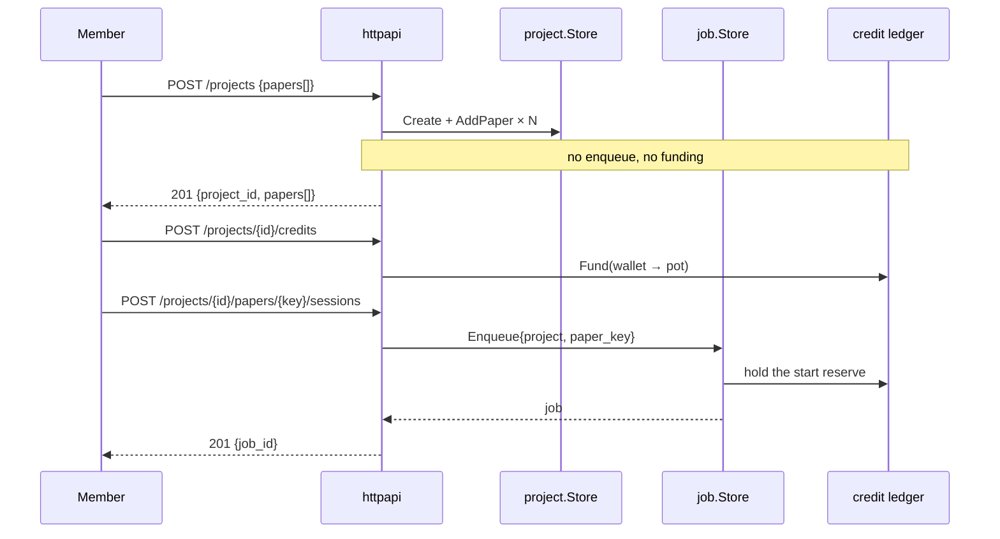

# 012 — A project holds papers

**Status:** built. `project_papers` holds what a project is about, keyed by the same `paper.Key` a session already stores, so a paper needs no column on `jobs` and outlives every run against it. `POST /projects` records papers and enqueues nothing; `GET/POST/DELETE /projects/{id}/papers` and `POST /projects/{id}/sessions` are the four routes that replaced `POST /papers`. Credits left the create path entirely: `fundNewProject`, `undoProject`, the 422, and 006j's never-leave-an-empty-project rule are all gone, along with the frontend's partial-success apparatus. The project screen gained a Papers card where a run is started; the New-project screen records and navigates.

**The create and start flow was checked manually against a running server, on an account with a wallet of $0.00**, the state that produced the refusal this spec exists to remove. A create naming three references (one deliberate garbage) answered `201` with the two good papers recorded, the bad one reported against itself, the project kept, and **no sessions started**. The project's placeholder title was replaced a moment later by the real one resolved in the background ("Short-Form Videos Degrade Our Capacity to Retain Intentions…"), which is the enrichment running off the request path. Starting a session was then `402 no_credits`; a paper the project did not hold was `404`; after an admin top-up and an allocation the same start returned `201` and the session ran to `done`; a second start of the same paper while it ran was `409`. Removing the paper that had run was `409` and the one that had not was `204`.

One thing the run surfaced that this spec does not solve: `paper.Key` is offline and `paper.Resolve` is not, so an arXiv preprint and its published DOI are two rows here and one paper to the identity system (arXiv 2302.03714 declares DOI 10.1145/3544548.3580778, and resolving either returns the DOI identity). The project then lists two papers with the same title. That divergence predates this spec (`jobs.paper_key` and the double-trigger guard both key on the offline value), and unifying them is a paper-identity question for 001/003, not a papers-table one.

Coverage went from 79.2% to 79.4% overall, with `internal/httpapi` at 84.3%.

**Scope:** make a paper a durable thing a project holds, rather than an argument to the act of starting a session. `POST /projects` records its papers and runs nothing; a member starts a session for a paper from the project page, which is also where the credit check now lands. Adds one table (`project_papers`), four routes under `/projects/{id}/papers`, and a papers section to the project screen. Revises [006j](006j-the-new-project-flow.md) (its create enqueues; its 422 and per-paper session errors go) and [011](011-what-a-session-costs.md) (credits leave the create path).
**Depends on:** [006g](006g-projects-and-replication-sessions.md) (projects own sessions; `jobs.paper_key` and the double-trigger guard), [006j](006j-the-new-project-flow.md) (the create endpoint and the `PaperResolver` seam this reshapes), [006c](006c-identity-and-access.md) (membership decides who may add a paper or start a session), [011](011-what-a-session-costs.md) (the pot and the start reserve the Start button meets), [001](001-paper-identity-and-slugs.md) (`paper.Key`, `paper.Resolve`).

## Problem

`internal/project/project.go` says it plainly: *"The paper a session targets lives on the session (the job), never here."* A project is a container of runs, and the paper exists only as `jobs.ref` on a run that was started. Three things follow from that, and all three are felt.

**Creating a project is spending.** Because a project is opened *by submitting a paper*, `createProject` must fund the new project's pot before its first enqueue (`fundNewProject`), and must delete the project again, credits and all, if not one paper started (`undoProject`). So an account with an empty wallet cannot create a project at all. It cannot name one, cannot invite collaborators to one, cannot write down which papers it intends to reproduce. It is refused `402` at the start, for an act that costs nothing. That refusal is what a new user meets first, and it is the wrong shape: the money question belongs at the moment a run starts, not at the moment a container is named.

**A paper that has not run does not exist.** There is no way to say "these four papers are what this project is about" and start them one at a time, or next week, or after allocating credits. The New-project screen collects several papers precisely because a project is usually several papers, and then converts every one of them into a run in the same request, whether or not that is what anybody wanted.

**A failed run erases its paper.** A session that fails is a failed session; the paper it targeted is still the paper the project is about. Today the only record that the paper was ever part of the project is the failed job row, which reads as a fault rather than an intent. "Replicate again" exists but works from a session, so a paper whose only session failed has no obvious way back.

The reporting complexity in `createProject` (best-effort per paper, `sessions[]` carrying either a `job_id` or an error, the `422 no_sessions_started` compensating delete) is all machinery for making one request do two jobs. Separating the jobs removes the machinery rather than improving it.

## Decisions

**`project_papers`, keyed by `(project_id, paper_key)`.** One row per paper a project holds: the offline paper identity, the reference it was added from, the resolved title once known, who added it, and when. The key is the primary key together with the project, so the same paper twice in one project is impossible by construction rather than by a check.

```sql
CREATE TABLE project_papers (
    project_id TEXT NOT NULL REFERENCES projects (id) ON DELETE CASCADE,
    paper_key  TEXT NOT NULL,
    ref        TEXT NOT NULL,
    title      TEXT NOT NULL DEFAULT '',
    added_by   TEXT NOT NULL,
    added_at   TIMESTAMPTZ NOT NULL,
    PRIMARY KEY (project_id, paper_key)
);
```

**Sessions join to papers by the key they already carry.** `jobs.paper_key` exists since 006g, where it keys the double-trigger guard (`jobs_active_paper_project`). A session belongs to the paper whose key it holds, in the project it holds, so this spec adds no column to `jobs`, no foreign key on the hot enqueue path, and no backfill of existing runs beyond seeding `project_papers` from the distinct `(project_id, paper_key)` pairs already in `jobs`. The join is the handler's, in the same shape as the existing project-to-sessions join through `job.ListByProject`.

**Create records; it does not run.** `POST /projects {title?, papers[], collaborators[]}` writes a project, one `project_papers` row per paper, and the collaborator members, and enqueues nothing. It returns `201 {project_id, title, papers: [{key, ref, title} | {ref, error}], members[]}`. A reference that is not a DOI/arXiv/URL is reported against that reference and the others are still recorded; `paper.Key` is offline, so this costs no network and cannot half-fail on a slow source.

**A project with no papers is a legitimate state**, so 006j's "never leave an empty project" rule and the `422 no_sessions_started` response are both retired, along with the compensating `undoProject` delete. Nothing is created that has to be un-created, because nothing was spent.

**Titles resolve best-effort, server-side.** After the rows are written, the handler resolves each new paper through the existing `PaperResolver` seam and fills `title`, concurrently and bounded by the fetcher's timeout. A source that cannot be reached leaves the title blank and is not an error: the row is a paper you can still start, and the first session's Resolve phase fills the title in as it does today for the project. The client's previewed title is never trusted onto the record: the New-project screen has already resolved the paper for its own preview, but a title stored against a project is a record, and records are the server's to write.

**Credits leave the create path entirely.** `fundNewProject` is removed from `createProject`, and so is the request body's `credits` field, not kept as an optional convenience. A field that funds best-effort would answer `201` to a caller whose wallet could not cover it, with the refusal buried in the body: a project that exists, holds no money, and said so somewhere the reader did not look. That is the exact failure this codebase has just finished removing from the create path, and one funding path is worth more than one saved request. A new project starts with an empty pot, and the existing `ProjectCreditsCard` on the project screen is how it is funded, which is where its copy already points ("allocate from here to fund one").

This is the fix for the refusal a new account meets: with no session started, there is nothing to reserve against, so an empty wallet creates projects freely and meets the credit check exactly once, when somebody presses Start, on a screen showing the pot they are spending from.

**Starting a session is its own route.** `POST /projects/{id}/sessions {paper_key}` enqueues one session for one paper the project holds, with the same submission `job.Enqueue` builds today (`Kind: KindAudit`, the project, the paper key). Every refusal that create used to report per paper now belongs here, singly and unambiguously: `409 active_session` from the double-trigger guard, `402 no_credits` from the pot, `404` for a paper the project does not hold.

**A paper key is never a path segment.** `paper.Key` returns `doi:10.1145/3544548.3581433` and `url:https://…`, with colons and slashes both. So a paper is addressed by body (`{paper_key}`) or by an encoded `?key=` query, never by `/papers/{key}`, which would split one key across several segments and route it nowhere.

**`POST /papers` is removed, not deprecated.** It exists to create-or-append-and-enqueue, which is exactly the conflation this spec undoes; every one of its uses is now two explicit calls. Its consumers are the frontend's "Replicate again" (which becomes a Start on a paper the project already holds) and `scripts/smoke.sh`, which is updated in the same change.

**The papers a project holds are readable and editable.** `GET /projects/{id}/papers` lists them, each with its session count and the phase of its latest session, so the project screen can render a paper with what has happened to it. `DELETE /projects/{id}/papers?key=…` removes a paper that has no sessions. Once a paper has been run, the record of what was reproduced stays, and stays undeletable. That rule applies to the backfill too: every paper seeded from an existing job has a session by definition, so **no paper that exists at deploy time can be removed**. That is the intended reading of "the record stays", not an oversight: a project's history of what it ran is not editable, and the only removable papers are ones added after this ships and never started.

**Membership decides.** Adding, starting, and listing are open to any project member, matching what `POST /papers` allows today for an existing project; removing a paper is the lead's, matching who may move credits out.

## Data flow



## API surface

```
POST   /projects                        { title?, papers[], collaborators[] }
         → 201 { project_id, title, papers: [{key, ref, title} | {ref, error}], members[] }
GET    /projects/{id}/papers            → 200 [{key, ref, title, added_by, added_at, sessions, latest_phase}]
POST   /projects/{id}/papers            { url } → 201 {key, ref, title}
DELETE /projects/{id}/papers?key=<enc>  → 204   (lead only; refused 409 once it has sessions)
POST   /projects/{id}/sessions          { paper_key } → 201 {job_id}
```

Removed: `POST /papers`.

## Frontend

**The New-project screen stops being a launcher.** It creates and records; the "Nothing runs until the session starts" line under its button becomes literally true rather than nearly true. Every part of `createOutcome`'s partial-success handling goes with the behavior that needed it: a create either records the papers or reports which references were not recognized, and there is no such thing as a paper that was recorded but did not start.

**The project screen gains a Papers section** above Sessions: each paper with its title, its session count, and a Start button, disabled with the reason when the pot cannot cover the reserve, which is the same sentence `creditsShort` already carries. `ProjectSubmit` ("Replicate again") becomes "add a paper", posting to `/projects/{id}/papers`; starting is the paper row's own button.

## Acceptance criteria

1. `POST /projects` with several papers creates the project, records one paper per reference, seeds the collaborators, and enqueues **nothing**; `GET /projects/{id}` reports no sessions.
2. An account with an empty wallet creates a project successfully. The refusal it used to meet (`402` at create) is gone, and appears instead on `POST /projects/{id}/sessions`. `POST /projects` no longer accepts a `credits` field at all.
3. A reference that is not a DOI/arXiv/URL is reported against that reference; the other papers are still recorded and the project survives. There is no response that deletes a just-created project.
4. `POST /projects/{id}/sessions {paper_key}` starts one session for that paper; a second call while it runs is `409 active_session`; a project below the start reserve is `402 no_credits`; an unknown key is `404`. A DOI key (`doi:10.1145/3544548.3581433`) round-trips through both this body and the delete route's encoded query.
5. A paper whose session failed still lists on the project, and can be started again from the same button.
6. `GET /projects/{id}/papers` reports each paper's session count and latest phase; the same paper cannot be added twice.
7. `DELETE /projects/{id}/papers?key=…` removes a paper with no sessions, is refused `409` for one that has any (including every backfilled paper, which has a session by definition), and is refused for a non-lead.
8. Paper titles resolve server-side best-effort: a reachable source fills the title at create, an unreachable one leaves it blank without failing anything, and the first session's Resolve phase fills it in afterwards.
9. The migration seeds `project_papers` from the distinct `(project_id, paper_key)` pairs already in `jobs`, so every existing session's paper is listed on its project after deploy.
10. `POST /papers` is gone, and `scripts/smoke.sh` walks the new two-call path.

## Testing strategy

- **Store contract** (`internal/project/store_contract_test.go`): `AddPaper`, `ListPapers`, `RemovePaper`, `SetPaperTitle` run against both the in-memory and Postgres stores, as every other project method already does. Duplicate add, remove-what-is-not-there, and cascade-on-project-delete are contract cases.
- **Migration**: the backfill asserted against a database seeded with jobs carrying `paper_key`, including a project whose only session failed, which is the case that proves a paper outlives its run.
- **Handlers** (`internal/httpapi`): create-records-nothing-runs, empty-wallet-create, per-reference errors, start (happy, duplicate, no-credits, unknown key), remove (clean, has-sessions, non-lead), and membership refusals for each route, all against the existing fakes with the resolver seam faked.
- **e2e** (`cmd/server`): a project created with two papers, funded, then started one at a time, walking `submitted → done`, which is the flow the old `TestServerEndToEnd` covers, in its new shape.
- **Frontend**: the create outcome shrinks to record-or-report and its tests shrink with it; the paper row's Start button is covered for the disabled-no-credits state.

## Out of scope

- **Reordering or annotating papers.** A paper is a reference and a title, not a work item with notes.
- **Starting every paper at once** from the project screen. It is one more button over the same route, and it is worth having only once the per-paper flow is real.
- **Moving a paper between projects.** The identity would survive it, but nothing asks for it yet.
- **PDF upload** as a paper source: still [006d](006d-pdf-ingestion.md).

## Outcome

Every acceptance criterion holds, and two defects the decoupling introduced were found and fixed before it shipped.

**The project title was orphaned by the split.** The worker enriched a project's placeholder title only when it equaled the *running job's* ref. That was right while every paper started at create: the first paper's session always ran, so it always did the naming. Once starting became its own act, a project created around papers A and B and started at B compared B's ref to A's, declined, and kept a URL nobody chose as the project name forever. `isPlaceholderTitle` now recognizes the ref of any paper the project holds, and the create resolves titles itself so the worker's pass is a fallback rather than the primary path. Neither case had a test; both do now.

**Title resolution was blocking the create.** The first implementation waited on N source fetches inside the request, exactly the half-failure `paper.Key`'s offline key was chosen to avoid, since a client timing out would leave the papers recorded and the caller with nothing. It moved after the response, onto a context of its own so a client hanging up cannot cancel a half-done write; tests wait on it through `WaitBackground` rather than polling. Only a *derived* placeholder is ever replaced, so a project somebody named keeps its name.

**Deliberate divergences from the spec as drafted:**

- The start route is `POST /projects/{id}/sessions {paper_key}`, not `/papers/{key}/sessions`. A key is `doi:10.1145/3544548.3581433`, with colons and slashes, so it spans four path segments and routes nowhere. Delete takes it as an encoded `?key=`. A test round-trips a slashed key through both.
- The optional `credits` field on create was dropped rather than kept. Funding best-effort would answer `201` to a wallet that could not cover it with the refusal buried in the body, the exact failure this path had just finished removing.
- `errNoCreditsAtAll` and the create-time credit copy are deleted rather than kept for a case that can no longer happen.

**Unspecified work that landed with it:** the `background` helper and `WaitBackground` (a general seam, but introduced for this); `getArtifact` moved onto `ApiError` so the shared refusal reader cannot misread a 404 as a network failure.
