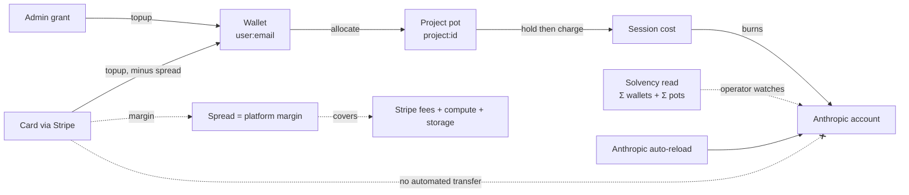
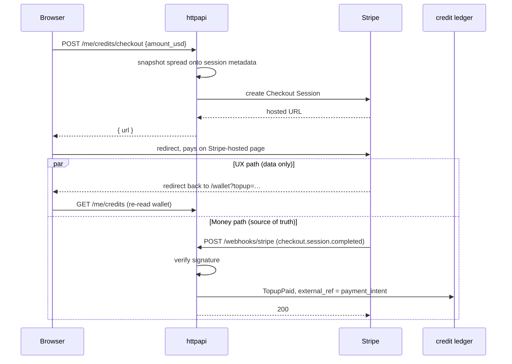
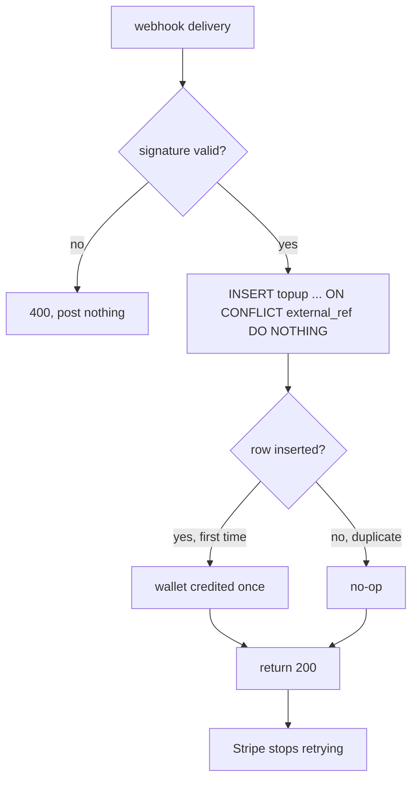
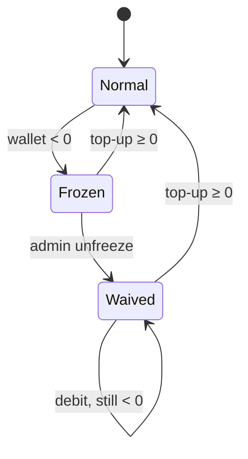

# 022 — Money comes in without an admin

**Status:** designed, not built. A design to refine into implementation leaves (a suggested breakdown is at the foot).

**Scope:** let a person buy credits into their own wallet with a card, so an admin is no longer the only way money exists. A Stripe **hosted Checkout** session creates the charge; a signed **webhook** is the one thing that posts the credit; the ledger dedupes the post on an external reference so a retried delivery cannot double it; a **spread** at purchase leaves margin for fees and overhead; a European may **pay in EUR** while the credit stays micro-USD, converted once at Stripe's own rate; a **refund** is a correcting ledger entry, not a reversal engine; and a **negative wallet freezes the account** until it is topped back up. Adds one migration (an `external_ref` column and its unique index), a payment port with a Stripe adapter, three routes (`POST /me/credits/checkout`, `POST /webhooks/stripe`, and a solvency read for the console), and the top-up modal the `402` already promises.

**Depends on:** [011](011-what-a-session-costs.md) (the ledger, `KindTopup`, micro-USD, the wallet the credit lands in and the `402 no_credits` that sends a person to buy some), [006c](006c-identity-and-access.md) (the signed-in email a wallet is keyed by, and the tier guard the webhook must sit *outside* of), [006k](006k-the-platform-admin-console.md) (platform settings, where the spread lives beside the rate card it complements), [010](010-deployment-and-release.md) (the secret the Stripe keys need, and the public ingress path the webhook needs reachable).

**Supersedes:** 011's closing line — *"an admin is still how credits come into existence"* — and only that line. Admin top-up ([`POST /admin/access/{email}/credits`](../internal/webauth/admin.go)) stays: it is how a grant, a comp, or a correction enters a wallet, and a card is not the only reason money should. This spec adds a second door, it does not close the first.

## Problem

011 built a ledger with two levels, priced sessions from it, and gated every start on it — and then left the front door to it locked. `KindTopup` is admin-only (`ErrNotAdmin`), so the only way a wallet holds anything is a platform admin typing a number into the console. That is fine for a seed and impossible for a product: every account arrives empty (006q), the start gate refuses it `402 no_credits`, and the only person who can lift that refusal is an operator. A researcher who wants to run a reproduction cannot pay to.

The ledger already anticipated the fix. `KindTopup`'s own comment reads *"Only an admin, and later a payment,"* and micro-USD was chosen partly because *"a payment provider charges in minor units of the same currency."* So the shape is known: a purchase is a `topup` posted by something other than an admin. What is missing is the three things that make posting it *safe* — who is allowed to post it, how a doubled delivery is refused, and where the money to run the compute the credit will buy actually comes from.

There is also a question this spec answers by **not** building it. The prompt that started this work asked whether a customer's payment should also top up the platform's own Anthropic API account. It should not — see the non-goal below — but the concern behind it is real and gets a small answer.

## Decisions

Where money enters, what the platform keeps, and the one place it does *not* flow — the map the decisions below fill in:



Two doors post `topup` into a wallet (admin grant, card purchase); only a pot is ever spent; the card door keeps a spread; and the dashed **✗** edge is the non-goal — a customer payment never funds the vendor account directly. `auto-reload` funds it, and the solvency read is how an operator knows when.

### A purchase is a webhook-posted entry, never a redirect-confirmed one

The money-moving fact is **the webhook**, `checkout.session.completed` (with its `payment_status: paid`), verified against the endpoint signing secret. The browser's return from Checkout is a UX event only: it navigates the user back and re-reads their wallet, and it may arrive before, after, or never relative to the webhook. Nothing about the credit is decided from a redirect query parameter, because a redirect parameter is client-supplied and the amount credited must come from the Stripe event object the server verified. This is the instruction-source boundary applied to money: the browser is data, the signed webhook is the instruction.

Concretely, three moves:

```
POST /me/credits/checkout   {amount_usd}   → creates a Checkout Session,
                                              returns its hosted URL
  (browser redirects to Stripe, pays, redirects back to /wallet?topup=…)
POST /webhooks/stripe        (Stripe → us)  → verify signature, on
                                              checkout.session.completed
                                              post the topup, return 200
```

The two paths are independent, and the webhook — not the redirect — is what moves money. This is the whole flow:



The `par` block is the point: the redirect and the webhook race, in either order, and only the lower branch credits the wallet. If the redirect wins, the re-read simply shows the old balance until the webhook lands — so the return page **polls `/me/credits` briefly** (a few reads over a few seconds) and the new balance appears on its own the moment the webhook posts, falling back to a "payment received — your credits will appear shortly" line if the poll window closes first. This is perceived latency only; correctness never depends on the redirect.

`POST /webhooks/stripe` **mounts outside the tier guard** (006c): Stripe is not a signed-in principal and carries no `TierUser`. Its authentication is the signature, not the session cookie. This is the one route in the app whose caller is a machine, and getting it out from under `RequireTier` is a deliberate seam, not an oversight — stated here so a later refactor that "tidies up" by moving all routes under one guard does not silently start rejecting every payment.

### The credit is posted at most once, and the ledger insert is what guarantees it

Stripe retries webhook deliveries by design, and a network hiccup can deliver the same `checkout.session.completed` twice. The current ledger has no defense: a balance is a fold over entries, so two `topup` rows silently double the money. The fix is a unique reference on the entry, and the *insert* — not a read-then-insert check — is what dedupes, for exactly the reason 011 gives for holding inside the enqueue transaction: a check on a second connection races the write it is trying to protect.

Migration `v2` of the credit schema:

```sql
ALTER TABLE credit_entries ADD COLUMN external_ref TEXT;
CREATE UNIQUE INDEX credit_entries_external_ref
  ON credit_entries (external_ref) WHERE external_ref IS NOT NULL;
```

A purchased `topup` carries `external_ref = <stripe payment_intent id>`; the insert is `ON CONFLICT (external_ref) DO NOTHING`. Both the first delivery and every retry take the same path and end at `200` — only the first inserts a row:



A duplicate delivery hits the index, inserts nothing, and the webhook still returns `200` so Stripe stops retrying. At-most-once insert over a folded balance is exactly-once crediting, with no stored counter to drift. Every other entry (`allocate`, `hold`, `charge`, an admin `topup`) leaves `external_ref` NULL, and the partial index ignores them — the column is dead weight for internal moves and load-bearing only where an outside system's identifier is the idempotency key.

This is the single highest-risk part of the spec. It is also the smallest: one column, one index, one `ON CONFLICT`.

### The payment path is its own store method, and `ErrNotAdmin` keeps its meaning

`Topup(ctx, byAdmin access.Principal, email, amount)` takes a principal and returns `ErrNotAdmin` — a webhook has neither. Rather than widen that signature and weaken what `ErrNotAdmin` asserts, add a sibling:

```go
// TopupPaid posts a purchased credit into a wallet, idempotent on ref.
// It has no principal to check: authority came from the verified webhook
// signature, upstream. actor records the payment, e.g. "stripe:pi_123".
TopupPaid(ctx context.Context, email string, credited int64, ref, actor string) error
```

The `actor` field then does real work in the wallet statement 011 built: a granted credit reads `actor = admin@…`, a purchased one reads `actor = stripe:pi_…`, and a person reading *why does my wallet hold this?* sees the difference between a comp and a purchase without a new column. Two doors into `KindTopup`, distinguished by who posted and recorded on the row itself — which is the ledger's whole thesis (011): a balance is the rows, and each names its cause.

### Hosted Checkout, and margin is a visible spread at purchase

**Hosted Checkout** (Stripe-hosted page, redirect out and back) over an embedded Payment Element: the card fields never touch this origin, so the PCI surface is the smallest one on offer, and Link and the wallet buttons ride along for free. The app holds a publishable key and a secret key; it renders no card input.

**The spread lives at the till, not in the rate card.** 011's rate card is raw vendor pricing, and its own text leans on that: an unknown model is charged *"at the highest rate the card holds,"* and a session's cost is meant to reconcile against Anthropic's published rates. Baking a margin multiplier into that card would quietly break the reconciliation — every session would cost more than the vendor charges, for a reason invisible on the session. So the margin is a purchase spread instead: **you pay $20 and your wallet gains $18** (or whatever the spread resolves to). The rate card stays honest, the session cost still matches the vendor, and the place the platform takes its cut is the one place a customer expects one — the moment of sale.

The spread is a platform-settings pair beside the rate card (006k), admin-editable like everything else there: a **percentage plus a fixed per-purchase amount** — `spread_bps` and `spread_fixed_micro` — shaped to mirror Stripe's own `2.9% + $0.30`, so a $5 top-up and a $500 top-up each cover the real cost of taking them. A percentage alone under-covers the fixed per-charge fee at the low end, which is the whole reason the fixed term exists:

```
credited_micro = gross_micro − round(gross_micro × spread_bps / 10_000) − spread_fixed_micro
gross_micro    = usd_minor(charge) × 10_000       # the USD the charge is worth, → micro-USD
```

`gross_micro` is the charge's value **in USD**: for a USD charge it is `amount_cents × 10_000` exactly; for a EUR charge it is the USD-equivalent Stripe reports for that charge (next section). The spread then applies to the USD figure, so margin is computed in one currency regardless of what the customer paid.

Two rules make it trustworthy:

- **The credited amount is shown before the charge.** The modal states *"$18.00 in credits for $20.00"* using a public spread, so nobody is surprised at the statement. `GET /me/credits` (or a small quote endpoint) exposes the spread so the client can compute it without a round-trip per keystroke.
- **The spread is snapshotted onto the Checkout session at create time**, in its metadata, exactly as 011 snapshots the rate card onto the job at enqueue and for the same reason: an admin editing the spread while a payment is in flight must not change what a paid session credits. The webhook reads the snapshotted spread from the session metadata, not the live settings row.

**Purchasing is free-entry above a floor.** A person types any amount at or above a **minimum** (a platform-settings number, e.g. $5 / €5), rather than choosing from fixed packs — the floor is what keeps Stripe's fixed per-charge fee from dwarfing a tiny top-up, and it lives beside the spread so an operator tunes both together. The floor is public and per-currency, so the modal can refuse a too-small amount before it ever reaches Stripe.

### Paying in EUR, crediting in USD — Stripe decides the rate

A credit is prepaid **USD** compute: Anthropic bills USD, the rate card is USD, and a session's cost reconciles against USD vendor rates (011). So the ledger stays micro-USD end to end, and **EUR is a presentment currency at Checkout and nowhere else** — a European funds a USD credit balance by paying euros. 011's *"no conversion, no EUR-denominated balances, no FX"* holds for every stored balance; the only conversion in the system happens once, at the moment of a EUR purchase, and it is **Stripe's conversion, not ours**.

The customer picks a round **EUR** amount (or a round USD one); the Checkout session is created in that currency. On `checkout.session.completed`, the webhook resolves the charge to its **balance transaction**, which carries the exchange rate Stripe applied and the amount in the platform's settlement currency. From it we take the charge's **USD value** and feed it to the spread as `gross_micro` above. We never invent, store, or refresh an FX rate: Stripe tells us how much USD the euros are worth, on that charge, at that instant.

```
customer pays €20  ──►  Stripe charge (currency: eur)
                        balance_transaction.exchange_rate  (Stripe's, on this charge)
                   ──►  gross_micro = USD-equivalent of €20
                   ──►  credited_micro = gross_micro − spread
wallet shows a USD balance; the statement line records both:
   "purchased $21.06 in credits for €20.00"   (actor = stripe:pi_…)
```

Three consequences, stated so they are decisions not surprises:

- **The wallet is displayed in USD**, because a credit buys USD compute. The euro paid is not lost — it is on the statement line beside the dollars credited — but the balance is one honest number in the unit sessions are priced in.
- **The credited USD is not round** (€20 → ~$21.06 before spread). That is correct: the customer chose the euro figure, and the dollar value is whatever Stripe's rate makes it.
- **Stripe's currency-conversion fee eats into margin.** A EUR charge that settles to a USD balance costs a conversion fee on top of the card fee, so the `spread_bps` an operator sets must cover it; the fixed-plus-percentage shape already exists to absorb exactly this, and the number is admin-tunable per the rate an operator actually sees on their Stripe dashboard.

Supported currencies are a small allow-list (`usd`, `eur`) carried on the checkout request; the rate card, the pots, the holds, the charges, and the reserve are untouched — none of them learn what EUR is. **This is not tax handling.** Selling digital credits to EU consumers triggers EU VAT (charge at the buyer's country rate, remit via OSS), which this spec deliberately does not do — see the named deferred spec below, to be resolved with an accountant before EU-consumer sales.

### A refund is a correcting entry, and a wallet may go negative

Stripe can claw money back after the credit is spent — a refund or a chargeback lands days later, when the wallet has already been allocated into a project and burned. The ledger already has the shape for this: `KindAdjust`, *"either sign … deliberately not unique per session."* A refund posts a **negative `adjust`** to the wallet, `external_ref = <refund/dispute id>` (a *different* id from the purchase, so it dedupes independently and does not collide with the topup it reverses):

- The wallet **may go negative**, and a negative wallet **cannot allocate** — `Allocate` already refuses a move larger than available (`ErrInsufficient`), and a negative available refuses every move. The person cannot spend money that was taken back.
- We **do not** reach into project pots or claw back holds. Money already moved into a pot and possibly spent is gone; the negative wallet is the record that the person owes it. But the record is not the end of it — a negative wallet **freezes the account** (next decision), because a debt nobody acts on is exactly the cash-flow leak this spec exists to close.

A refund of a EUR purchase claws back the **USD credited**, not the euros paid: Stripe returns the euros to the card, and the ledger posts a negative `adjust` for the same micro-USD the purchase added. If the FX rate has drifted between purchase and refund, the small mismatch is the platform's to bear — the ledger's job is to undo the credit it made, in the unit it made it.

Handling `charge.refunded` / `charge.dispute.created` in the same signed webhook is the minimum; the full lifecycle is a breakdown leaf.

### A negative wallet freezes the account, and only a top-up thaws it

Recording the debt is not enough: a clawed-back user whose wallet reads −$18 has already cost the platform $18 of real compute, and nothing should let them cost more before they make it good. So a negative wallet puts the account into **view-only mode**.

**Frozen is derived, not a stored flag** — the ledger's own rule (011). An account is frozen when `Balance(wallet) < 0` **and** no admin override is active; there is no `frozen` column to drift. This makes the state self-healing in both directions: the moment a top-up brings the balance to `≥ 0`, the account thaws on the next request, with nothing to remember to clear.

**The freeze is enforced server-side, and the banner only mirrors it.** A frozen account may issue **reads** (every `GET`: browse projects, sessions, transcripts, and *download the project archive* — the work they already produced is theirs to retrieve) but no **writes**: every mutating request is refused `402 account_frozen`, with two deliberate exceptions — `POST /me/credits/checkout` (the one escape hatch) and sign-out. Starting a session, creating a project, allocating, renaming, editing a profile: all refused. The rule is one middleware keyed on the caller's wallet, at the same narrow point 006q's gate lives, so a frozen user calling the API directly is refused exactly as the UI is. The frontend reads the same balance, shows a banner explaining the freeze and the top-up that lifts it, and renders every spend/create control disabled — UX over a gate that does not depend on it.

**A top-up is always allowed, and thaws by arithmetic.** The escape hatch cannot itself be frozen, or the account is a roach motel. A purchase posts its `topup`, the balance crosses to `≥ 0`, and the next request is unfrozen — no separate "unfreeze" call, because freezing was never a stored act to undo.

**An admin may override a freeze, and the override is one-shot.** A lead sorting out a chargeback with a customer they trust may keep working; an admin unfreezes them from the console **while still negative**. The override is recorded state (actor, when — the shape 006q's revocation already uses), and it is **cleared the moment the wallet returns to `≥ 0`** (the top-up that would have thawed it anyway retires it). So the waiver covers *this* debt only: a later chargeback drives the wallet negative again and re-freezes, a fresh decision rather than a standing exemption. `frozen = Balance < 0 AND no override active`, and the override does not outlive the debt it forgave.

**They are told, not left to discover it.** When the freezing `adjust` posts, `internal/notify` (006p) emails the person: what happened, that the account is view-only, and that a top-up lifts it. A chargeback lands when nobody is looking at the app, so the email — not the banner — is what turns a silent debt into an action.

The whole lifecycle, and why no state is stored:



Three states, but only one is stored. `Normal` and `Frozen` are the same predicate read two ways — `Balance < 0 && no override` — so there is no transition to *perform*, only a balance crossing zero (a chargeback into `Frozen`, a top-up back to `Normal`). While `Frozen`, reads still work — including the archive download — and every write is refused `402` except the top-up that thaws it. `Waived` is the one fact an admin writes: a one-shot override that survives further debits but is **retired at the zero-crossing**, so an admin's mercy never outlives the debt it forgave.

### The admin sees who owes, and decides

The console's people table already lists every grant with its wallet balance merged in (`GET /admin/access` → `GrantView.Wallet`). This spec extends that one view rather than building a second:

- **A frozen flag on each row**, derived the same way the gate derives it (`Wallet < 0 && no override`), so the table shows *normal / frozen / banned* as three visible states.
- **A filter to the accounts that owe** — the negative-wallet rows — so an operator can find every debt in one place instead of scanning balances.
- **An unfreeze action** (`POST /admin/access/{email}/unfreeze`) that records the one-shot override above, and its inverse if an admin wants to re-freeze a still-negative account they had waived.

This is the collections surface, deliberately small: it makes the debt *visible* and *actionable by a human*, and stops there. It does not auto-retry cards, dun on a schedule, or escalate — those stay operator judgment, which is the right altitude for something that will happen rarely and always wants a person's read.

### Non-goal: a customer's payment does not top up the Anthropic account

The prompt asked whether a user's payment should also fund the platform's own Claude API balance. It should not, for two reasons that are worth writing down so the question stays answered:

1. **It would make Stripe a dependency of serving traffic.** Coupling "a customer paid" to "the vendor account is funded" means a webhook outage, a Stripe incident, or a single failed transfer degrades the platform's ability to run *anybody's* sessions, not just the payer's. The float that pays the vendor must be independent of any one customer's payment clearing.
2. **There is no clean API for it.** Anthropic's console funds a pay-as-you-go account through **auto-reload**, not a public "add these dollars" call keyed to an external event. The right mechanism already exists and is the vendor's: set an auto-reload threshold on the API account and let it top itself up from the platform's own card.

What the concern behind the question deserves is the **observability half**, and that is cheap. The platform's outstanding liability is a fold it can already compute — the sum of every wallet balance plus every project pot balance is *credits the platform has sold and not yet delivered as compute*. Surface that one number on the admin console (006k) beside the rate card, so an operator can watch sold-liability against what the Anthropic account holds and decide when to reload. A read, not an integration; a solvency gauge, not a coupling. That replaces the automated transfer the prompt reached for with the thing the transfer was really trying to give: knowing the float is healthy.

### Configuration and secrets

Three secrets, injected like every other (010): `STRIPE_SECRET_KEY`, `STRIPE_WEBHOOK_SECRET`, and the publishable key (public, but carried the same way for parity). Absent all three, the payment adapter is a **no-op that refuses**: `POST /me/credits/checkout` returns a clear "payments not configured" rather than a `nil`-pointer panic, and the admin console still funds wallets. This mirrors 011's `nil` `CardSnapshot` / `Reserve` meaning "unmetered": a deployment without payment keys is a valid deployment (a local `docker compose up`, a test), it just cannot sell credits. The payment provider is a port with a Stripe adapter and a memory adapter, on the same neutral-core rule the audit engine follows — so the whole flow is testable offline, with a fake that posts the webhook the real one would.

## Acceptance criteria

- A signed-in person with an empty wallet opens the top-up modal (reached from the `402 no_credits` path 011 built), sees *"$X in credits for $Y"* computed from the public spread, and is redirected to a Stripe-hosted Checkout page.
- On successful payment, a `checkout.session.completed` webhook posts one `KindTopup` entry to that person's wallet, `external_ref = <payment_intent>`, `actor = stripe:<payment_intent>`, `amount = credited_micro` derived from the **snapshotted** spread — and the wallet balance reflects it on next read.
- **A EUR purchase credits the USD-equivalent from Stripe's own rate:** a €X Checkout charge results in a micro-USD credit computed from the charge's balance-transaction exchange rate (no platform-set rate), and the statement line records both the euros paid and the dollars credited. A test drives a EUR charge through the fake adapter with a known exchange rate and asserts the credited micro-USD matches `gross_micro − spread`.
- Delivering the **same** webhook event twice results in **one** ledger entry and a `200` both times (the unique `external_ref` index + `ON CONFLICT DO NOTHING`). A test posts the identical event twice and asserts the balance moved once.
- A webhook with a **bad or missing signature** posts nothing and returns `400`. A test tampers with the payload and asserts no entry and no `200`.
- The credited amount is derived **only** from the server-verified event/metadata, never from a redirect query parameter. A test hits the return URL with an inflated `amount` param and asserts the wallet is unchanged.
- A `charge.refunded` webhook posts a negative `KindAdjust` to the wallet with the refund's own `external_ref`; the wallet may go negative; a negative-available wallet's `Allocate` is refused `ErrInsufficient`. Tests cover the post, the negative balance, and the refused allocation.
- **A negative-wallet account is frozen:** every mutating request (start session, create project, allocate, rename, edit profile) is refused `402 account_frozen`, while every `GET` — including the project archive download — still succeeds. Tests drive a wallet negative and assert a representative write is refused and a representative read (and the archive) still work.
- **A top-up thaws it:** after a purchase brings the balance to `≥ 0`, the same write that was refused now succeeds, with no separate unfreeze call. A test asserts the transition on the next request.
- **`POST /me/credits/checkout` is never frozen:** a frozen account can still reach Checkout. A test asserts the escape hatch is exempt from the gate.
- **An admin override thaws a still-negative account, and is one-shot:** `POST /admin/access/{email}/unfreeze` lets a negative account write again; a later `adjust` that drops it further stays writable, but once a top-up returns it to `≥ 0` the override is cleared, so the next negative re-freezes. Tests cover the override, its survival across a further debit, and its clearing on return to positive.
- **The freeze emails the person once**, via `internal/notify`, when the freezing `adjust` posts. A test asserts one notification with the reason and the top-up remedy.
- **The admin people table shows and filters the debt:** each row carries a derived `frozen` flag (`Wallet < 0 && no override`), and the list can filter to negative-wallet accounts. Tests assert the flag matches the gate and the filter returns exactly the owing accounts.
- With no Stripe keys configured, `POST /me/credits/checkout` returns "payments not configured" (not a panic), admin top-up still works, and the app still boots and runs unmetered.
- The admin console shows outstanding sold-liability (`Σ wallet balances + Σ pot balances`) as one micro-USD number. A test asserts it equals the fold over the ledger.
- Every new behavior is covered by an e2e test through the HTTP surface with a fake payment adapter that emits the webhooks the real Stripe would; coverage of the new code stays above the project bar.

## Deliberately not here

- **Automated vendor top-up.** The non-goal above; auto-reload on the Anthropic account plus the solvency read replace it.
- **A margin multiplier in the rate card.** Rejected in favor of the purchase spread, to keep session cost reconcilable against vendor rates.
- **Invoices, receipts, tax/VAT, and Stripe Tax.** A purchased-credit statement line exists in the wallet (011); a compliant invoice/receipt document is its own spec if a jurisdiction requires one.
- **Subscriptions, auto-recharge of a user's wallet, and saved-card management** beyond what Link offers inside Checkout. Top-up is one-shot here.
- **Automated dunning beyond the freeze.** The account freeze, the admin freeze-list, and the one email are in scope (they are what protects cash flow). Card-retry schedules, escalating reminder sequences, and handoff to a collections service are not — a chargeback-after-spend is rare and always wants a human's read.
- **Recovering a negative project *pot*.** The freeze acts on a negative *wallet* (a clawed-back payment), which is a clean account→person mapping. A pot taken negative by a session overrun (011's overdraft floor bounds but permits it) is a real cash-flow leak this spec does **not** close: a pot is fungible and can have several lead funders, so "whose wallet is charged for the shortfall" has no clean answer here. Recovering an overrun pot from its leads is its own later spec — named so the gap is deliberate, not forgotten.
- **Per-cell rate-card or spread editors.** Both are typed values on the settings row 006k/011 already render; a wrong cell mis-prices until noticed, which is the same accepted risk 011 states.
- **EU VAT on EUR (or any) consumer sales — named, and now urgent.** Charging a EU consumer means charging VAT at the buyer's country rate and remitting it (OSS), and issuing a compliant invoice. This spec adds EUR *payment* but no *tax* handling, so it is not tax-compliant for EU-consumer sales on its own. Stripe Tax can automate the calculation; the registration (OSS number) and the "who is a consumer vs a business" logic need an accountant's input. Its own spec, to land before EU consumers are sold to — flagged here so shipping EUR is not mistaken for being ready to sell.
- **A ledger denominated in anything but micro-USD.** EUR is presentment only; no stored balance is ever in EUR, and the one conversion is Stripe's, at purchase. Multi-currency balances and conversion-at-spend stay out (they would reopen 011's core).
- **Currencies beyond USD and EUR.** The checkout allow-list is `usd`/`eur`; adding GBP, etc. is a one-line list change plus a floor per currency, deferred until asked for.

## Settled (were open; decided before the breakdown)

Every decision in this spec is chosen, not deferred. The four that were briefly open are recorded here with the choice and the reason, so the breakdown inherits them rather than re-litigating them:

1. **Vendor coupling — no.** A payment credits only the wallet; the Anthropic account is funded by its own console auto-reload, and the solvency read is how an operator knows when. A customer payment never funds the vendor directly (it would put Stripe in the serving path, and there is no vendor API for it). This is the non-goal above.
2. **Idempotency key — `payment_intent`.** It is the canonical "this money moved" id and survives a retried payment on one Checkout session, so one purchase maps to exactly one credit. The checkout_session id is only used to correlate the create call with its return.
3. **Ledger seam — a new `TopupPaid` method**, not a widened `Topup`. It keeps `ErrNotAdmin` meaning what it says and records `actor = stripe:pi_…` so the statement tells a purchase from a grant.
4. **Refund — a negative `KindAdjust`, wallet may go negative, and negative *freezes* the account.** No claw-back from pots (011's pot is fungible). A negative wallet is view-only: every write is refused `402 account_frozen` except the top-up that thaws it, an admin may grant a one-shot override cleared on return to positive, and the console's people table shows and filters the debt. Freeze trigger is the **wallet only** (a chargeback), not a negative pot — that gap is a named deferred spec.
5. **Unconfigured — no-op that refuses.** No Stripe keys ⇒ the app still boots and runs unmetered, admin top-up still works, and only the checkout route returns "payments not configured".
6. **Minimum purchase — free-entry above a public floor** (e.g. $5), not fixed packs, so the fixed fee cannot dominate a tiny top-up.
7. **Spread — percentage plus a fixed term** (`2.9% + $0.30`-shaped), so small and large purchases each cover their real cost, including a EUR charge's currency-conversion fee.
8. **Return page — poll `/me/credits` briefly**, falling back to a "credits will appear shortly" line; perceived latency only.
9. **EUR — presentment only, credits stay micro-USD.** A credit is prepaid USD compute, so the ledger is untouched; EUR lives only at Checkout. Supported currencies are a `usd`/`eur` allow-list on the checkout request.
10. **FX — Stripe's rate, not ours.** A EUR charge is converted to the micro-USD it credits using the exchange rate on that charge's balance transaction. No platform-set rate to maintain, no FX risk beyond the single transaction. The wallet displays USD; the statement line shows the euros paid beside the dollars credited.
11. **VAT — flagged, deferred, urgent.** EUR *payment* ships here; EU-consumer *tax* handling (Stripe Tax + OSS) is its own spec, to be resolved with an accountant before selling to EU consumers. This spec is not tax-compliant on its own.

## Suggested breakdown

Four implementation-ready leaves, in dependency order:

- **022a — the ledger seam and the idempotent post.** Migration `v2` (`external_ref` + unique index), `TopupPaid`/refund-`adjust` on both stores with contract tests, the `ON CONFLICT` dedupe, and the payment **port** with a memory adapter. No Stripe, no HTTP — the money-safety core, fully tested offline. Highest risk, so it lands first and alone.
- **022b — Checkout, the webhook, and the modal.** The Stripe adapter behind the port, `POST /me/credits/checkout` (with the `usd`/`eur` currency allow-list), the signed `POST /webhooks/stripe` mounted outside the tier guard, the spread snapshot, the EUR→USD credit read from the charge's balance-transaction rate, and the top-up modal wired to the `402`. The visible half.
- **022c — refunds and the solvency read.** `charge.refunded` / dispute handling to the negative-`adjust` policy, and the sold-liability number on the admin console.
- **022d — the account freeze.** The server-side gate (`402 account_frozen` on every mutating request bar top-up and sign-out), thaw-by-arithmetic, the one-shot admin override (`/admin/access/{email}/unfreeze`, cleared on return to positive), the freeze email via `notify`, the frozen flag + negative filter on the admin people table, and the frontend banner + disabled controls. Depends on 022c (the negative wallet it reacts to).
