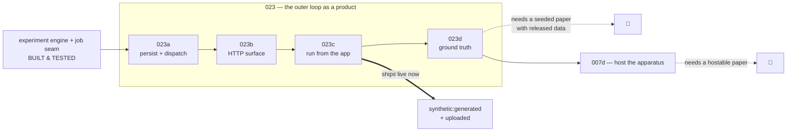
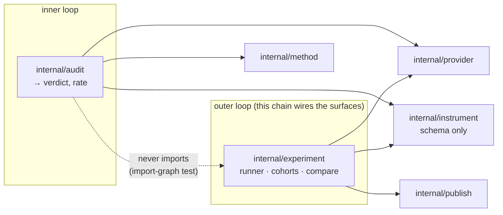

# 023 — The outer loop, as a product

**Status:** draft. Parent of [023a](023a-experiments-persisted-and-dispatched.md), [023b](023b-the-experiment-http-surface.md), [023c](023c-running-an-experiment-from-the-app.md), [023d](023d-ground-truth-for-a-cohort.md).

**Scope:** wire the experiment engine — built and tested in [007b](007b-experiments-over-instruments.md) and [007c](007c-the-synthetic-pilot.md) — to a person. The engine can already run all four data sources; nothing user-facing can reach it. This parent holds the decisions the four leaves share and the order they land in, and it records why the sequence is what it is.

**Depends on:** [007b](007b-experiments-over-instruments.md) (the runner, the store interfaces), [007c](007c-the-synthetic-pilot.md) (the cohorts and the indelible label), [006b](006b-job-model-and-persistence.md) (the job lifecycle the dispatch reuses), [015](015-a-verdict-belongs-to-a-session.md) (a repository, and now an experiment, belongs to the session that produced it).

## Problem

Three things are already true, and together they say what is missing:

- The experiment engine is done. `internal/experiment` holds the runner, `Compare`, the `generated` and `model` cohorts, `PILOT.md`, the sweep, and the firewall test. `internal/instrument` holds the schema. Both golden cases still pass.
- The job model is ready for it. `job.KindExperiment` exists, and `internal/job/worker.go` already says the composition root supplies a `Runner` that "dispatches on `Job.Kind` to `audit.Auditor` or `experiment.Runner`." The seam is cut; nothing fills it.
- `instrument.json` is published. It is in `publish.Classify`'s allowlist ([gate.go](../internal/publish/gate.go)), so every reproduction since [007a](007a-the-study-protocol-as-an-artifact.md) carries a real instrument for an experiment to bind to.

So the whole of what remains is the path from a researcher to that engine: persistence, dispatch wiring, an HTTP surface, and a screen. The README's own "still open in the server" line names it — the experiment `Kind` callee, the Postgres stores for 007b/007c, nothing more.

## The decisions the leaves share

**An experiment belongs to the session that produced its instrument, not to the project.** The 007b engine keys an `Experiment` on `ProjectID` alone. That is [015](015-a-verdict-belongs-to-a-session.md)'s bug waiting to happen again: a project holds many papers ([012](012-a-project-holds-papers.md)), and a repository — the thing an instrument resolves from — hangs off a session. So the persistence keys an experiment to the **session and paper** whose instrument it ran and addresses it under `/p/{id}/s/{jobId}/…`, so two papers' experiments never hide behind one another. This is settled here, at the schema, before it is built.

**Offline and people-free sources ship first; the two that need a new input come last.** The engine has four sources, but they do not carry equal risk or equal readiness. `synthetic:generated` (deterministic, no model, no credits) and `uploaded` (a researcher's own data) need no participants, no ground truth, and no anonymous write path — they exercise the whole product at the cheapest risk. `synthetic:model` and `released` re-analysis are near-free on the same runner but epistemically empty without a paper that released data to check against. Hosting real participants ([007d](007d-hosting-a-study.md)) is last, for the reasons that spec already carries.

**The census makes this a corpus fact, not only a caution.** Every published `instrument.json` was read while writing this chain. Three carry a real protocol and analysis, and across them **0 of 26 protocol components are servable** and **0 of 3 papers' raw released data is held** — they are physical, field, and interview studies. So `007d` has nothing to host today and `synthetic:model`/`released` have no ground truth today; both are blocked on **corpus**, not code. `synthetic:generated` and `uploaded` are the two sources with live input. The two unlocks are papers to reproduce, not features to build — recorded so the sequence is not mistaken for a limitation of the engine.

**No new execution path, no new trust posture.** Every leaf reuses what exists: the job lifecycle ([006b](006b-job-model-and-persistence.md)), the provider sandbox with a read-only mount ([006f](006f-taking-a-reproduction-out.md), [007b](007b-experiments-over-instruments.md)), the fail-closed access gate ([006c](006c-identity-and-access.md)), and the SSE stream the audit already uses. This chain adds surfaces, not machinery.

**And it preserves the one boundary the track is built on.** The audit writes `verdict` and `rate`; no experiment ever does, and — the stronger half — `internal/audit` never imports `internal/experiment`, so a cohort cannot inform a verdict by any side door. This chain adds an executor and its surfaces on the outer-loop side of that wall and touches nothing on the audit side.

*The firewall is one-way and compiler-adjacent: the dashed edge is the one a test asserts never appears. Re-auditing a paper yields the same verdict whether a thousand cohorts ran against its instrument or none.*

## The leaves

| Child | Scope | Depends on |
|---|---|---|
| **[023a](023a-experiments-persisted-and-dispatched.md) — Experiments persisted and dispatched** | the Postgres `experiment.Store` + `Dataset` store and migration (`cohort_kind` NOT NULL); the composition-root `Runner` that dispatches `KindExperiment` → `experiment.Runner`; the deployment `ArtifactStore`; ownership keyed to session/paper | 007b, 007c, 006b, 015 |
| **[023b](023b-the-experiment-http-surface.md) — The experiment HTTP surface** | the routes to bind an instrument to a source, upload and validate a dataset, list, and read the outcome, `PILOT.md`, and the comparison; authenticated and session-scoped | 023a, 006a, 006c |
| **[023c](023c-running-an-experiment-from-the-app.md) — Running an experiment from the app** | the screen: start an experiment from a session, pick a source (`synthetic:generated` and `uploaded` first), upload data, watch it run over SSE, read the result | 023b, 006e, 013, 021 |
| **[023d](023d-ground-truth-for-a-cohort.md) — Ground truth for a cohort** | `synthetic:model` and `released` behind the released-data gate, the calibration rendering that reads as a statement about the model, and the seeded-paper prerequisite | 023c, 007c |

## Acceptance criteria

Track invariants, verified as the leaves land:

1. Every invariant of [007](007-from-reproduction-to-replication.md) still holds. No experiment writes `verdict` or `rate`; `internal/audit` still never imports `internal/experiment`; a synthetic result cannot reach a reader stripped of its `cohort_kind`.
2. An experiment is reachable under the session and paper that produced its instrument, and a project holding two papers never shows one paper's experiment under the other.
3. A job of `KindExperiment` runs `experiment.Runner` through the same lifecycle, worker, and progress stream as an audit — asserted end to end, not only on the seam.
4. `synthetic:generated` and `uploaded` run end to end from the app; `synthetic:model` and `released` are refused server-side wherever the released data is not held, and the refusal names the reason.
5. Every new surface is tested on the project's existing terms — fake forge, stub issuer, in-process provider — with no network or credential.

## Out of scope

Hosting real participants ([007d](007d-hosting-a-study.md)) — its own spec, after this chain and a hostable paper. Recruitment, payment, and ethics review — [007](007-from-reproduction-to-replication.md) places them outside the track. Reproducing the two papers the unlocks need — a corpus action, tracked separately from this build.
