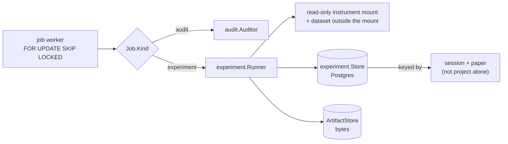
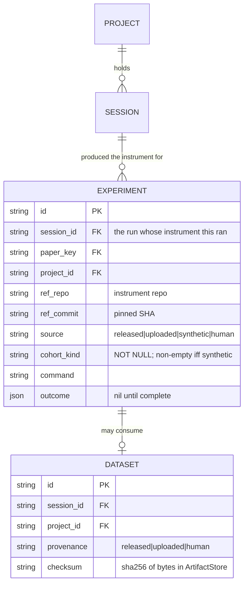
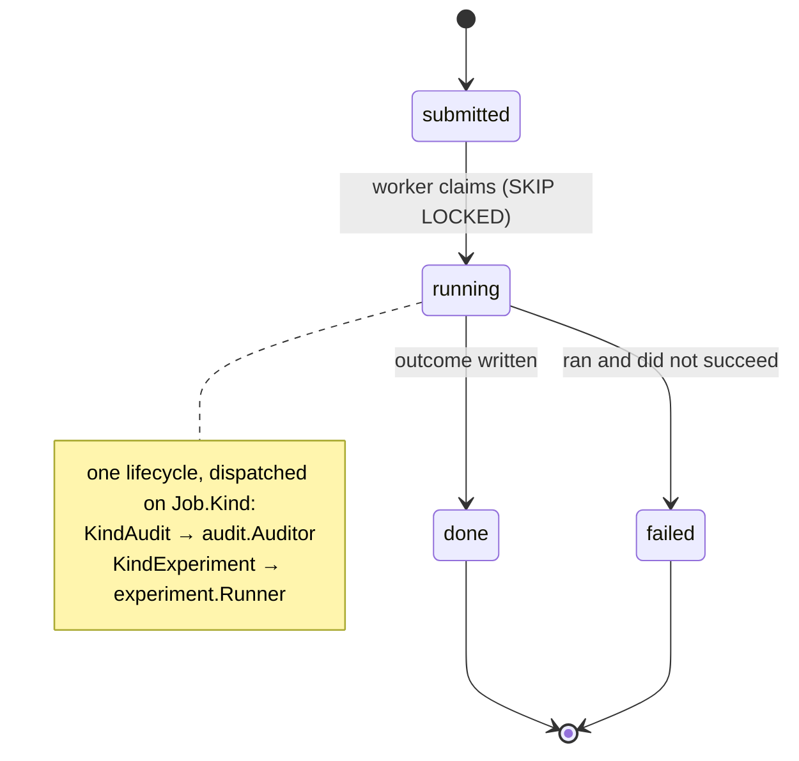

# 023a — Experiments persisted and dispatched

**Status:** draft. A child of [023](023-the-outer-loop-as-a-product.md).

**Scope:** give the experiment engine the two things it was built without — a place to store what was run, and a worker that runs it. The Postgres `experiment.Store` and `Dataset` store with their migration, the deployment `ArtifactStore` for bytes, and the composition-root `Runner` that fills the `KindExperiment` seam. Nothing user-facing; this is the foundation the rest of the chain stands on.

**Depends on:** [007b](007b-experiments-over-instruments.md) (the `Store`/`ArtifactStore` interfaces and the runner this persists behind), [007c](007c-the-synthetic-pilot.md) (`cohort_kind`, which becomes a `NOT NULL` column here), [006b](006b-job-model-and-persistence.md) (the job lifecycle, worker, and Postgres pattern), [015](015-a-verdict-belongs-to-a-session.md) (ownership keyed to the session).

## Problem

[007b](007b-experiments-over-instruments.md) shipped the engine "before Postgres exists," so `experiment.Store` and `ArtifactStore` are interfaces with in-memory and filesystem implementations, and the runner is called directly, never by a worker. [007c](007c-the-synthetic-pilot.md) added `cohort_kind` as a struct field and said it "becomes a `NOT NULL` column when 006b lands." 006b has landed. This spec is the persistence and the wiring those two specs deferred to it by name.

It also has one correction to make. The engine keys an `Experiment` and a `Dataset` on `ProjectID` alone. A project holds many papers ([012](012-a-project-holds-papers.md)) and an instrument resolves from a repository that belongs to a *session* ([015](015-a-verdict-belongs-to-a-session.md)), so `ProjectID` is the foreign key that reproduces 015's bug. The schema fixes it before it is built.

## Decisions

**The Postgres `experiment.Store` implements the interface 007b fixed, unchanged.** `CreateExperiment`, `GetExperiment`, `UpdateExperiment`, `ListExperiments`, and the three dataset methods land against Postgres exactly as 006b's job store did — same `internal/*/migrate.go` shape, same in-memory fake kept for tests. The engine is not touched; only an implementation is added behind a settled contract.

**An experiment carries its session and paper, and lists by them.** `Experiment` and `Dataset` gain the `session_id` (the job that produced the instrument) and the `paper_key` alongside `project_id`. `ListExperiments` gains a session-scoped read, because that is the one the app addresses at `/p/{id}/s/{jobId}/…`. Keeping `project_id` too is deliberate — a project-wide read is still legitimate — but the session key is the one that stops two papers colliding.

*The `session_id`/`paper_key` keys are the whole correction: an experiment resolves to the reproduction it ran, so the app reads it under that session and two papers never collide.*

**`cohort_kind` is `NOT NULL`, empty for a non-synthetic source.** The column is the durable half of [007c](007c-the-synthetic-pilot.md)'s indelible label: a synthetic row cannot exist in the table without it. A `released`, `uploaded`, or `human` row stores the empty string, which the type system already allows and the check constraint permits only for non-synthetic sources.

**Result bytes live in an `ArtifactStore` the deployment owns, keyed by experiment.** The metadata plane (Postgres) holds rows and checksums; the bytes — the uploaded dataset and the analysis outputs — live in the `ArtifactStore` under `DatasetKey`/result keys, as 007b defined. Production wires a concrete store (filesystem on the mounted volume for the MVP, the same seam [008](008-drive-data-plane.md) later moves); tests wire the in-memory one. Deleting a dataset cascades to its bytes, as 007b's contract requires.

**The composition root supplies the dispatching `Runner`.** `cmd/server` builds one `job.Runner` that switches on `Job.Kind`: `KindAudit` calls the auditor it already builds, `KindExperiment` calls `experiment.Runner` with the instrument mounted read-only and the dataset attached outside the mount. The worker, its `FOR UPDATE SKIP LOCKED` claim, and its progress observation are reused with no change — [007b](007b-experiments-over-instruments.md) promised exactly this, and 006b already carries the lifecycle.

*A failed experiment is a finding about the instrument, not an error to repair — `failed` is a legitimate terminal state, exactly as an audit's is. The worker runs; it does not fix the analysis.*

**No push credential enters an experiment sandbox.** The mount carries 007b's `ReadOnly` intent. Enforcement is the token's GitHub scope, which is [009](009-secret-containment-when-the-agent-commits-live.md)'s open two-token split; until it lands the mount expresses the intent and a read-only token makes it real. The dataset lands outside the mount, so a researcher's data physically cannot be committed into a reproduction.

## Acceptance criteria

1. The Postgres `experiment.Store` passes the same contract test suite as the in-memory fake, including round-tripping an `Outcome` and a `cohort_kind`.
2. The migration adds the experiment and dataset tables with `session_id` and `paper_key` columns and a `cohort_kind` that is `NOT NULL`, non-empty exactly when the source is synthetic. A migration test asserts the constraint.
3. `ListExperiments` scoped to a session returns only that session's experiments; a project with two papers, each with an experiment, never returns one under the other.
4. A `KindExperiment` job runs `experiment.Runner` to completion through the real worker, and a `KindAudit` job still runs the auditor — one dispatcher, asserted for both kinds.
5. The experiment sandbox receives a read-only mount and a dataset placed outside it; no path writes a push credential into it, asserted structurally.
6. Everything is tested with the in-memory provider and store — no network, no credential.

## Out of scope

The HTTP surface ([023b](023b-the-experiment-http-surface.md)) and the screen ([023c](023c-running-an-experiment-from-the-app.md)). The released-data gate for `synthetic:model` ([023d](023d-ground-truth-for-a-cohort.md)) — this spec persists a cohort but does not decide when one may run. The read-only *token* — [009](009-secret-containment-when-the-agent-commits-live.md) owns it; this spec expresses the intent at the mount.
