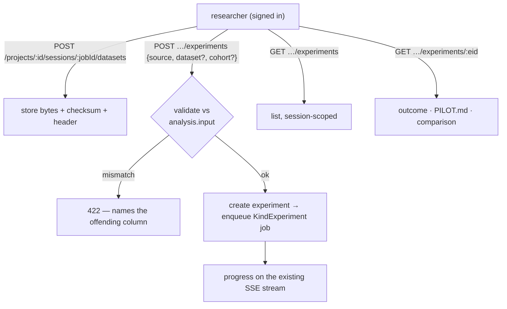
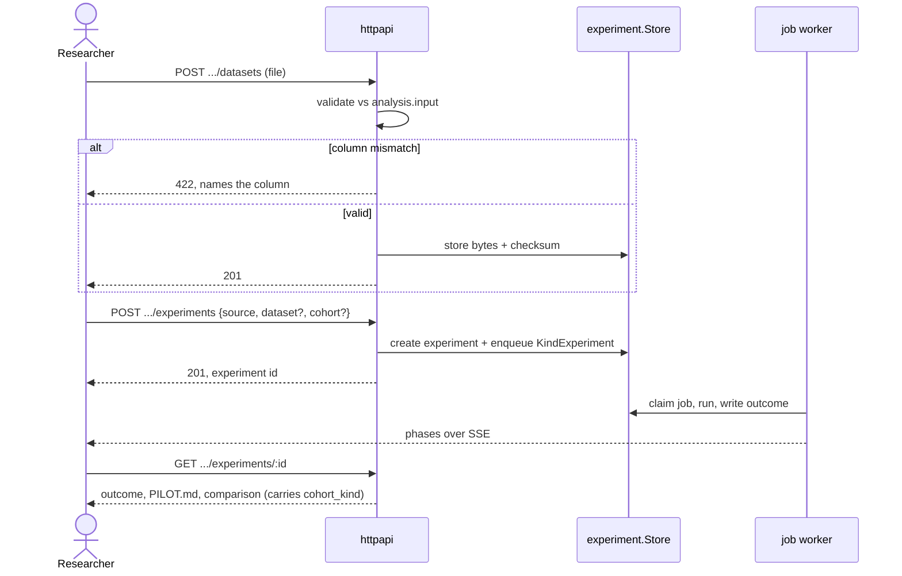

# 023b — The experiment HTTP surface

**Status:** draft. A child of [023](023-the-outer-loop-as-a-product.md).

**Scope:** the authenticated HTTP routes that let a researcher bind an instrument to a data source, upload a dataset and have it validated before a sandbox ever starts, enqueue the run, and read back the outcome, the `PILOT.md`, and the comparison. The server half of the chain; no screen yet.

**Depends on:** [023a](023a-experiments-persisted-and-dispatched.md) (the store and the dispatching runner these routes drive), [006a](006a-http-api-and-streaming.md) (the router, the SSE stream, the read surfaces), [006c](006c-identity-and-access.md) (the fail-closed gate every route passes).

## Problem

[023a](023a-experiments-persisted-and-dispatched.md) can persist an experiment and a worker can run it, but only Go code can start one. `internal/httpapi` has no experiment route at all. This spec adds them, and it puts the one piece of validation that belongs in the server — checking an uploaded dataset against the instrument's declared input schema — in front of the sandbox, so a malformed file is a good error rather than a failed run.

## Decisions

**The routes are session-scoped, and every one is behind the gate.** They live under `/projects/{id}/sessions/{jobId}/…`, matching [015](015-a-verdict-belongs-to-a-session.md)'s address for the thing an instrument resolves from. `POST …/experiments` binds one instrument to one source and enqueues the job; `POST …/datasets` uploads bytes; `GET …/experiments` lists; `GET …/experiments/{eid}` returns the outcome and its artifacts. The fail-closed access gate ([006c](006c-identity-and-access.md)) resolves membership per request — an experiment is a write to a project, so it needs a member, and reading needs view rights, exactly as the archive ([020](020-download-the-whole-project.md)) does.

**Input is validated in the server, before a sandbox exists.** `analysis.input` from [007a](007a-the-study-protocol-as-an-artifact.md) declares the columns, types, units, and which are required. An uploaded dataset is checked against it on `POST …/datasets`, and a mismatch is a `422` that names the offending column — never a run started to discover inside a script that column three is a string. This is [007b](007b-experiments-over-instruments.md)'s "validated in the server" decision, given its route.

**A synthetic run needs no dataset; an uploaded run needs a valid one.** The request body carries the `source` and, for `synthetic`, the `cohort_kind` and its parameters (seed, optional effect). The server refuses an incoherent binding — an `uploaded` source with no dataset, a `synthetic` source with one — before enqueuing. What it does *not* decide here is whether a `synthetic:model` cohort is *allowed*; that gate is [023d](023d-ground-truth-for-a-cohort.md)'s.

**Progress reuses the audit's stream; results reuse the read surface.** An experiment job emits phase progress on the same SSE stream a submitted paper already streams to `done` ([006a](006a-http-api-and-streaming.md)) — the client watches an experiment exactly as it watches an audit. The result read returns the `Outcome` and serves `PILOT.md` and the comparison from the `ArtifactStore`, so no new streaming or artifact machinery is introduced.

*Validation happens in the server round-trip, before any sandbox exists — a malformed dataset is a named-column error, never a failed run.*

**The synthetic label survives the API.** Every experiment response carries `cohort_kind`, and a `synthetic` result is served as `PILOT.md`, never `RESULTS.md` — [007c](007c-the-synthetic-pilot.md)'s criterion 5 tested at the one boundary that leaves the server. An API response a reader could mistake for evidence about people is the failure this route is written to prevent.

## Acceptance criteria

1. A signed-in member can create a `synthetic:generated` experiment and an `uploaded` experiment over a session's instrument, watch each run on the SSE stream, and read its outcome; a non-member is refused by the gate on every route.
2. An uploaded dataset that violates `analysis.input` is rejected with a `422` naming the offending column, and no job is enqueued.
3. An incoherent binding — `uploaded` without a dataset, `synthetic` with one — is refused before enqueue.
4. `GET …/experiments` returns only the addressed session's experiments (023a's session scope, surfaced).
5. Every experiment API response carries `cohort_kind`, and a synthetic result is served as `PILOT.md`; a test asserts no response path drops the label.
6. Tested end to end with the in-process provider and store — no network, stub issuer for identity.

## Out of scope

The screen ([023c](023c-running-an-experiment-from-the-app.md)). The `synthetic:model` released-data gate ([023d](023d-ground-truth-for-a-cohort.md)). The anonymous participant write path — that is [007d](007d-hosting-a-study.md)'s, and it is deliberately a *different* origin from these authenticated routes.
