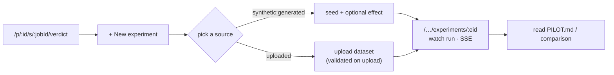
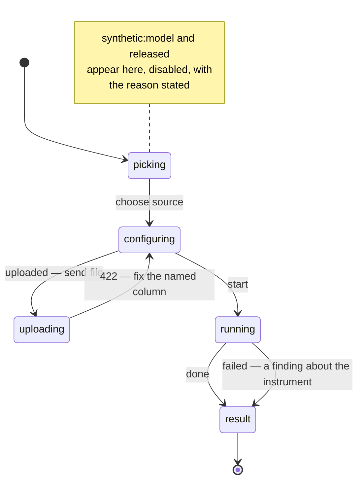

# 023c — Running an experiment from the app

**Status:** draft. A child of [023](023-the-outer-loop-as-a-product.md).

**Scope:** the screen. From a finished session, a researcher starts an experiment, picks a data source — `synthetic:generated` and `uploaded`, the two with live input — uploads data where the source needs it, watches the run stream, and reads the pilot or the comparison. This is where the outer loop becomes something a person does rather than a capability the engine holds.

**Depends on:** [023b](023b-the-experiment-http-surface.md) (the routes it calls), [006e](006e-frontend.md) (the frontend and its components), [013](013-the-address-bar-is-the-state.md) (every screen is a URL), [021](021-what-the-run-actually-found.md) (the session screens this extends).

## Problem

[021](021-what-the-run-actually-found.md) built the screens that read what a run found — the verdict, the findings, what the authors released — all under `/p/{id}/s/{jobId}/…`. An instrument is right there, in the session's own artifacts, and there is no way to run it. This spec adds the one action those screens are missing: take this instrument and bind it to new data.

## Decisions

**The experiment lives on the session, at its own address.** A session gains an Experiments view at `/p/{id}/s/{jobId}/experiments`, listing what has been run against this instrument and offering to start another; a single run reads at `/p/{id}/s/{jobId}/experiments/{eid}`. This is [013](013-the-address-bar-is-the-state.md)'s rule — a screen is a URL — applied so an experiment can be linked, reloaded, and found where its instrument is.

**Only the two live sources are offered, and the screen says why the others are not.** The source picker shows `synthetic:generated` and `uploaded`. `synthetic:model` and `released` appear disabled with the honest reason — "needs the paper's released data, which this reproduction does not hold" — rather than hidden, so the boundary is legible and [023d](023d-ground-truth-for-a-cohort.md) has only to enable them. This is the same posture the product takes elsewhere: state the wall, do not pretend it is not there.

**Upload validates in the browser's round-trip, not after the run.** The uploaded-data flow posts to [023b](023b-the-experiment-http-surface.md)'s dataset route and surfaces the `422`'s named column inline, at the field, before an experiment is created. A researcher fixes the header and retries without ever starting a sandbox.

**Watching an experiment reuses watching an audit.** The run view subscribes to the same SSE stream the session screen already uses ([021d](021d-watching-a-session-run.md)), so phases and progress render through the existing component. Nothing new is built for streaming; an experiment simply is another kind of job to watch.

*The screen's states mirror the server's: a validation `422` returns the researcher to configuring with the column named, and a `failed` run still reaches a result, because a pipeline that did not run is itself a finding.*

**A synthetic result is unmistakable on screen.** The result view renders a `synthetic` outcome as a pilot — titled `PILOT.md`, opening with what it does not establish, and never using the vocabulary of a finding about people. A comparison from a synthetic cohort reads as "how close a model cohort came," a `released` one as re-analysis; the label drives the copy, per [007c](007c-the-synthetic-pilot.md). No control implies a synthetic run tested a claim about the world.

**In-app widgets, per the house rule.** The source picker, the disabled-with-reason options, the file field, and any tooltip are the app's own components, portalled where they must overlay — no browser-native `select`, `prompt`, or `title` tooltip, consistent with the project's frontend convention.

## Acceptance criteria

1. From a session's screens, a researcher starts a `synthetic:generated` experiment (seed, optional effect) and an `uploaded` experiment (file), each at its own URL, and both reload and deep-link.
2. `synthetic:model` and `released` are shown disabled with a stated reason, not hidden.
3. An uploaded file that violates the input schema shows the offending column inline before an experiment is created; a valid file proceeds.
4. The run view streams phases over the existing SSE component to completion, and the result view renders the outcome — a synthetic one as a pilot, indelibly labelled.
5. Covered by the frontend's unit and browser suites on the project's existing terms, against a stubbed API.

## Out of scope

Enabling `synthetic:model` and `released` ([023d](023d-ground-truth-for-a-cohort.md)) — this screen offers them disabled and does no more. Hosting a study for participants ([007d](007d-hosting-a-study.md)). Any cross-project or cross-paper experiment view — an experiment is read where its instrument is.
