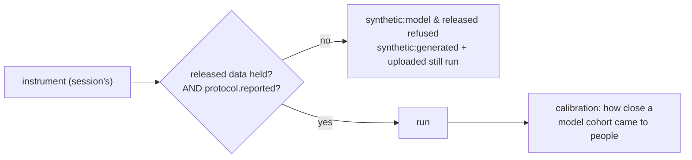

# 023d — Ground truth for a cohort

**Status:** draft. A child of [023](023-the-outer-loop-as-a-product.md).

**Scope:** enable the two sources the rest of the chain left disabled — `synthetic:model` and `released` re-analysis — behind the one gate that makes them honest: the platform must hold the paper's released data to check them against. Plus the calibration rendering that keeps a model cohort's result a statement about the model, and the record that the missing input is a paper, not code.

**Depends on:** [023c](023c-running-an-experiment-from-the-app.md) (the screen that shows these two disabled), [007c](007c-the-synthetic-pilot.md) (`GateModelCohort`, the comparison, the label).

## Problem

A model cohort on a paper with no released data emits numbers nobody can falsify — the exact failure the whole 007 track is built to avoid. [007c](007c-the-synthetic-pilot.md) already decided the defence: `synthetic:model` is available only where the platform holds released data *and* the paper reported its headline result, so every model cohort can be checked against a real answer immediately. `GateModelCohort(inst, releasedAvailable)` exists in the engine. This spec supplies the gate its `releasedAvailable` fact from the store, wires the same fact to enable `released` re-analysis, and turns [023c](023c-running-an-experiment-from-the-app.md)'s disabled options on where it holds.

It is last in the chain for a reason the census makes concrete: across the three real instruments published today, the platform holds **zero** papers' raw released data. So this spec's routes work, and have no live input until a paper that released data is reproduced. That unlock is a corpus action, and this spec records it rather than papering over it.

## Decisions

**Released availability is a store fact, supplied to the gate.** Whether the platform holds a paper's released data is a `Dataset` row of `released` provenance for that instrument ([023a](023a-experiments-persisted-and-dispatched.md)), never a field on `instrument.json` — [007c](007c-the-synthetic-pilot.md) is explicit that the audit reads the paper, not a deployment's holdings. The server reads the row and passes `releasedAvailable` to `GateModelCohort`; the gate, not the caller, decides. `released` re-analysis is gated on the same fact, because it too has nothing to run without the data.

**The gate is server-side, and the refusal names the reason.** A request to bind `synthetic:model` or `released` where the data is not held is refused at [023b](023b-the-experiment-http-surface.md)'s route with a reason a person can act on — "the paper's released data is not held," not a generic `403`. [023c](023c-running-an-experiment-from-the-app.md)'s disabled options become enabled exactly when the gate would pass, so the screen and the server never disagree.

**A model cohort's result is a statement about the model.** `Compare` is reused — comparing a cohort's statistics against `protocol.reported` is the right arithmetic — but the rendering reads as calibration: how close a model cohort came to what people did, which measures the cohort and never the paper. The `Source` on the `Comparison` distinguishes it from a `released` re-analysis, which reads as recomputing the paper. Same numbers, different subject, per [007c](007c-the-synthetic-pilot.md).

**The gate is a restriction to relax deliberately, not a permanent law.** [007c](007c-the-synthetic-pilot.md) frames the ground-truth requirement as a v1 safeguard, to be loosened once calibration has been measured on papers where it can be. This spec ships the safeguard; loosening it is a later decision with evidence behind it, not a default.

**The unlock is a paper.** Enabling these sources for real means reproducing a paper that released its raw data and reported its headline result. That is tracked as a corpus action outside this spec; this spec makes the machinery correct and dormant until the input exists, and says so plainly so a dormant route is not mistaken for a broken one.

## Acceptance criteria

1. `synthetic:model` and `released` run end to end for an instrument whose released data the store holds, and are refused server-side, with a stated reason, for one that does not — asserted at the route.
2. The refusal decision comes from `GateModelCohort` fed by a store read, not from a field on `instrument.json`; a test asserts no instrument-declared field controls it.
3. A model cohort's comparison renders as calibration ("how close a model cohort came"), distinct from a `released` re-analysis, and carries `cohort_kind` throughout.
4. [023c](023c-running-an-experiment-from-the-app.md)'s options enable exactly when the gate passes; screen and server never disagree.
5. Tested with the in-process provider and store, including both the held and not-held cases — no network.

## Out of scope

Relaxing the ground-truth gate — a later decision with calibration evidence. Reproducing the paper that unlocks these sources — a corpus action. Hosting real participants ([007d](007d-hosting-a-study.md)).
