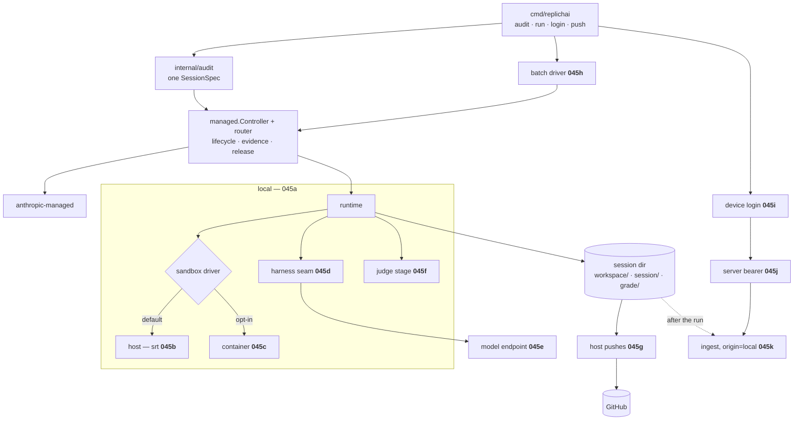
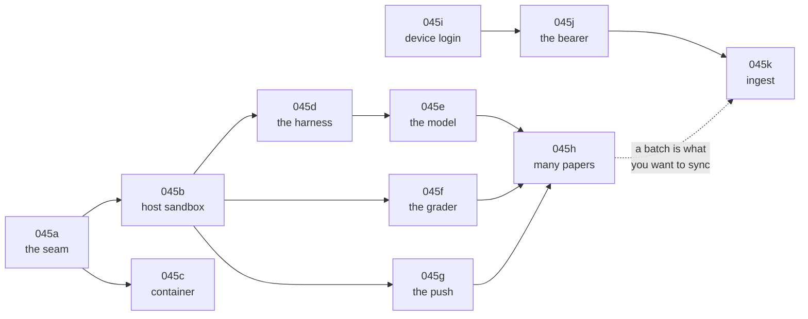

# 045 — The run happens on your machine

**Status:** built (eleven children). Parent of [045a](045a-the-sandbox-is-a-seam.md), [045b](045b-the-host-sandbox.md), [045c](045c-the-container-sandbox.md), [045d](045d-the-harness-inside-the-sandbox.md), [045e](045e-the-model-is-an-endpoint.md), [045f](045f-the-grader-cannot-edit-what-it-grades.md), [045g](045g-the-host-pushes.md), [045h](045h-many-papers-at-once.md), [045i](045i-signing-in-from-the-terminal.md), [045j](045j-a-bearer-the-api-accepts.md), [045k](045k-a-local-session-reaches-the-cloud.md).

**Scope:** make `replichai` able to run a full replication session on the operator's own machine: a sandbox around a folder, a coding harness inside it, a model reached through whatever endpoint the operator points at, a grader that cannot edit what it grades, a repository pushed from the host, and many papers at once. Then let those sessions reach `replichai.latere.ai` as first-class rows. One new managed runtime with two sandbox drivers, one new CLI surface, one new server credential path, one new job origin.

**Depends on:** [041a](041a-one-managed-session-contract.md) (the contract this plugs into), [041b](041b-one-managed-session-lifecycle.md) (the controller that drives it), [041c](041c-a-session-remembers-its-runtime.md) (routing by name), [044](044-a-run-that-produced-nothing.md) (what a run owes before it may claim success), [009](009-secret-containment-when-the-agent-commits-live.md) (the constraint this path escapes), [006b](006b-job-model-and-persistence.md) and [011](011-what-a-session-costs.md) (what an unbilled session must not touch).

## Problem

`replichai audit` can only run against Anthropic's managed backend. That single fact has four separate costs:

- **Nobody else can run the method.** A contributor with no Managed Agents access cannot exercise the engine at all, and the golden set can be re-run by one account.
- **The model is closed.** `internal/runtimes/builtin` names one vendor and one credential. An open-weights model behind a gateway has no way in, so the method cannot be checked against a model whose weights a reader can inspect. For a tool whose subject is reproducibility, that is a weakness.
- **The harness is not ours.** The worker loop, the tools it has, and the transcript it emits belong to the backend. When a run fails the way [044](044-a-run-that-produced-nothing.md) failed, the only lever is the method text.
- **Parallelism is somebody else's quota.** A replication project is a list of papers, and running it means running twenty sessions. Today that is twenty hosted sessions against one vendor's concurrency limits.

The seam to fix it already exists and is the one this deck plugs into. `managed.Runtime` is ten methods, held to a shared conformance suite in `internal/managed/contracttest`, composed explicitly in `internal/runtimes/builtin`. Nothing above it names a vendor. A local runtime is a peer of `anthropic-managed`, not a fork of the program.

## The decisions the leaves share

**One runtime, not one per sandbox or per harness.** `local` is the runtime. The sandbox is a driver inside it ([045a](045a-the-sandbox-is-a-seam.md)) and the harness is an adapter inside it ([045d](045d-the-harness-inside-the-sandbox.md)). A `managed.Runtime` per combination multiplies three ways, and the runtime name is what a persisted `SessionRef` routes through: a name encoding three orthogonal choices has to be migrated whenever one of them changes.

**A container is not the point; a boundary is.** The default sandbox is `srt` (Seatbelt on macOS, bubblewrap with seccomp on Linux), confining the harness already installed on the machine to one folder, with an allow-only network policy. It starts in milliseconds, needs no image and no virtual machine, and reuses the harness's own login rather than demanding a raw API key. The container driver stays, opt-in, for the one thing the host cannot give: a toolchain pinned identically on every operator's machine, which is what CI and cross-operator comparison need.

**Environment cleanliness is answered by recording it, not by assuming it.** Every local run writes `environment.json` (OS, architecture, sandbox driver, harness name and version, interpreter and package versions, the exact model reference) as system-authored evidence committed beside the transcript. A reader comparing two reproductions can see whether they ran on the same environment. Pinning gives a stronger guarantee and is available with one flag; recording is what makes an unpinned run accountable rather than silent.

**The workspace is a host directory, so the [044](044-a-run-that-produced-nothing.md) failure mode is structurally impossible.** Commits that are never pushed do not die with the sandbox, because the sandbox never held them. This is why the local path can push from the host ([045g](045g-the-host-pushes.md)) and why no forge credential ever enters a sandbox. That is the same containment [009](009-secret-containment-when-the-agent-commits-live.md) wanted and could not get within a one-hour installation token.

**The agent never writes its own evidence, and never grades itself.** The transcript is written by the host outside the workspace, which the sandbox denies the agent write access to; the grader runs as its own stage with the workspace read-only ([045f](045f-the-grader-cannot-edit-what-it-grades.md)). Both are the attestation model's rule stated as a filesystem permission rather than as an instruction: claim from the agent, evidence from the system, verdict from something that cannot edit what it grades.

**Nothing local touches the ledger.** The compute was bought from the vendor by the operator, with the operator's credential. A locally-executed session records its usage and its model, and `internal/credit` is not in the path: no reserve at insert, no settle at close, and no `ErrUnpriceable` refusal for a model nobody has a rate card for ([045k](045k-a-local-session-reaches-the-cloud.md)). A missing rate card is a fact about billing, and billing is not happening.

**A local session is an ordinary session everywhere else.** It lands in `jobs` with `origin = local`, under a project, filed against a paper by identity. Every read path (the project rail, the verdict screen, the transcript viewer, the publish gate, the sign-off) works unchanged, because a parallel table would duplicate all of them and [012](012-a-project-holds-papers.md), [015](015-a-verdict-belongs-to-a-session.md) and [032](032-a-session-can-be-thrown-away.md) already key off session-and-project.

## Why this is not 041g

[041g](041g-latere-runs-a-session.md) composes a hosted runtime from Topos, Cella, Lux and Auth, and is blocked on durable replay at the in-flight model/tool boundary. It answers "the platform runs your session on its infrastructure". This deck answers "you run your session on your laptop, and the platform holds the record". They differ in who owns the machine, who holds the model credential, who pays the vendor, and what happens when the process dies. Both are worth having: 041g is the product's own execution, 045 is how the method gets exercised by anybody outside the project, and how a replication project of twenty papers gets run without asking a vendor for concurrency.

They share the seam and the conformance suite, so neither is a fork.

## The order, and why

`045a`, `045b`, `045d`, `045e`, `045f` and `045g` are one runnable thing: after `045g` a single paper audits locally on an unmodified laptop and publishes. `045c` is independent and can land any time after `045a`; it is what CI needs, not what a first run needs. `045h` makes it a project. `045i`–`045k` are the cloud half and are independent of the runtime: the bearer and the ingest surface would be needed even if the local runtime never existed, which is why they are leaves rather than a section of `045h`.

## Acceptance criteria

The parent is met when its children are, and additionally:

1. `internal/runtimes/builtin` composes `local` alongside `memory` and `anthropic-managed`, and the new runtime passes `internal/managed/contracttest.Run` unchanged under **both** sandbox drivers. CI runs the suite as a matrix — one runner with `srt` and its dependencies installed, one with Podman — because a conformance claim about a driver nothing exercises is not one.
2. `replichai audit <paper> --runtime local --publish` produces, on a machine with a harness already installed and logged in and nothing else, the same seven output files as the hosted path, in a GitHub repository whose history is the agent's own commits plus the system's finalize commits.
3. The same command with `--sandbox container` produces the same result on a machine with only Podman and one model key.
4. No leaf introduces a code path in which a forge credential, a cloud credential, or a file outside the workspace and the harness's own configuration is readable from inside a sandbox that has network access and a shell.
5. `docs/architecture.md` gains the local path in the same session the runtime lands, because that document is what a reader consults before the specs.

## Not in scope

- Running a harness on the host with no sandbox at all. There is no degraded mode: a run either has a boundary or does not happen.
- Windows. macOS and Linux, on `arm64` and `amd64`. `srt` marks Windows alpha and the container path needs WSL2; the preflight says so and refuses.
- A hosted control plane for local runs. Nothing here polls a server, and a machine with no network beyond the model endpoint runs a complete audit.
- Replacing `anthropic-managed`. Both stay; the default stays what it is.
- Serving the model. What runs behind a gateway endpoint is the operator's business, GPU or otherwise.

## Outcome

Built, and then run against a real sandbox and real harnesses until a session finished. `replichai audit <paper> --runtime local` runs a complete session on an unmodified laptop with the operator's existing login and no API key: a bootstrap stage installs what the specification declared, a worker produces the reproduction in a workspace the sandbox confines it to, a judge grades it from a read-only copy, and the host verifies and pushes the committed tree afterwards. `replichai run` does the same for a whole project; `login`, `project` and `push` file the results in the app.

The runtime is `local`, composed in `internal/runtimes/builtin` beside `memory` and `anthropic-managed`, and it passes `contracttest` unchanged.

**Every defect had the same cause.** Every leaf here was written from documentation and reasoning, and every leaf passed its own tests, and a dozen defects were still present, each of them a fact about a real program that no fixture could have contained. srt refuses a wildcard, so the open network mode could not exist. Claude Code keeps its login in a keychain rather than a file, and needs a scratch directory or its shell tool fails before running anything. Codex is a Rust binary that will not trust an injected certificate authority. pip verifies through an operating-system service the sandbox does not open. `git` reads a global configuration the sandbox denies. A raw line that is not JSON cannot be stored in a `json.RawMessage`. A checkpoint derived from the caller's reference repeats while the journal moves.

The leaves record them individually. The general lesson belongs here: a spec deck for a component that composes other people's programs is a set of hypotheses, and the first real run is the experiment. Nothing in this deck was reliable until it had been run.

**What is still short**, each recorded on its leaf: evidence is not uploaded to the app and stays in the pushed repository; the container image is not published, so that driver is code without an artifact; no screen labels an imported session as locally executed; `environment.json` records where a run was allowed to go and not where it went; and the CI matrix this parent asked for is not configured, so the driver suites run where a developer has the tools and nowhere else.

## Not in scope

- Running a harness on the host with no sandbox at all. There is no degraded mode: a run either has a boundary or does not happen.
- Windows. macOS and Linux, on `arm64` and `amd64`. `srt` marks Windows alpha and the container path needs WSL2; the preflight says so and refuses.
- A hosted control plane for local runs. Nothing here polls a server, and a machine with no network beyond the model endpoint runs a complete audit.
- Replacing `anthropic-managed`. Both stay; the default stays what it is.
- Serving the model. What runs behind a gateway endpoint is the operator's business, GPU or otherwise.

## Outcome

Built. `replichai audit <paper> --runtime local` runs a complete session on an unmodified laptop: a bootstrap stage installs what the specification declared, a worker produces the reproduction in a workspace the sandbox confines it to, a judge grades it from a read-only copy, and the host verifies and pushes the committed tree afterwards. `replichai run` does the same for a whole project; `login`, `project` and `push` file the results in the app.

The runtime is `local`, composed in `internal/runtimes/builtin` beside `memory` and `anthropic-managed`, and it passes `contracttest` unchanged.

Three things diverged from this parent.

**The contract suite runs against a scripted driver, not against both real ones.** `internal/runtimes/local/localtest` is a sandbox driver that isolates nothing and scripts what a stage would have written, and `contracttest` runs `local` over it, so the runtime's own lifecycle is checked on any machine. The two real drivers are held to `sandbox/sandboxtest` instead, which the host driver runs where `srt` is installed and skips with its own reason where it is not. The CI matrix this parent asked for is not configured; the suites exist and nothing runs them on a machine with `srt` or Podman yet.

**A stage was added.** The bootstrap is 045a's, discovered while building: a specification declares packages and nothing installed them.

**`docs/architecture.md` gained the local path**, as this parent required.

**A whole audit was run.** arXiv 2603.01795 (`PleaSQLarify`, CHI '26), on the default one-hour budget, `--runtime local` with `claude-code` on the operator's own login and no API key: 17m44s, 527 events, verdict `partial` on a boundary table of eight inner-loop components, five verified against a reimplementation the agent wrote and ran. The judge graded it `passed`. All seven output files were produced, and `verdict.json` and `instrument.json` both validated except for one field of the wrong shape, which is recorded below.

That run found three things no test in this deck could have found, because all of them need a workspace that has installed something:

- The workspace is the repository and the build directory, and nothing system-owned separated them. A 258 MB virtualenv sat in the repository root, kept out of the commit only because the agent chose to write a `.gitignore`. The rule now belongs to the repository (`.git/info/exclude`), the harvest skips the same trees, and `publish.VerifyTree` bars a tree that carries one.
- The harvest copied 8200 files out of that workspace. Twenty-four were the reproduction.
- `instrument.json`'s `plan` was prose where the schema wants a list, and the validator called a well-formed document invalid JSON. A shape mismatch is now a violation naming the field, and the method states the shape.

Two limits of that rule are known and left as they are. The repository's ignore file can only match by name, so a virtualenv under an unexpected name is still committed on a `--publish` run; the harvest and `VerifyTree` both catch it structurally, so the reproduction is still produced and pushed, but the repository is barred from ever being made public rather than being kept clean in the first place. And `VerifyTree` reads extensions, so a `.sqlite` the agent generated itself (this run made one as a synthetic fixture) is barred on the same terms as a downloaded dataset. Both are the gate behaving as designed: it is a backstop that never allow-lists, and the method is the primary control.
