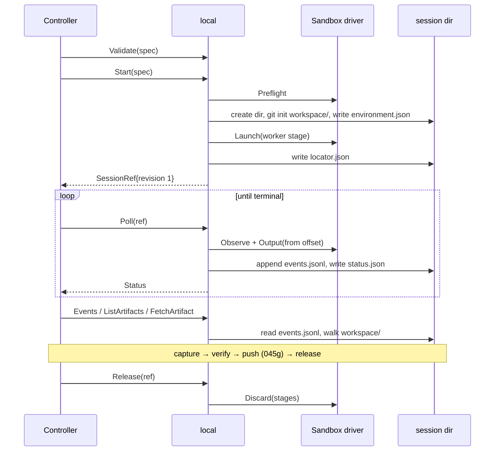

# 045a — The sandbox is a seam

**Status:** built.

**Scope:** `local`, a `managed.Runtime` that executes a session on the operator's own machine, and the `Sandbox` driver interface it runs everything through. The session directory, the capability declaration assembled from the driver, the locator, the transcript pump, cancellation and release. The two drivers are [045b](045b-the-host-sandbox.md) and [045c](045c-the-container-sandbox.md); the harness is [045d](045d-the-harness-inside-the-sandbox.md).

**Depends on:** [041a](041a-one-managed-session-contract.md), [041b](041b-one-managed-session-lifecycle.md), [041c](041c-a-session-remembers-its-runtime.md).

## Problem

`internal/runtimes/builtin` installs two runtimes: `memory`, which answers without doing anything, and `anthropic-managed`, which needs a vendor account. There is nothing in between: no way to run the real method with real tool use on hardware the operator controls.

The contract to satisfy is precise. `managed.Runtime` is ten methods; `Capabilities` must state what the backend can do so an unsupported specification is refused before anything is created; `SessionRef` must be enough, on its own, to recover a session after the process that started it has gone; evidence must stay readable until `Release`.

Two mechanisms can provide the boundary, an OS-level sandbox around a host process or a container, and they differ in exactly the ways that matter to a reproduction: how fast they start, what toolchain the work runs against, whether the harness's existing login is reachable, and how many can run at once. Choosing one and building the runtime around it would make the other a rewrite. So the choice is a driver.

## The runtime

The canonical name is `local`. It takes no aliases: `podman`, `docker` and `srt` name sandbox mechanisms, and a name that conflates the runtime with one of its interchangeable backends is the mistake [041](041-the-runtime-is-not-the-model-vendor.md) removed when it deleted the `anthropic` alias.

The driver is chosen at composition (`--sandbox host|container`, `REPLICHAI_SANDBOX`, defaulting to `host`), so one runtime instance has one driver and one capability declaration. That matters for restart: the locator records which driver started a session, and a `Poll` on an instance built with the other driver refuses the reference rather than inspecting a sandbox that was never there.

## The driver interface

```go
// Sandbox is a boundary a stage runs inside. It owns isolation, process
// lifetime and the raw output stream, and owns nothing about agents, models,
// grading or git.
type Sandbox interface {
    // Name is the driver's canonical name, recorded in the locator.
    Name() DriverName

    // Preflight reports whether this machine can run the driver at all,
    // returning a *NotReadyError carrying remediation when it cannot.
    Preflight(context.Context) error

    // Capabilities is the driver's half of the runtime's declaration:
    // package managers, network modes, attachment limits.
    Capabilities() DriverCapabilities

    // Launch starts one stage detached and returns a handle that survives
    // the calling process.
    Launch(context.Context, StageSpec) (StageHandle, error)

    // Observe reports whether a launched stage is still running, and its
    // exit status once it is not.
    Observe(context.Context, StageHandle) (StageStatus, error)

    // Output streams the stage's raw bytes from a given offset. It reads
    // from somewhere the stage itself cannot write.
    Output(context.Context, StageHandle, int64) (io.ReadCloser, error)

    // Stop terminates a running stage with a grace period.
    Stop(context.Context, StageHandle) error

    // Discard removes whatever the driver created. It never touches the
    // session directory: that is the runtime's, and the push has not
    // necessarily happened yet.
    Discard(context.Context, StageHandle) error
}
```

`StageSpec` carries the argv, the environment, the paths to allow read-only and read-write, the network policy, and the working directory. Everything in it is data the runtime computes; the driver interprets it into a Seatbelt profile, a bubblewrap invocation, or engine arguments.

The two rules that keep the seam sound, and that both drivers are tested against:

- **The stage's raw output is written somewhere the stage cannot reach.** For the container driver that is the engine's log; for the host driver it is a file under `session/`, which the sandbox denies writes to. Same guarantee, different mechanism.
- **A handle outlives the process that made it.** Detached mode is not an extra: it is how `--detach`, `replichai finish`, and a batch that survives a laptop lid closing all work.

## The session directory

Every session gets a fresh directory under `REPLICHAI_SESSION_ROOT` (default `~/.replichai/sessions`), named `<random>`, created `0700`:

```
7f3a91c2/
  workspace/          the agent's work, and the repository
  tmp/                downloads — the paper, datasets, anything third-party
  venv/               the session's language environment, outside the repository
  grade/              writable by the judge stage only (045f)
  session/            never writable by any stage
    events.jsonl      the normalized transcript, append-only
    status.json       the last observation: state, usage, model, times, terminal reason
    locator.json      the same journal the SessionRef carries
    environment.json  what this run ran on (045b)
    raw/<stage>.log   the stage's own stream, byte-for-byte
```

The split matters. `workspace/` is what becomes the repository, and everything the agent needs but must not publish (downloads, the language environment) is writable and adjacent rather than inside it. `session/` is evidence, authored by the host, and no stage can write it. Anything that blurs those two turns the transcript into something the subject of the audit can edit.

`workspace/` is `git init`-ed by the host before the first stage, with `init.defaultBranch=main` and a committer identity already configured, so a run cannot stall on git refusing an empty `user.email`. There is no remote ([045g](045g-the-host-pushes.md)).

## Capabilities

The runtime's declaration is the driver's, plus what the runtime itself provides:

```
OutputDir          <workspace path>       host driver: the real path; container: /workspace
PackageManagers    from the driver        host: pip (into a workspace venv), npm; container: the image's
NetworkModes       from the driver        host: none, allowlist, open; container: none, open
RepositoryModes    ro: true, rw: false
Evaluation         true                   (045f)
DurableEvents      true                   (events.jsonl)
Artifacts          true                   (a walk of workspace/)
Cancellation       true
MaxAttachmentBytes 64 MiB
MaxLocatorBytes    managed.DefaultMaxLocatorBytes
```

`rw: false` is a refusal, not a gap: the local path does not mount a writable remote, because the host pushes ([045g](045g-the-host-pushes.md)). A specification asking for a read-write repository is refused with a message naming that leaf, rather than being honoured by putting a forge token inside a sandbox.

`allowlist` differing between the drivers is the consequence of what each can enforce, and `ValidateCapabilities` is what turns it into a refusal before anything is created rather than a silently ignored policy. The audit's `NetworkOpen` specification runs on both.

## The locator, and what a restart recovers

```json
{
  "version": 1,
  "dir": "/Users/x/.replichai/sessions/7f3a91c2",
  "driver": "host",
  "stages": [
    {"role": "worker", "handle": "pid:48213@1724570400", "started_at": "..."},
    {"role": "judge",  "handle": "pid:48990@1724571120", "started_at": "..."}
  ]
}
```

Nothing in it is a credential, and `SessionRef.Validate` rejects any locator key containing `secret`, `token`, `credential` or `api_key`, so these field names are chosen to pass that check rather than to be exempted from it. Nothing in it is user content either.

A handle is opaque to the runtime and meaningful to its driver: a pid plus the process start time for the host driver (start time is what makes pid reuse detectable), a container name for the container driver.

`Poll` on a fresh process reads `locator.dir`, asks the driver to `Observe` the named stages, and answers from that plus `session/`. That is what makes `--detach` and `replichai finish` work locally: the state that matters is a directory and a process handle, both of which outlive the process that made them.

## Lifecycle



**Usage is monotonic by construction.** The pump folds decoded per-event usage into a running total held in `status.json`; it never reports a driver-supplied delta as a total. The controller's monotonicity check is therefore a real check on the decoder, not on arithmetic.

**Cancel** stops the running stage with a grace period, marks the session cancelled in `status.json`, and leaves the directory intact so evidence stays readable until `Release`.

**Release** discards what the driver created. What it does with the directory is policy: `REPLICHAI_SESSION_RETENTION` is `keep` (default), `on-failure`, or `discard`. The default is `keep` because the directory is the artifact: the workspace is the reproduction, and deleting it on success would destroy the only copy of anything the push has not yet taken. `replichai sessions ls` and `replichai sessions prune [--older-than 7d]` are how it gets cleaned up.

Release must not run before the push. The ordering is stated in [045g](045g-the-host-pushes.md) and enforced by the `Retain` hook, where finalize already lives.

## Acceptance criteria

1. `local` passes `internal/managed/contracttest.Run` without exception or skip, under both drivers, including the "a ref naming another runtime is refused" cases.
2. `builtin.Catalog` installs it, and `builtin_test.go`'s `Names()` assertion is updated to `["anthropic-managed", "local", "memory"]` rather than loosened.
3. A driver contract suite runs both drivers through the same cases: launch, observe to exit, read output from an offset, stop, discard, and a launched stage surviving the death of the launching process.
4. A session directory is `0700`, and no stage spec ever grants write access to `session/`. A test asserts it by inspecting the `StageSpec` the runtime builds for every stage under both drivers.
5. A `Poll` with a locator naming a driver this instance was not built with is refused with a message naming both drivers.
6. Killing the process mid-run and re-attaching by `SessionRef` alone yields the same terminal status and the same events, with no duplicated event ids.
7. `Poll` after `Release` returns `managed.ErrNotFound`; `Events` before `Release` succeeds after the session goes terminal.
8. `ValidateCapabilities` refuses a read-write repository resource under both drivers, and refuses an `allowlist` network under the driver that does not support it, each with a message naming the capability.
9. `Usage` reported by two consecutive polls never decreases, under a decoder fed a stream that repeats a cumulative total and one that emits deltas.
10. `Release` never deletes the session directory when retention is `keep`, including after a failed run.

## Not in scope

- A third driver. Two mechanisms cover the two real needs; a remote-machine driver is a spec of its own and would break the session-directory assumption.
- Resource limits as a product surface. Concurrency and per-stage limits are the batch driver's ([045h](045h-many-papers-at-once.md)).
- Interactive attach to a running stage. Sessions are non-interactive.
- Running the runtime inside the server. `cmd/server` continues to compose the hosted runtimes; a session executed locally reaches the app through [045k](045k-a-local-session-reaches-the-cloud.md), not by the server shelling out.

## Outcome

Built as `internal/runtimes/local`. The driver interface is what this spec describes, with one addition and one correction.

**`Capabilities` allocates the session the next `Start` will use.** The contract has a caller read the output directory and then start a session that writes to it, and on this runtime that directory is per-session: the workspace of a directory that does not exist until it is made. So `Capabilities` reserves one and `Start` consumes it, which is what makes the two calls agree. A `Capabilities` never followed by a `Start` leaves an empty directory for `sessions prune`. This is not in the spec above and is the one place the local runtime holds state between two contract calls.

**The harness version is read through the driver, not the harness.** This spec and 045d put a `Detect` on the harness; what shipped is `VersionArgv` on the harness and an optional `Version` on the driver, because where the harness lives differs by driver (a binary on the host, a program inside an image) and only the driver knows which.

**`replichai sessions ls` and `sessions prune` shipped with it.** Retention defaults to keeping a directory, which makes them accumulate by design, so reclaiming the space had to be something other than `rm -rf`. A `Capabilities` never followed by a `Start` leaves an empty one, and prune takes those too.

**A bootstrap stage runs first.** `internal/runtimes/local/bootstrap.go` prepares the language environment and installs the specification's declared packages before any agent runs, journalled and observable like every other stage. It is not in the sequence this spec drew.
