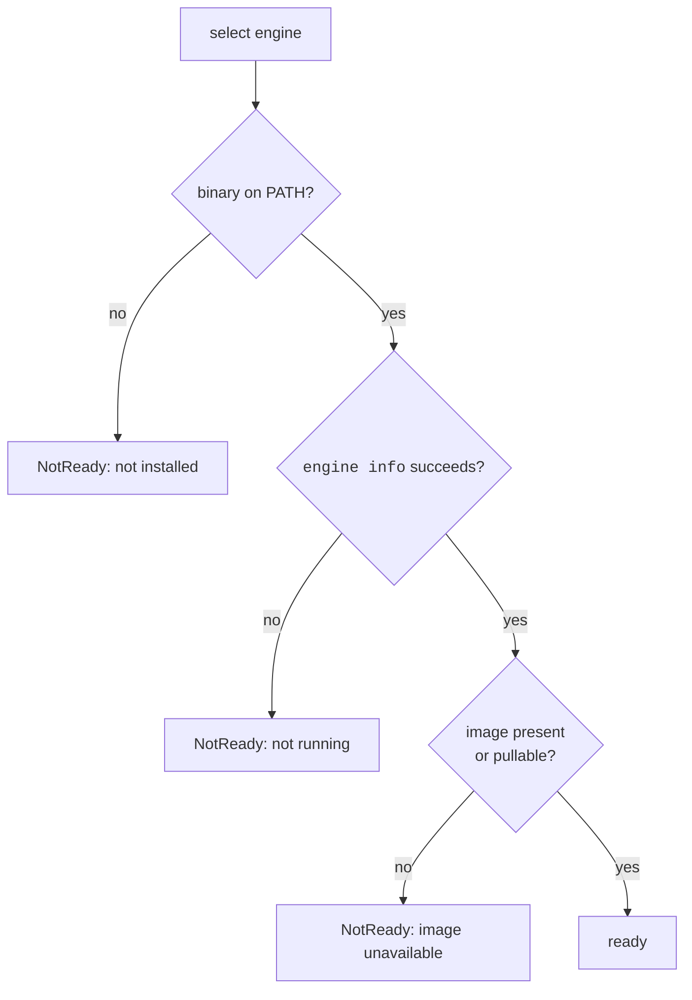

# 045c — The container sandbox

**Status:** built.

**Scope:** the second `Sandbox` driver: an OCI container, Podman by default and Docker supported, giving a toolchain pinned identically on every machine. The engine driver, the readiness preflight and the message it prints, the harness image, file ownership under rootless mappings, and what it does and does not declare. Opt-in with `--sandbox container`.

**Depends on:** [045a](045a-the-sandbox-is-a-seam.md), [045b](045b-the-host-sandbox.md) (the default it is an alternative to).

## Problem

The host sandbox runs against whatever the machine has. That is right for a first run and wrong for three cases:

- **CI.** The golden set is re-run to detect method regressions. A regression and a Python minor bump must not look the same.
- **Cross-operator comparison.** Two people reproducing one paper and disagreeing is only informative if the environment was the same.
- **A machine on which the agent should not be trusted.** Domain-filtered egress and a denied `$HOME` are a real boundary, and a kernel namespace is a stronger one.

None of those is the common case, which is why this is the second driver and not the first.

## The engine

Reached through four operations (run detached, inspect, remove, and a log stream), shelled out through `latere.ai/x/pkg/cmdexec` rather than a client library, so Podman and Docker are a table and not a dependency.

Selection order:

1. `REPLICHAI_CONTAINER_ENGINE`, if set. A value naming an unusable engine is an error, never a fallback: an operator who named an engine gets that engine or a message.
2. `podman`, if on `PATH` and usable.
3. `docker`, if on `PATH` and usable.

## The preflight

Three ordinary failures, three messages. Probed at construction, so a bad environment is reported before a paper is resolved or a repository created, and again at `Launch`, because a machine can be stopped between the two.



```
local: no container engine is installed.

Podman is the default:

    brew install podman                                   # macOS
    podman machine init --cpus 4 --memory 8192 --disk-size 100
    podman machine start

    sudo apt-get install -y podman                        # Debian, Ubuntu

Docker works too; set REPLICHAI_CONTAINER_ENGINE=docker after installing it.
Or use the host sandbox, which needs no engine:  --sandbox host
```

```
local: podman is installed at /opt/homebrew/bin/podman, but its virtual
machine is not running.

    podman machine start

If you have never initialised one:

    podman machine init --cpus 4 --memory 8192 --disk-size 100
    podman machine start

Then confirm with: podman info
```

```
local: podman is running, but the harness image is unavailable.

    podman pull ghcr.io/latere-ai/replichai-harness@sha256:<digest>

The image is public. Behind a proxy, set REPLICHAI_HARNESS_IMAGE to a
mirror holding the same digest.
```

On Linux the first message omits the machine, because rootless Podman there has no VM. Windows is refused, naming WSL2. Each message comes from a pure function of `(platform, engine, condition)`, testable with no engine present, and each names the host-sandbox alternative.

## The image

`ghcr.io/latere-ai/replichai-harness`, pinned by digest, published from its own repository, holding the pinned toolchain and both harnesses. What it declares about itself is a label the driver reads rather than a constant the code repeats:

```
org.replichai.managers = pip,npm,apt
org.replichai.harnesses = claude-code@2.1.4,codex@0.48.0
org.replichai.python = 3.13.2
```

`Capabilities.PackageManagers` comes from that label, so a custom image with a different toolchain declares its own, and a specification naming a manager the image lacks is refused rather than failing mid-run.

## File ownership

A rootless container writing `/workspace` as root leaves a directory the operator cannot push from. The driver pins the mapping per engine:

- **Podman rootless:** `--userns=keep-id`, mapping the container user onto the invoking host uid.
- **Docker:** `--user <uid>:<gid>` from the caller, with the image's home directory writable by that uid.

After each stage the runtime asserts every file under `workspace/` is owned by the caller and fails with a specific error if not. A repository assembled from files the operator cannot read fails later and elsewhere, which is worse.

## What it declares

```
PackageManagers   from the image label (pip, npm, apt)
NetworkModes      none: true, open: true, allowlist: false
```

`allowlist: false` is the one place this driver is weaker than the default. Neither engine enforces domain filtering natively; doing it properly needs an egress proxy the container is forced through, which is exactly what `srt` already provides on the host and is a spec of its own here. Declaring the capability and not enforcing it would be a false claim that a specification is validated against, so `ValidateCapabilities` refuses an allowlist specification under this driver, naming the field and the other driver. The audit's `NetworkOpen` path is unaffected.

## Evidence, and the environment record

The stage's raw output is the container's stdout, read with `logs --since` and pinned with `--log-driver=json-file --log-opt max-size=0` so retention does not depend on the host default. A container's log is written by the engine, outside the container's filesystem, so the [045a](045a-the-sandbox-is-a-seam.md) rule that the stage cannot reach its own transcript holds by the same argument as the deny rule does on the host.

`environment.json` is written under this driver too, with `sandbox.driver = container`, the image digest, and the toolchain read from the image rather than the host. Its `packages` list is what the reproduction resolved, not what the label promises.

## Acceptance criteria

1. The driver passes the shared driver contract suite from [045a](045a-the-sandbox-is-a-seam.md).
2. All three preflight conditions produce a `NotReadyError` naming the platform's commands and the `--sandbox host` alternative, tested with no engine present.
3. `REPLICHAI_CONTAINER_ENGINE` naming an unusable engine errors and does not fall back.
4. `session/` is never passed as a bind mount. A test inspects the argv the driver builds for every stage.
5. After a completed run every file under `workspace/` is owned by the invoking uid, on both engines.
6. `Capabilities.PackageManagers` comes from the image label; an image with no label fails construction rather than defaulting.
7. `ValidateCapabilities` refuses an `allowlist` network under this driver with a message naming `--sandbox host`.
8. A stage's stdout is recoverable through the engine after the launching process dies, with no gap and no duplication across a restart.
9. `environment.json` records the image digest, and a run under this driver on two different machines produces the same `toolchain` block.

## Not in scope

- The egress proxy that would make `allowlist: true` accurate here. Named, wanted, and a spec of its own.
- Building the image. It is published from its own repository and pinned by digest.
- A remote engine over `DOCKER_HOST`/`CONTAINER_HOST`. The driver would work; the session directory would not, because it is a host path. Refused explicitly rather than half-working.
- Making this the default. It is the pinned option, chosen deliberately.

## Outcome

Built as `internal/runtimes/local/container`, opt-in with `--sandbox container`. The engine probe at construction, the three distinguished failures, capabilities from the image's own label, the uid mapping per engine, and the refusal of the allowlist mode are as specced, and all of it is testable with no engine installed through a scripted engine seam.

Two things are short.

**The file-ownership assertion is not made.** The uid mapping is passed to both engines and asserted in the argv; nothing checks afterwards that every file under the workspace is owned by the caller. That check needs a real engine.

**`Toolchain()` is read from the image and not yet written into the run's environment record**, so a container run records its driver and image but not the pinned interpreter versions the label carries.

The image itself is not published: `DefaultImage` names a tag that does not exist yet, so this driver is code without an artifact to run.
