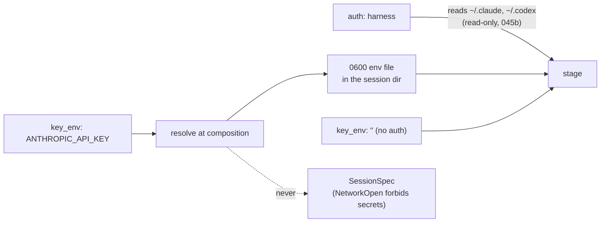

# 045e — The model is an endpoint, not a vendor

**Status:** built.

**Scope:** how a local session picks and reaches a model: the operator-declared catalogue that `Models()` answers from, the three credential sources (the harness's own login, a vendor key, a gateway key), how a key reaches a stage without appearing in `ps` or in a specification, and what a session records about the model when nobody is billing for it. Adds `--model` to `replichai audit`.

**Depends on:** [045a](045a-the-sandbox-is-a-seam.md), [045d](045d-the-harness-inside-the-sandbox.md), [041d](041d-models-and-meters-name-their-source.md), [031](031-the-model-is-a-choice.md), [011](011-what-a-session-costs.md).

## Problem

Three things stand between the operator and a model of their choosing.

**`Models()` has nothing to enumerate.** The contract requires a runtime to report a catalogue, and `runtimes.ModelResolver` resolves `best`/`balanced`/`fast` against it, erroring rather than guessing when a preference maps to two models. A hosted vendor has a catalogue endpoint. A gateway in front of an open-weights model may serve one model and expose no catalogue at all, or expose a hundred with names that mean nothing to a preference tier.

**The credential cannot travel in the specification.** The audit sets `NetworkOpen`, and `SessionSpec.Validate` refuses network mode `open` carrying `SecretRefs`, deliberately, because a host-bound secret is meaningless when every host is allowed. So the model credential is not a spec field. It is runtime configuration, resolved at composition, exactly as `builtin.AnthropicConfig` already is.

**`replichai audit` has no `--model`.** `WithSessionModel` exists and nothing on the CLI reaches it. Every audit runs on `DefaultModelPreference`.

## The catalogue is declared, not discovered

Configuration at `~/.config/replichai/models.yaml`, overridable with `REPLICHAI_MODELS_FILE`:

```yaml
gateways:
  harness-login:                # the harness's own credential; no key here
    dialect: anthropic
    auth: harness
  anthropic:
    base_url: https://api.anthropic.com
    dialect: anthropic
    key_env: ANTHROPIC_API_KEY
  lux:
    base_url: https://lux.latere.ai/v1
    dialect: openai-responses
    key_env: LUX_API_KEY
  local:
    base_url: http://127.0.0.1:11434/v1
    dialect: openai-chat
    key_env: ""                 # a local server that wants no key

models:
  - {provider: anthropic, id: claude-opus-5,      gateway: harness-login, harness: claude-code, preferences: [best]}
  - {provider: anthropic, id: claude-sonnet-5,    gateway: harness-login, harness: claude-code, preferences: [balanced, fast]}
  - {provider: qwen,      id: qwen3-coder-480b,   gateway: lux,           harness: codex,       preferences: [balanced]}
  - {provider: meta,      id: llama-4-scout,      gateway: local,         harness: codex,       preferences: [fast]}
```

Declared, because there is nothing to discover that a preference tier could be resolved from. An operator pointing at a gateway serving one model writes one row, and `best`, `balanced` and `fast` all resolve to it.

Validation at construction, not at first use:

- Every model names a gateway that exists and a harness that is installed.
- **Dialect and harness must agree.** Claude Code speaks the Anthropic dialect; Codex speaks the OpenAI dialects. A `claude-code` row on an `openai-chat` gateway is a configuration error naming both halves, not a run that fails forty seconds in with an unhelpful 400.
- Within one harness, each preference resolves to at most one model. Two `best` rows is an error, mirroring `ModelResolver`'s own refusal to pick arbitrarily.
- `Provider` and `ID` are both non-empty, because `ModelRef.Valid()` requires both.

`Models()` returns the rows for the selected harness. Where no file exists, a built-in default declares the `harness-login` rows above, so a first run on a machine where `claude login` has already happened needs no configuration and no API key.

## Three credential sources, one rule



`auth: harness` is the important one and the reason the host sandbox is the default: the operator has already logged in, the credential is refreshed by the harness itself, and nothing about it passes through this program. `environment.json` records `auth: subscription` or `auth: api-key`: which kind, never the value.

Where a key is configured, it is resolved from the environment at composition and delivered through a `0600` file in the session directory, passed as an env file and unlinked once the stage is running. Not as an inline argument: process arguments are visible to every user on the machine. Under the container driver, `engine inspect` still shows the value to whoever can talk to the engine, which is the same person who owns the key; this is stated rather than concealed.

Where `key_env` names a variable that is unset, construction fails naming the variable, before a paper is resolved.

The credential never appears in `events.jsonl`, in `status.json`, in the locator, in `environment.json`, or in any error message. The transcript writer redacts any value equal to a configured credential before writing, because a harness that echoes its own environment into a tool result would otherwise put it in the published evidence.

## Selecting one

```
replichai audit <paper> --runtime local --model best
replichai audit <paper> --runtime local --model anthropic/claude-opus-5
```

A bare tier goes to `ModelSelector.Preference`; a `provider/id` pair goes to `ModelSelector.Exact` and must match a declared row, because a session on a model the operator never declared has no gateway to reach it through. `--model` is added to `runAudit`'s flagset and threaded to the existing `audit.WithSessionModel`, and works for every runtime, because tier resolution is the contract's and not this runtime's.

Whatever is asked for, `Status.Model` reports the exact `ModelRef` the session ran on, so evidence never depends on re-resolving a tier later.

## Money, and its absence

The vendor was paid by the operator, with the operator's credential, outside this program. So:

- **A missing rate card is not a refusal.** `job.ErrUnpriceable` guards the hosted path, where tokens nobody can price would be a session that ran at the platform's expense for nothing. Locally there is no platform expense, and a run on an unpriced model proceeds.
- **Usage is still recorded.** `Status.Usage` carries the buckets the harness reported and `Status.Model` the exact reference, because a reader of a published reproduction is entitled to know what produced it whether or not anybody was billed.
- **`internal/credit` is not in the path.** No reserve, no settle. [045k](045k-a-local-session-reaches-the-cloud.md) states what that means once the session reaches the app.

Where the harness reports a cost of its own (Claude Code's `result` line carries `total_cost_usd`), it is recorded in `Usage.Details` as the vendor's figure, clearly not the platform's price for it.

## Acceptance criteria

1. A `models.yaml` in which one harness has two `best` rows fails construction, naming both rows.
2. A `claude-code` model on an `openai-chat` gateway fails construction, naming the harness, the gateway, and the dialect each expects.
3. A gateway whose `key_env` is unset fails construction naming the variable; one whose `key_env` is empty produces a stage with no credential in its environment.
4. With no `models.yaml` and a logged-in harness, a run completes with no API key anywhere in the process tree, and `environment.json` records `auth: subscription`.
5. `Models()` returns only the selected harness's rows, and `ModelResolver.ResolveModelRef` resolves each tier to exactly one qualified reference.
6. No stage invocation contains a credential in argv. A test inspects the built argv for every stage under both drivers and asserts the only credential channel is the env file, that it is `0600`, and that it is gone once the stage is running.
7. A transcript decoded from a stream containing the configured credential verbatim contains a redaction marker and not the credential, in `Content` and in `Raw`.
8. `replichai audit --model best` and `--model anthropic/claude-opus-5` both run; an exact reference not declared in the catalogue is refused before the session starts.
9. `Status.Model` after a run equals the declared row that was selected, provider and id both.
10. A run on a model with no rate card completes and publishes; the same specification on the hosted path still refuses with `ErrUnpriceable`.

## Not in scope

- Pricing local runs. `internal/credit` is not involved and `replichai rates` continues to describe the hosted path only.
- Serving the model. What runs behind the endpoint is the operator's business.
- Automatic discovery from a gateway's `/models` endpoint. It would be a convenience over the declared file, not a replacement, and tier assignment would still be the operator's.
- Per-stage model overrides. The judge runs the worker's model ([045f](045f-the-grader-cannot-edit-what-it-grades.md)).

## Outcome

Built as `internal/runtimes/local/catalog.go`. The declared catalogue, the dialect-and-harness agreement check, the one-model-per-preference rule, the credential resolution at construction and the redaction of every configured credential from the transcript are as specced. `--model` reaches `WithSessionModel` from both `audit` and `run`.

**The credential file is written by the driver, not by this layer.** The host driver passes credentials through the launcher's environment and the container driver through a `0600` env file it removes once the container is running; the catalogue's job ends at resolving the value. The acceptance criterion asking that no stage invocation carry a credential in argv is met by both drivers' argv tests rather than by one test here.

The default catalogue is the harness's own login on three Anthropic models, so a first run on a machine where `claude login` has happened needs no configuration and no API key. That path is the one most likely to break silently, so it is the one the live end-to-end test drives.

**What "the harness's own login" costs was not knowable from here.** This spec treats `auth: harness` as the absence of a credential to manage. On macOS it is a credential in the operating system's keychain, which the sandbox has to be opened to, read-only, and only for a session using that login. 045b carries the argument; the catalogue's job ends at saying which kind of credential a model is reached with, and that turned out to be the important thing it says.
