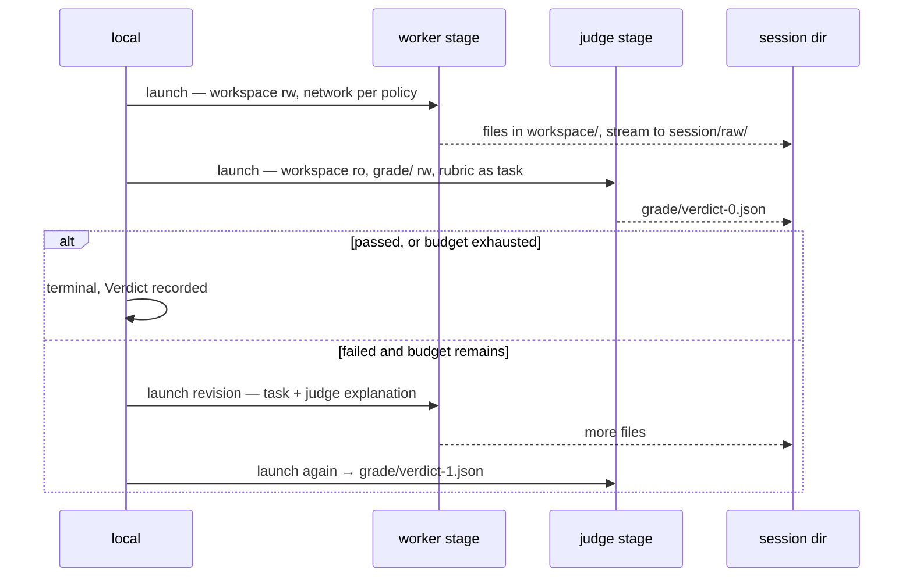

# 045f — The grader cannot edit what it grades

**Status:** built.

**Scope:** how a local session is graded: a judge stage in its own sandbox with the workspace read-only, the verdict it writes, the revision loop, and how the result becomes `managed.Verdict`. Includes the one-line correction to `method/rubric.md`'s ninth criterion that the local path forces. This is what lets `local` declare `Capabilities.Evaluation: true` accurately.

**Depends on:** [045a](045a-the-sandbox-is-a-seam.md), [045b](045b-the-host-sandbox.md), [045d](045d-the-harness-inside-the-sandbox.md), [002](002-publishing-reproductions.md) (who authors what).

## Problem

`ValidateCapabilities` refuses a specification carrying an `EvaluationSpec` against a runtime whose `Capabilities.Evaluation` is false, and the audit always carries one: `method/rubric.md` plus a revision budget. A local runtime that cannot grade cannot run the method at all. It would produce a reproduction with no verdict, which is not a reproduction under this product's own definition, where claim, evidence and verdict have three different authors.

Grading is not a post-processing step here. Each run carries its rubric and a revision budget: the output is graded, and if it falls short the worker revises and is graded again, up to the budget. Whatever grades it has to read the workspace and must not be able to change it.

## The shape



Three properties, each necessary, and each expressed as a `StageSpec` the driver enforces rather than as an instruction the model is asked to respect:

**A fresh stage.** The judge inherits nothing from the worker: no shell history, no temporary directory, nothing it downloaded. It sees the reproduction, not the process that made it.

**The workspace is read-only.** Both drivers can enforce that: a Seatbelt or bubblewrap read-only path, or a `ro` bind mount. A judge that could edit what it grades is not a judge, and this is testable: a write from inside the judge fails.

**`grade/` is the only writable path.** A directory the worker never sees, holding one file per grading round. The verdict is therefore outside the reproduction: not committed as the agent's work, and not something a later worker revision can edit before the next round.

The judge needs the model endpoint, so its network policy matches the session's. It has no forge credential, because nothing local does ([045g](045g-the-host-pushes.md)).

## What the judge writes

```json
{
  "grade": "passed",
  "explanation": "…",
  "model": {"provider": "anthropic", "id": "claude-opus-5"},
  "criteria": [
    {"id": 1, "name": "Verdict",   "passed": true, "evidence": "REPRODUCIBILITY.md:12 …"},
    {"id": 9, "name": "Published", "passed": true, "evidence": "no repository was mounted"}
  ]
}
```

`grade` maps onto `managed.Grade`; `explanation` becomes `Verdict.Explanation` with the failing criteria appended, so a reader who sees only the verdict still learns which of the nine failed and why. The file is validated against a schema before it is accepted: a judge returning prose where a grade was asked for is a failed grading round, not an undecided session. A round producing no parsable verdict is retried once, and a session that cannot be graded ends `failed` with that reason rather than `done` with no verdict, because a graded session may not finish without a decided verdict.

`grade/verdict-<n>.json` is system-authored evidence, and finalize commits it into the repository beside the transcript, `environment.json` and `replication.json` ([045g](045g-the-host-pushes.md)). Its `model` field is what tells a later reader whether grader and worker were the same model.

## The judge runs the worker's model

The obvious extension is a stronger or a different grader. It is deliberately out of this leaf, for one concrete reason: `Usage.Model` is a single reference, and a session whose tokens came from two models has no correct value to put there. Splitting buckets by stage would mean either misattributing the judge's tokens to the worker's model or pushing them into `Extra`, which is defined as billable non-token meters a rate card must cover.

So: one model per session, worker and judge alike, and the accumulated usage stays accurate. A different grader model needs the usage model to become per-stage first, which is a change to `managed`, not to this runtime.

The self-grading concern this leaves is real, and is handled by disclosure: the verdict records the model that produced it, and a reader comparing two reproductions can see when both halves came from the same model.

## The revision loop

`EvaluationSpec.MaxRevisions` is the budget, and `SessionSpec.Validate` already requires it positive when an evaluation is present. Each failed round launches a new worker stage against the same workspace with the judge's explanation appended to the original task under a fixed header, so the revision request is legible in the transcript as a distinct request rather than as a mutated task.

Every stage is an entry in the locator journal ([045a](045a-the-sandbox-is-a-seam.md)), which is what makes a mid-loop restart recoverable: a process dying between round two's judge and round three's worker resumes from the journal, not from the beginning.

Usage accumulates across stages, monotonically. Wall-clock and stage count both grow with the budget, which is the real cost of grading and is reported in the batch summary ([045h](045h-many-papers-at-once.md)).

## Criterion 9 says "mounted" and means "has a remote"

`method/rubric.md`'s ninth criterion is conditional:

> **Published.** *Where a git repository is mounted* — **the run's instructions say so, and name its path.** A run without one has no remote to reach and passes this criterion trivially.

Read against the local path, the condition is met and should not be. `workspaceProtocol` ([045g](045g-the-host-pushes.md)) opens by telling the agent its reproduction lives in a git repository and naming the path, which is exactly the test the criterion operationalises. A judge reading the rubric and those instructions concludes the criterion applies, looks for the recorded `git log --oneline origin/main -1`, finds none, and fails it. Every local run would come back with one spurious failed criterion, and the revision loop above would then spend a whole extra worker stage trying to fix something the agent has no remote to fix.

The condition is wrong, not the local path. What criterion 9 grades is whether the work reached a remote; a repository being present was only ever a proxy for a remote being configured, and the two stopped being the same thing when a session got a local repository. So the condition is reworded, one line:

```
9. **Published.** *Where a git remote is configured* — the run's instructions
   say so, and name it. A run with no remote has nothing to reach and passes
   this criterion trivially. With one, the reproduction reached it. …
```

Everything after the condition is unchanged, and the hosted path grades exactly as it does today: `mountProtocol` names a remote, so the criterion applies. This is the smallest edit that makes both paths correct by construction, and it is preferable to a disclaimer in the instructions, which would leave the rubric saying one thing and the instructions saying another.

What the local path loses by passing trivially is a graded self-report that the work left the sandbox. What replaces it is stronger: the host verifies the tree and pushes it after the run, outside the model's reach entirely, and an empty repository is recorded as such ([044d](044d-an-empty-repository-says-so.md)). This is the same argument [044](044-a-run-that-produced-nothing.md) made when it added recovery that does not depend on the agent's discipline beside prevention that does.

## Acceptance criteria

1. `Capabilities.Evaluation` is true, and the ungraded and graded lifecycles in `contracttest` both pass under both drivers.
2. A write attempt from inside the judge stage against the workspace fails, asserted by a test that runs one under each driver.
3. The judge stage's writable paths are exactly `grade/`; a test inspects the `StageSpec` and asserts the workspace is read-only and `session/` is absent.
4. A judge returning prose instead of a schema-valid verdict causes one retry, then a `failed` session whose error names the grading failure. The session never ends `done` with no verdict.
5. A failing first round with budget remaining launches a revision worker whose task contains the judge's explanation under the fixed header, and the transcript shows the revision as its own stage.
6. `MaxRevisions` is respected exactly: a session failing every round ends terminal with the last verdict, having run at most `MaxRevisions + 1` worker stages.
7. Usage after a three-stage session equals the sum of the stages, and no poll reports a decrease.
8. `grade/verdict-<n>.json` records the grading model, and finalize commits it as system-authored.
9. Killing the process between two stages and re-attaching by `SessionRef` resumes at the next stage rather than re-running the worker.
10. A local run's judge verdict does not fail criterion 9. Tested against a fixture workspace holding commits and no remote, graded with the reworded rubric, asserting the criterion is reported passed with the no-remote evidence.
11. The hosted path's criterion 9 is unchanged: the same fixture with a remote configured and commits ahead of it still fails.

## Not in scope

- A grader model different from the worker's. Named above with what would have to change first.
- A grader that is not the same harness. The seam allows it; a second implementation is not worth its cost until there is a reason.
- Multi-judge panels or majority verdicts. One judge, one verdict, recorded.
- Any rubric change beyond criterion 9's condition. The other eight criteria are untouched, and the rubric still travels with the run.

## Outcome

Built. The judge is a stage of its own with the workspace read-only and one writable directory; the verdict is validated before it is accepted; a round that cannot be parsed is retried once and then fails the session rather than finishing it undecided; the revision loop spends its budget exactly.

**The round had two definitions and they disagreed by one.** The launch told the judge to write `verdict-1.json` and the read looked for `verdict-0.json`, so every session was graded twice and the first verdict was discarded as missing. There is one definition now, `currentRound`, used by both.

**Criterion 9 was reworded**, as the correction to this spec recorded, and `method/rubric.md` now keys it on a remote being configured.

**The read-only mount is asserted against the stage specification, not against a kernel.** A test drives the judge's `StageSpec` and fails if the workspace is writable or the evidence directory is present at all. Running a write inside a real sandbox belongs to the driver contract suite, on a machine that has one.
