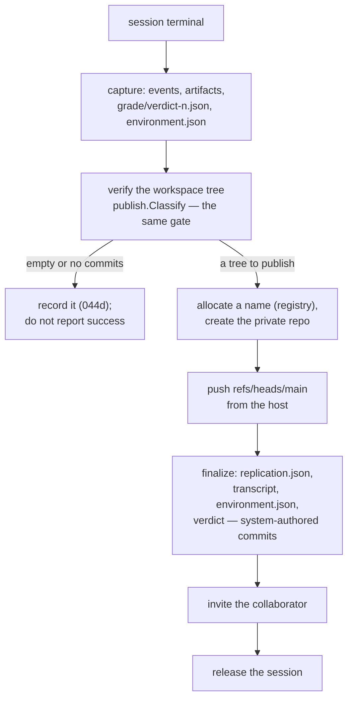

# 045g — The host pushes, the sandbox holds no token

**Status:** draft.

**Scope:** how a local session's work reaches GitHub — no remote inside the sandbox, no forge credential inside the sandbox, and a push performed by the host after the run, through the same redistribution gate and the same finalize the hosted path uses. The workspace instruction protocol that replaces the mount protocol, and the ordering that keeps release from destroying what has not been pushed.

**Depends on:** [045a](045a-the-sandbox-is-a-seam.md), [006f](006f-taking-a-reproduction-out.md), [044a](044a-the-mount-is-pushed.md), [044b](044b-the-server-harvests-the-session.md), [044d](044d-an-empty-repository-says-so.md), [009](009-secret-containment-when-the-agent-commits-live.md).

## Problem

The hosted path clones a private repository into the sandbox with a token and asks the agent to push as it works. That design earned its place — the history is the agent's own — and it carries two costs the local path does not have to pay.

**A forge credential lives inside a sandbox with an open network and a shell.** [009](009-secret-containment-when-the-agent-commits-live.md) wanted a per-repository mount token instead of an organisation PAT and could not have it, because a GitHub App installation token lives at most an hour and a real run took fifty-three minutes. That third commit is still deferred.

**Unpushed commits are destroyed.** [044](044-a-run-that-produced-nothing.md) is the record of a run that committed five times, never pushed, and left an empty repository. [044a](044a-the-mount-is-pushed.md) made the push its own instruction and a graded criterion; [044b](044b-the-server-harvests-the-session.md) added recovery that does not depend on the agent doing it.

Locally, both costs are avoidable rather than manageable. The workspace is a host directory: nothing is destroyed when the sandbox ends, so nothing has to leave during the run, so no credential has to be inside.

## What the agent is told

`mountProtocol` is replaced, not edited, by a `workspaceProtocol` used when the runtime reports no mounted repository:

```
Your reproduction lives at <workspace>, which is a git repository on the
machine running this session. It is not destroyed when this session ends.

- Write your reproduction files (README.md, REPRODUCIBILITY.md, src/,
  UNVERIFIED.md, SOURCES.md, verdict.json, instrument.json) inside <workspace>.
- Commit your progress as you finish each part — small, meaningful commits.
- There is no remote and nothing to push. The system publishes what you
  committed, after this session ends, and verifies it independently.
- Before you finish, run "git status" and confirm nothing is uncommitted.
  Uncommitted work is not part of the history that gets published.
- Keep every download (the paper PDF, datasets, benchmarks, any third-party
  file) OUTSIDE <workspace>; use the temporary directory. Never "git add"
  third-party data: the repository must contain only your own work.
```

The push sentence is gone because there is nothing to push to, and inventing a remote so the instruction could stay would put a token back inside the sandbox to satisfy a sentence. What replaces it is a real check the agent can fail — uncommitted work is genuinely dropped — and a system check it cannot influence.

## What the host does



**The gate is the one that already exists.** `publish.Classify` decides what may be redistributed; the local path runs the workspace tree through it before the first push rather than verifying after the fact, which is strictly earlier than the hosted path manages. A file the gate refuses is not pushed and is named in the run's output.

**The push is a host act with a short-lived credential.** The token reaches `git` through a `0600` askpass helper named by `GIT_ASKPASS`, never in argv (visible in `ps`), never in the URL (it lands in `.git/config` and in the reflog), and never written into the workspace's git configuration. The remote is added, the push is made, and the remote is removed, so a workspace directory left on disk under the `keep` retention policy carries no credential and no push target.

**Finalize is the same code.** `publish.FinalizeLive` writes `replication.json`, commits the transcript and `TRANSCRIPT.md`, and invites the collaborator. The local path adds `environment.json` and `grade/verdict-<n>.json` to the same system-authored commit, and calls the same function, so the two paths cannot drift.

**An empty repository says so.** If the workspace has no commits, or the verified tree is empty, the session records that instead of reporting success, exactly as [044d](044d-an-empty-repository-says-so.md) requires — and distinguishes "the agent produced nothing" from "the publish failed", because locally those are two different observations and both are available.

## Ordering

Capture, then verify, then push, then release. Release is what discards the sandbox's leavings, and under the `discard` retention policy it removes the session directory — which holds the only copy of the work until the push has succeeded. The ordering lives in the `Retain` hook, where `finalizePublication` already runs, so it is the existing sequence with a push inserted rather than a second lifecycle.

A push that fails leaves the session directory intact regardless of retention policy, and prints the command to retry it:

```
replichai finish <owner>/<repo> <paper> --session <session-id>
```

`finish` already exists for the detached hosted path; locally it reattaches by session directory and repeats from the verify step. A local run therefore never loses work to a network failure at the last step.

## What this does to 009

[009](009-secret-containment-when-the-agent-commits-live.md)'s deferred third commit is a hosted-path problem: the agent needs write access for the length of the run, and the strongest available credential expires sooner than a run lasts. The local path does not need the credential to be inside for any length of time, so the constraint does not apply — not because it was solved, but because the requirement was removed. Where a hosted run and a local run of the same paper produce different containment properties, this is the difference, and it is worth saying rather than leaving a reader to infer that 009 was fixed.

## Acceptance criteria

1. No `StageSpec` under either driver carries a forge credential, and no workspace git configuration contains a remote while a stage is running. A test asserts both.
2. `workspaceProtocol` is used exactly when the specification carries no repository resource, and `mountProtocol` exactly when it does. A test pins that the workspace protocol contains no push instruction and does contain the uncommitted-work consequence.
3. The workspace tree is run through `publish.Classify` before the first push; a file the gate refuses is not pushed and is named in the output.
4. The push token never appears in argv, in `.git/config`, in the reflog, or in the session directory after the push. A test inspects all four.
5. The remote is removed after the push, and a retained session directory has no remote configured.
6. A workspace with no commits produces the [044d](044d-an-empty-repository-says-so.md) outcome, distinguishing an agent that produced nothing from a publish that failed.
7. A push failure leaves the session directory intact under every retention policy and prints a working `finish` command; running it completes the publication.
8. `publish.FinalizeLive` is called by the local path, not reimplemented, and `environment.json` and the judge's verdict are in the system-authored commit.
9. Release never runs before a successful push or a recorded failure.

## Not in scope

- Pushing to anything but GitHub. `Forge` is the seam and a second forge is its own spec.
- Signing commits. The agent's commits are the agent's; attributing them further is [006n](006n-who-signed-off.md)'s business, not the transport's.
- Pushing during the run. It is possible — the host could push after each commit — and it buys nothing here, because nothing is at risk of being lost.
- Changing the hosted path. 006f, 044a and 044b stand as they are.
