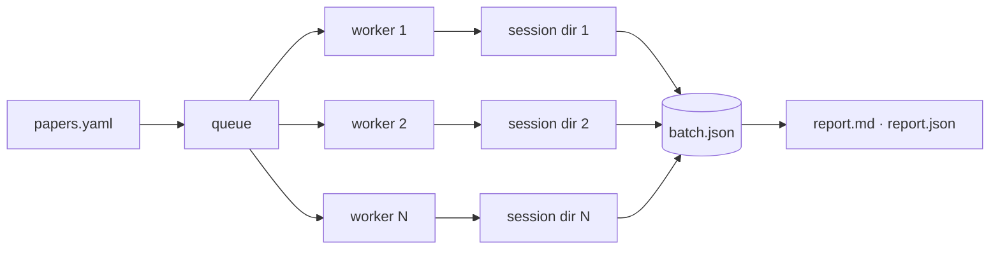

# 045h — Many papers at once

**Status:** built.

**Scope:** `replichai run`, the batch driver: a list of papers, a concurrency cap, one isolated session each, resumable state, partial-failure semantics, and a report at the end. The name allocation race two concurrent sessions create, and what arbitrates it.

**Depends on:** [045a](045a-the-sandbox-is-a-seam.md), [045g](045g-the-host-pushes.md), [003](003-reproduction-registry.md) (the registry that allocates names), [012](012-a-project-holds-papers.md) (what a project is).

## Problem

A replication project is a list of papers. Today the only unit is one paper, one process, one terminal: twenty papers is twenty invocations, twenty terminals, and a person watching them. Nothing shares a report, nothing survives a laptop sleeping, and a failure in the fourth is discovered when someone scrolls back.

The local runtime makes the batch cheap for the first time (the host sandbox starts in milliseconds and costs no virtual machine), so what stands between an operator and a whole project is a driver, not capacity.

## The input

Either a plain list, one reference per line with `#` comments, or a project file:

```yaml
project: chi-2026-audit          # names the cloud project (045k), optional
harness: claude-code
model: best
sandbox: host
publish:
  owner: open-hai
  invite: some-github-login
papers:
  - https://arxiv.org/abs/2603.01795
  - doi: 10.1145/3654777.3676417
    model: fast                  # per-paper overrides
  - 10.1145/3411764.3445374
```

```
replichai run papers.yaml --parallel 4 --publish
replichai run papers.txt --parallel 2 --sandbox container
```

Per-paper fields override the file's defaults; the CLI overrides both. A reference that fails to resolve is a failed entry, not a failed batch.

## Concurrency



A fixed pool, default `min(4, cpus/2)`, capped by `--parallel`. Each entry gets its own session directory, its own sandbox, its own workspace, its own repository. Nothing is shared between two papers except the registry read and the batch state file, and both are handled below.

The pool refuses to start more concurrent sessions than the machine can carry, and says so rather than thrashing: under the container driver it compares the declared per-stage memory against what the engine reports it has, and under the host driver it warns when the pool exceeds the core count. The refusal uses the same actionable-message shape as the sandbox preflights.

## The name race

`internal/registry` derives the set of published reproductions by reading manifests and allocates `<canonical-slug>-<suffix>` for the next one. It is a read followed by a decision, and two concurrent sessions reproducing the same paper, or two papers whose canonical slugs collide, will read the same set and decide the same name.

Two guards, because one is not enough:

**A process-local lock around allocate-and-create.** The batch driver serializes the allocation and the repository creation for its own workers, so within one batch the second worker reads a registry that already contains the first worker's repository.

**The forge is the arbiter.** A concurrent batch on another machine is outside that lock, so a creation that fails on a name collision retries with the next suffix, up to a small bound, and the registry read is treated as advisory. This is the correct ownership: the registry is derived state and the forge holds the actual namespace, so the forge's refusal is the authoritative fact and the registry's answer is a hint that avoids most collisions.

## State, and resuming

`batch.json` beside the batch file, rewritten after every state change:

```json
{"version": 1, "started_at": "…",
 "entries": [
   {"paper": "…", "state": "done",    "session": "7f3a91c2", "repo": "open-hai/…", "grade": "passed", "usage": {…}},
   {"paper": "…", "state": "running", "session": "a91c27f3"},
   {"paper": "…", "state": "failed",  "error": "resolve identity: …"},
   {"paper": "…", "state": "pending"}
 ]}
```

`replichai run papers.yaml --resume` skips terminal entries, reattaches `running` ones by their `SessionRef` (which is what the locator is for), and starts the rest. A session whose sandbox is gone but whose workspace survived resumes at the verify-and-push step rather than re-running the agent, because the work is on disk and re-running it would cost the model twice for a result that already exists.

Interrupting the batch cancels in-flight sessions through the controller, keeps every workspace, writes `batch.json`, and exits. Nothing is lost to a Ctrl-C.

## Failure, and the report

One paper failing never fails the batch: the pool continues and the entry records its error. The process exits non-zero if any entry ended `failed`, so CI reads the exit code and a person reads the report.

`report.md` and `report.json` are written at the end and after every state change, so a report exists even if the batch is killed:

| paper | verdict | rate | repository | model | usage | wall | state |
|---|---|---|---|---|---|---|---|

Plus the totals a person asks for: how many passed, how many produced an empty repository ([044d](044d-an-empty-repository-says-so.md)), total tokens by bucket, total wall-clock, and total vendor cost where the harness reported one. The report names what it could not do (an entry that failed to resolve, one whose push failed and is retryable), because a summary that shows only successes reads as completeness.

## Acceptance criteria

1. `replichai run` accepts both input forms; a malformed entry fails that entry with a message naming the line, not the batch.
2. Per-paper overrides beat file defaults, and CLI flags beat both. A test drives all three levels.
3. `--parallel N` never exceeds N concurrent sessions, asserted against a fake runtime that counts overlap.
4. Two entries resolving to the same canonical slug in one batch produce two repositories with different suffixes; a creation refused for a name in use retries with the next suffix and succeeds.
5. `batch.json` is rewritten after every state change and is valid JSON at every point, asserted by killing the batch at each transition.
6. `--resume` skips terminal entries, reattaches a running session by reference, and resumes a session whose workspace survived at the verify step without re-running the agent.
7. Ctrl-C cancels in-flight sessions, keeps every workspace, writes `batch.json`, and exits non-zero.
8. A batch with one failing entry completes the rest, exits non-zero, and the report names the failure and its error.
9. The report's totals equal the sum of the entries, and the file exists after a killed batch.
10. A pool larger than the machine can carry is refused with a message naming the limit and the flag, not started and left to thrash.

## Not in scope

- Distributing a batch across machines. One host, one batch.
- Scheduling or retrying failed entries automatically. `--resume` is manual and deliberate.
- Running a batch on the hosted runtime. Nothing prevents it, because the driver is runtime-agnostic, but the concurrency and quota questions there are the platform's, not this leaf's.
- Uploading the batch as it runs. Sync is [045k](045k-a-local-session-reaches-the-cloud.md) and happens after, deliberately: a run that needs the network to record its own progress is a run that fails when the network does.

## Outcome

Built as `internal/batch` and `replichai run`. Both input forms, the per-paper overrides, the concurrency cap, the state file rewritten atomically after every change, the report written continuously, and the non-zero exit on a partial failure are as specced.

**Resume skips only what finished.** This spec said terminal entries; what shipped retries failed ones, because retrying what failed is the reason to resume. A retried paper keeps its repository and its session reference, so it publishes into the repository the first attempt created rather than allocating a second.

**The name race is guarded within a batch and not across machines.** Preparation is serialized, so two papers in one batch cannot allocate one name. The cross-machine case (a creation refused for a name in use, retried with the next suffix) is not implemented: `newPublisher` still reuses an existing repository on `ErrRepoExists`, which is right for a re-run of one paper and wrong for a collision between two.

**A paper can run more than once.** `runs:` on a paper, or at the top of the file for every paper, expands it into that many runs, and a paper listed twice is two runs of it. Each run gets its own session, repository and local directory (`<slug>-run-<n>` once a paper has more than one run). `batch.json` keys an entry by paper and run ordinal, so a resume returns each run to its own record; a state file written before runs existed is numbered in the order its entries appear. The report counts runs and names the run beside a repeated paper.

**The pool does not refuse an oversized parallelism.** `--parallel` is honored exactly; nothing compares it against what the machine or the engine can carry.
