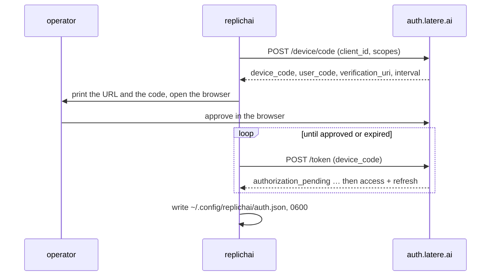

# 045i — Signing in from the terminal

**Status:** built.

**Scope:** `replichai login`, `whoami`, `logout`, `org` — the OAuth2 device-code flow against `auth.latere.ai`, where the token is stored, how it is refreshed, and how a short-lived actor token is minted for the API. The client half only; the server half is [045j](045j-a-bearer-the-api-accepts.md).

**Depends on:** [006c](006c-identity-and-access.md) (what authorisation actually is here), [014d](014d-an-auth-outage-is-not-sign-out.md) (the lesson this reuses), `latere.ai/x/pkg/oidc`.

## Problem

The CLI has no identity. Everything it does is local or goes to GitHub with a token from the environment. For a locally-run session to reach the app ([045k](045k-a-local-session-reaches-the-cloud.md)) the CLI has to be able to say who it is, and a terminal cannot run a browser redirect.

The device-code flow is the answer and it is already built next door: `latere` signs in against `auth.latere.ai` with RFC 8628 and stores the result under `~/.config/latere/`. `latere.ai/x/pkg/oidc` provides `DeviceAuth` and `DeviceAccessToken` directly. This leaf is that flow with replichai's own client identity, and the decisions are about what *not* to share.

## The flow



```
replichai login
    Open https://auth.latere.ai/device and enter code:  WXYZ-1234
    Waiting for approval… signed in as changkun@latere.ai
```

`--no-browser` prints and does not open. `--auth-url` and `--client-id` override the defaults for a self-hosted deployment.

## Its own client, its own file

The token goes to `~/.config/replichai/auth.json`, mode `0600`, holding the access token, the refresh token, the expiry, the issuer, the client id and the active organisation.

Deliberately not `~/.config/latere/`. The two CLIs are different OAuth clients requesting different scopes, and `latere`'s own source carries the warning that made this decision: a refresh that silently narrowed scopes strands commands until the next full login. Two programs sharing one token file means either program's refresh can narrow the other's. Sharing a *sign-in* is a product question for auth to answer with the browser session; sharing a *token file* is a coupling with no upside.

The file is on the sandbox deny list ([045b](045b-the-host-sandbox.md)), so a running session cannot read it.

## Scopes, and what they do not decide

`openid email profile offline_access`. Nothing product-specific, because nothing product-specific is decided by the token.

[006c](006c-identity-and-access.md) is explicit: authorisation is this deployment's own table, decided against `access_grants`, never read out of a token. The bearer says who the caller is; `internal/access` says what they may do; signing in self-grants the ordinary user tier and what limits a person is the meter, not a guest list. The CLI therefore requests identity scopes only, and a token carrying a claim about tiers would be ignored if it had one.

## Refresh, and what a failure means

The token is refreshed on use when it is within a minute of expiry, and the refresh preserves the previous refresh token where the response omits a new one, which is ordinary OAuth behaviour and a common source of a working client that logs itself out after a day.

[014d](014d-an-auth-outage-is-not-sign-out.md) settled the equivalent question in the app: an auth outage is not a sign-out. The same rule here. A refresh that fails because the network is down, or because auth returned a 5xx, leaves the stored token in place and reports the failure. Only an explicit `invalid_grant` — the credential is genuinely revoked or expired — clears the file and asks for `replichai login`. A CLI that deletes its credential whenever a coffee-shop network hiccups is a CLI people stop trusting with a batch that runs for an hour.

## Organisation context

`replichai org` prints the active context; `replichai org <uuid>` and `replichai org --personal` switch it through the refresh-token grant, so switching does not need another device login. The active organisation is stored beside the token and sent with every API call, because a project belongs to a context and an operator who works in two of them must not have to guess which one a `push` landed in.

## The actor token

The stored access token is long-lived by design. The API call ([045j](045j-a-bearer-the-api-accepts.md)) uses a short-lived, audience-scoped token minted from it at `POST {auth}/actor-tokens` with audience `replichai.latere.ai`, so a token captured in transit or in a shell history is bounded to minutes and to one service.

Where auth refuses the mint — an older deployment, an audience it does not know — the CLI falls back to presenting the stored access token directly, exactly as `latere` does for the same reason. The fallback is logged at debug level and is not silent, because a security property that quietly stops holding is worse than one that was never claimed.

## Acceptance criteria

1. `replichai login` completes a device-code flow against a fake auth server and writes `auth.json` with mode `0600`.
2. `whoami` prints the subject and email from the stored token without a network call, and reports the active organisation.
3. `logout` removes the file and revokes at the endpoint where one is offered; a second `logout` is not an error.
4. A refresh failing with a network error or a 5xx leaves the file intact and reports the failure; a refresh failing with `invalid_grant` clears it and says to sign in. Both are tested.
5. A refresh response with no new refresh token preserves the old one.
6. `org <uuid>` switches context through the refresh grant with no second device login, and the new context is used by the next API call.
7. The actor-token mint is used when available; an audience-mismatch refusal falls back to the stored token and logs that it did.
8. No token, access or refresh, is ever written outside `auth.json`, printed by any command other than an explicit `print-token`, or included in an error message.
9. `~/.config/replichai` is unreadable from inside a running sandbox, asserted by the [045b](045b-the-host-sandbox.md) deny-list test.

## Not in scope

- Sharing a sign-in with `latere`. Separate clients, separate files, for the reason above.
- Machine credentials for CI. A service account is a different principal kind and its own spec; CI today runs the local path with no cloud sync.
- Authorising anything. The token identifies; `internal/access` authorises.
- A browser-based login for the CLI. The device flow is the terminal's answer.

## Outcome

Built as `internal/cloud` and the `login`, `whoami`, `logout` and `org`
commands. The device-code flow, the private credential file under replichai's
own client id, the refresh that keeps a previous refresh token, the
organisation switch through the refresh grant, and the actor-token mint with
its reported fallback are as specced.

**An auth outage is not a sign-out**, tested both ways: a server error and a
network failure leave the credential in place, and only `invalid_grant` clears
it.

**The credential's directory is on the host sandbox's deny list**, so a running
session cannot read it — asserted in `045b`'s deny-list test rather than here.

`whoami` reads the stored token without a network call, so it answers the same
when the provider is unreachable.
