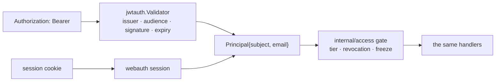

# 045j — A bearer the API accepts

> **Amended 2026-09-16.** The shared verifier is `latere.ai/x/pkg/authkit/jwt`,
> which the dependency line below now names; the standalone package it
> replaced is retired. Where this spec writes jwtauth.Validator, read
> jwt.Validator, built by `jwt.New(jwt.Config{JWKSURL, Issuer, Audiences})`
> the way `internal/webauth/bearer.go` builds it. The design is unchanged: one
> validator, checking issuer, audience, signature and expiry, with the one
> audience named by `AUTH_AUDIENCE` since v0.29.0.

**Status:** built.

**Scope:** the server half of terminal access: a bearer credential path beside the existing cookie session, resolving to the same principal, gated by the same `internal/access` policy. One authentication seam, two credential sources. No new authorization model and no new routes.

**Depends on:** [045i](045i-signing-in-from-the-terminal.md), [006a](006a-http-api-and-streaming.md), [006c](006c-identity-and-access.md), `latere.ai/x/pkg/authkit/jwt`.

## Problem

Every authenticated route on `replichai.latere.ai` is reached with a session cookie. `internal/webauth` runs the OIDC login, sets a cookie holding the subject and the email, and mounts the gate the API is registered behind. The only `Authorization: Bearer` in the tree is `webauth/userinfo.go` calling out to the identity provider.

So a CLI has no way in, and [045k](045k-a-local-session-reaches-the-cloud.md) has nothing to call. That is one missing credential path, not a missing authorization model: who may do what is already decided by `internal/access` against a table, and that decision is independent of how the caller proved who they are.

## One principal, two sources

The gate today takes a principal from the cookie. It changes to take a principal from a resolver, and there are two resolvers. Nothing downstream (no handler, no store, no policy) learns which one answered, because nothing downstream should behave differently for the same person on a laptop and the same person in a terminal.

**Precedence is fixed and total.** A request carrying `Authorization: Bearer` is authenticated by the bearer only: the cookie is not consulted, and a failed bearer is a 401 rather than a fall-through to the cookie. A fall-through would let an attacker-supplied header downgrade a cookie session, or a stale cookie rescue a revoked token, two confusions that are cheap to prevent and hard to debug.

**CSRF applies to the cookie path only.** Cross-site request forgery is an attack on ambient credentials; a bearer is not ambient. The CSRF check therefore runs where the cookie authenticated the request and is skipped where the bearer did, which is a consequence of the precedence rule and not a second decision.

**Validation is the library's.** `jwtauth.Validator` verifies signature against the issuer's JWKS with caching, checks issuer, audience and expiry, and provides the middleware. The audience is `replichai.latere.ai`; a token minted for another service is refused even though it is validly signed by the same issuer, which is the entire reason [045i](045i-signing-in-from-the-terminal.md) mints an audience-scoped actor token.

**Identity mapping is one function.** The claim that becomes `Principal.Subject` and the claim that becomes `Principal.Email` are read in one place, shared with the cookie path, so the two sources cannot disagree about what identifies a person. A bearer with no email claim resolves to a principal with no email, and the sign-in self-grant behaves as it does for a cookie session with none.

## What does not change

- **No new routes.** The existing gated routes accept both credentials.
- **No new tier, no new grant kind.** A terminal caller is the same principal with the same tier ([006c](006c-identity-and-access.md)).
- **Revocation still works.** It is recorded state in `access_grants`, read per request; a valid token belonging to a revoked principal is refused by the gate, not by the validator.
- **The freeze gate still applies.** A negative wallet is view-only for a terminal caller exactly as it is in the browser ([022d](022d-a-negative-wallet-is-frozen.md)).
- **The dev bypass still refuses to run off loopback.** Adding a second credential path must not add a second way past it.

## Configuration, and the failure mode that matters

Issuer, audience and JWKS URL come from configuration; a deployment with none configured serves the cookie path and refuses every bearer, rather than accepting unverified tokens. Clock skew tolerance is explicit and small.

A JWKS fetch that fails does not fail open. `jwtauth`'s cache serves the last known keys, and where there are none the request is refused. This is the same reasoning as [014d](014d-an-auth-outage-is-not-sign-out.md) applied in the opposite direction: an outage must not sign a person out, and it must not sign anyone in either.

## Acceptance criteria

1. A valid bearer and a valid cookie for the same subject produce byte-identical principals, asserted by a test that runs one request each way through the same handler.
2. Every gated route accepts both credentials and refuses an unauthenticated caller. The existing enumerable-routes test is extended to drive both, so a route registered outside the gate still fails the suite.
3. A request carrying a bearer never consults the cookie: an invalid bearer with a valid cookie is a 401.
4. A token for another audience, another issuer, an expired token, and one signed by an unknown key are each refused with a 401 and no principal.
5. CSRF is enforced on the cookie path and not on the bearer path, asserted both ways.
6. A revoked principal with a valid token is refused by the gate; a frozen principal is view-only.
7. A deployment with no bearer configuration refuses every bearer and serves the cookie path unchanged.
8. A JWKS endpoint that is down serves cached keys, and with no cache refuses rather than accepting.
9. The dev bypass is unreachable off loopback through either credential path.

## Not in scope

- Personal access tokens issued by replichai itself. Auth is the issuer; a second token factory here would be a second thing to revoke.
- Machine credentials for CI. A service principal is a different principal kind and its own spec.
- Rate limiting per credential. Named, not solved here.
- Any change to what a principal may do. This leaf is about how a request proves who it is, and nothing else.

## Outcome

Built as `internal/webauth/bearer.go`, mounted in `cmd/server` around the existing cookie middleware. One principal, two sources; precedence is total, and a request carrying a bearer has its cookie removed rather than consulted. A deployment with no issuer configured refuses every bearer rather than accepting an unverified one.

**There was no CSRF check to skip.** This spec argued that CSRF applies to the cookie path only. The deployment's protection is `SameSite=Lax` on the session cookie, not a token, so nothing had to be conditioned: a bearer request carries no cookie and the cookie's own protection is untouched. The acceptance criterion asking for it both ways is met vacuously, which is recorded here rather than marked as done without comment.

**Validation is `jwtauth`'s.** Issuer, audience, expiry and the JWKS cache are the library's; this package contributes the precedence rule, the identity mapping and the refusal vocabulary.
