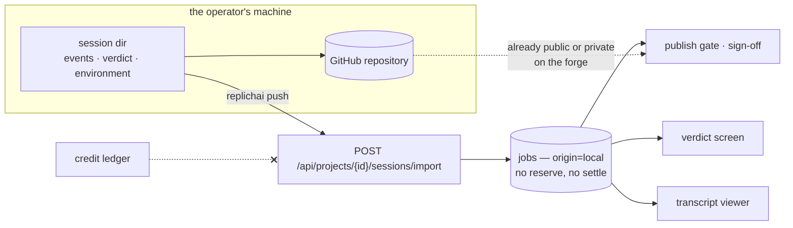

# 045k — A local session reaches the cloud

**Status:** built.

**Scope:** `replichai push` and the ingest surface behind it: a terminal-executed session becoming a `jobs` row with `origin = local`, filed under a project and a paper, carrying its verdict, its instrument, its transcript, its environment record and its repository. What ingest must not touch: the credit ledger. Project creation and listing from the terminal.

**Depends on:** [045j](045j-a-bearer-the-api-accepts.md), [045g](045g-the-host-pushes.md), [006b](006b-job-model-and-persistence.md), [012](012-a-project-holds-papers.md), [015](015-a-verdict-belongs-to-a-session.md), [011](011-what-a-session-costs.md), [005](005-transcript.md).

## Problem

A session run on a laptop produces everything the app renders (a verdict, an instrument, a transcript, a repository, a usage record) and none of it is reachable from a browser. The operator's own work is invisible in the product built to hold it, and a replication project run locally has no page.

The obvious shape is a second table for sessions the platform did not execute. It is the wrong one. [012](012-a-project-holds-papers.md), [015](015-a-verdict-belongs-to-a-session.md) and [032](032-a-session-can-be-thrown-away.md) all key off session-and-project; the rail, the verdict screen, the transcript viewer, the publish gate, the sign-off and the project download all read that shape. A parallel surface duplicates every one of them, and the duplicates drift.

So: the same table, with the one column that says where the work happened.

## `origin`

```
Origin  =  platform | local
```

A typed enum with a closed set, defaulting to `platform`, so every existing row keeps its meaning without a backfill. `platform` means this deployment ran it and metered it; `local` means somebody ran it on their own machine with their own model credential and pushed the record here.



## The ledger is not in the path, structurally

The reserve is taken inside the transaction that inserts a job, in both stores, and `ErrUnpriceable` refuses a submission this deployment cannot price. Both are correct for platform work and wrong for imported work: nobody here bought those tokens.

The skip is **structural, not a flag**. The store gains a distinct entry point, `ImportLocal`, beside `Submit`, that inserts a terminal row and never calls `takeReserve`. A boolean on `Submit` would be one `if` away from being forgotten by the next submission path, which is exactly how [044](044-a-run-that-produced-nothing.md)'s defects were shaped. A test asserts `ImportLocal` cannot reach the reserve, by driving it against a store wired with a credit seam that fails if touched.

Three consequences to state, because a reader of a bill will notice all three:

- **`SpendSince` does not count a local session.** The project rail's thirty-day spend is what this deployment charged, and it charged nothing. [035](035-a-paper-can-move-to-another-project.md) settled the neighboring case (a moved session keeps counting because the ledger holds a real charge) and the same reasoning gives the opposite answer here, because there is no entry.
- **The session shows its usage, not a price.** Tokens and the vendor's own reported cost where the harness gave one, labeled as the vendor's figure.
- **A frozen account can still import.** The freeze is a spending control ([022d](022d-a-negative-wallet-is-frozen.md)) and importing spends nothing. It cannot start a platform session, and that stays true.

## What is imported

Only a terminal session. A run still going is not a record, and importing a `running` row would create a job no worker owns and no lease heartbeats ([044c](044c-a-lease-says-it-is-alive.md)).

| | |
|---|---|
| identity | paper reference and resolved identity, project id, method digest |
| execution | runtime `local`, sandbox driver, harness name and version, model reference, started and finished, terminal reason |
| findings | `verdict.json`, `instrument.json` |
| evidence | `transcript.jsonl`, `environment.json`, the grade file |
| result | repository full name, head commit, grade |
| cost | usage buckets, the vendor's reported cost where present |

**The locator is dropped.** It holds a host path and a process handle: meaningless to the server and a small leak of the operator's home directory. The session id and the runtime name are kept, because they are what makes the import idempotent.

**Evidence is bounded.** The transcript is capped at 32 MiB; a larger one is refused with a 413 naming the size. The CLI does not truncate to fit: a silently shortened transcript is worse evidence than a refused import, and the operator can decide.

## Idempotency

Keyed on `(origin, runtime, session_id)`, unique. Re-pushing an identical payload is a 200 that changes nothing; re-pushing a changed payload updates the same row. A batch that half-uploaded and was interrupted is resumed by running `replichai push` again, which is what an operator will do anyway.

## The terminal surface

```
replichai project create "CHI 2026 audit"
replichai project ls
replichai push papers.yaml                 # every terminal entry in the batch
replichai push --session 7f3a91c2 --project <id>
```

`replichai run` with a `project:` field in the batch file pushes each session as it finishes, and a push failure is recorded in `batch.json` and retried by `replichai push` rather than failing the run. A local run must not depend on the network to have happened.

Papers are filed by identity through the existing project path ([012](012-a-project-holds-papers.md)), so a paper already in the project gains a session rather than a duplicate row, and [037](037-a-paper-carries-its-bibliography.md)'s bibliography is populated the same way it is for a platform session.

## What the reader sees

A local session is labeled as such wherever a session is shown: the rail, the session header, the public page if it is published. Not as a warning: the verdict was produced by the same method and graded against the same rubric. The label is there because `environment.json` says the run happened somewhere this deployment did not control, and a reader comparing two reproductions is entitled to know that before they compare.

Publishing and sign-off are unchanged. An owner's deliberate act with a recorded sign-off ([006n](006n-who-signed-off.md)) is what publishes a session, imported or not; ingesting is not publishing.

## Acceptance criteria

1. `origin` is a typed enum with a closed set, defaults to `platform`, and the migration backfills nothing.
2. `ImportLocal` inserts a terminal job without reaching the credit seam, asserted against a store wired with a seam that fails when touched. `Submit` still takes the reserve.
3. An import for a project whose owner is frozen succeeds; starting a platform session in the same project still refuses.
4. `SpendSince` excludes local sessions; a test asserts a project with one platform and one local session reports only the platform charge.
5. Importing a non-terminal session is refused with a message naming the phase.
6. Re-importing an identical payload is a 200 and changes no row; re-importing a changed payload updates the same row; two imports of different sessions create two rows.
7. The stored row carries no locator, and a test asserts no host path reaches the database.
8. A transcript over the cap is refused with a 413 naming the size, and the CLI reports it without truncating.
9. An imported session renders on the verdict screen, the transcript viewer and the rail with no handler special-casing `origin`, and is labeled as locally executed.
10. An imported session can be published and signed off through the existing path, and the publish gate reads it exactly as it reads a platform session.
11. `replichai push` on a batch uploads every terminal entry, records failures in `batch.json`, and is resumable.

## Not in scope

- Streaming a local session to the app while it runs. The record arrives when the session is a record.
- Importing a session this deployment could not verify. The repository is on the forge and the manifest is readable; deeper attestation of a run somebody else executed is a real question and a separate one.
- Charging for imported sessions. Nothing here touches money.
- Importing from anywhere but this CLI. There is no public import format.

## Outcome

Built as `job.Origin`, `ImportLocal` on both stores, migration 9, one gated route, and `replichai project` / `replichai push`. The reserve skip is structural: `ImportLocal` has no path to the credit seam at all, proved by a test whose seam fails when touched. `SpendSince` excludes a local session in both stores. Re-pushing updates one row, and only a terminal session may be imported.

**Evidence is not uploaded; it stays in the repository.** This spec listed the transcript, the environment record and the grade file among what is ingested, with a 32 MiB cap. What ships carries the record (identity, execution, model, usage, verdict, repository) and nothing else, because the evidence is already in the pushed repository and this deployment has no blob store to put a second copy in. The cap that shipped is 1 MiB on the record itself. A session pushed without `--publish` therefore reaches the app as a verdict with no evidence behind it, which is a real gap rather than a simplification.

**The imported session is not labeled in the UI.** The origin is stored, the API returns it, and no screen shows it. A reader comparing two reproductions cannot yet see that one ran somewhere this deployment did not control.
