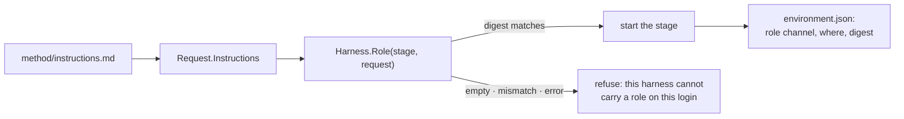

# 045m — The role reaches the agent, or the run does not start

**Status:** draft. A child of [045](045-the-run-happens-on-your-machine.md).

**Scope:** the harness contract's obligation to deliver the worker's standing instructions, the runtime's assertion that it did, and the record of what was delivered. One question: did the agent receive the method? What the method says is [`method/`](../method), data and not code; what the judge does with the result is [045f](045f-the-grader-cannot-edit-what-it-grades.md).

**Depends on:** [045d](045d-the-harness-inside-the-sandbox.md) (the seam this tightens), [045a](045a-the-sandbox-is-a-seam.md), [005](005-transcript.md) (what a run owes a reader).

## Problem

The method is the product. `method/instructions.md` is the worker's durable role (the inner/outer boundary, the workspace protocol, the commit discipline), and every claim replichai makes rests on the agent having read it.

Delivering it is currently each adapter's own responsibility, decided privately and reported to nobody:

| Harness | Channel | Delivered when |
|---|---|---|
| Claude Code | `--append-system-prompt` | always |
| Codex | `AGENTS.md` under `CODEX_HOME` | only when the session writes a configuration directory |

Codex writes no configuration directory when the gateway is the operator's own login, because `CODEX_HOME` is then the operator's own and replichai will not write into it. That is the right call about a configuration file and the wrong call about a role, and the two were combined in the adapter in one `return nil, nil`. Codex has no flag for a role, so on the documented common case (`claude login` / `codex login`, no API key, which is what [`docs/local-runs.md`](../docs/local-runs.md) tells a first-time operator to use) the agent received no standing instructions at all.

Three runs of the real method showed what that costs. Each spent about forty minutes and eleven million tokens, wrote a complete reproduction into a subdirectory the harvest does not publish, committed nothing, and left an empty repository. The rubric passed all three.

Nothing in the system noticed, and nothing could have: no component was responsible for the question. A missing role is invisible at every layer: argv looks ordinary, the stream decodes, the stage exits zero, the judge grades what it finds. The one place it shows up is the reproduction, by then an hour late.

## The obligation

Delivery becomes part of the contract, asserted before a stage starts.

```go
// RoleDelivery is how one harness hands a stage its standing instructions,
// and the evidence that it did. A harness that cannot carry a role for a
// given request says so; the runtime refuses to start the stage rather than
// running an agent that was told nothing.
type RoleDelivery struct {
    Channel Channel // argv | file | stream
    Where   string  // the flag, or the path, the role travelled in
    Digest  string  // sha256 of the exact bytes delivered
}

type Harness interface {
    // ...
    // Role reports how request.Instructions reach this stage. It is called
    // before Argv and Files, and its Digest must equal the digest of the
    // instructions the request carried.
    Role(stage Stage, request Request) (RoleDelivery, error)
}
```

The runtime's check is one equality, and it runs for every stage of every session:

$$
\texttt{Role}(s, r).\mathit{Digest} = \mathrm{sha256}\big(r.\mathit{Instructions}\big) \quad\text{whenever } r.\mathit{Instructions} \neq \varepsilon
$$

A harness that returns a mismatch, an empty digest, or an error fails the stage at start: before the model is reached, before anything is billed, and with a message naming the harness and the auth mode rather than the symptom.



**Why a digest and not a boolean.** A boolean answers "did the adapter intend to deliver a role", which is exactly what was true before: Codex's adapter intended to, through a file it did not write. The digest answers "were these bytes delivered", which is the question, and it is the same value a later reader needs to tell whether two runs were given the same method.

**Why refuse rather than fall back.** A fallback is a second delivery path that nobody tests, and the one that matters is always the one in use. An adapter that has no channel on some login is a defect to fix in the adapter, and a refusal at second zero costs nothing; the alternative costs forty minutes and produces a result that looks graded.

## What a run records

`session/environment.json` already says what the run ran on. It gains what the run was told:

```json
"role": {
  "channel": "argv",
  "where": "prompt",
  "digest": "sha256:9f2c…",
  "method_digest": "sha256:f9af…"
}
```

Two digests, because they answer different questions. `digest` is what this stage received. `method_digest` is what the method was at the time, which the registry and the manifest already carry. A run where they disagree is a run whose role was rewritten between loading and delivery, which is worth seeing.

## Acceptance criteria

1. `Harness.Role` exists on the seam and every adapter implements it. A stage starts only when its digest matches the request's instructions; the check runs for worker, revision, and judge stages alike.
2. Claude Code reports `argv` / `--append-system-prompt`; Codex reports `file` / `<CODEX_HOME>/AGENTS.md` where it writes one, and `argv` / `prompt` where it does not.
3. A harness returning an empty or mismatched digest fails the stage before the sandbox starts, with a message naming the harness and the gateway's auth kind. Tested per adapter, per auth kind.
4. The conformance suite drives every registered harness through both auth kinds and asserts a role arrives in each; a new adapter cannot pass it without answering the question.
5. `environment.json` carries the role block, and the transcript's environment record shows it.
6. A request with no instructions starts normally and records no role block: the check binds only where there is a role to deliver.
7. The regression that motivated this is covered by name: a codex request on `AuthHarness` delivers the instructions, and a codex request with an API-key gateway delivers them exactly once.

## Not in scope

- **What the instructions say.** The method is data and changing it needs no code ([`method/`](../method)).
- **The judge passing a run that committed nothing.** That is a rubric question, and a real one: three sessions were graded `passed` with an empty workspace. It belongs with [045f](045f-the-grader-cannot-edit-what-it-grades.md) and [044d](044d-an-empty-repository-says-so.md), not here. This spec makes the cause visible; it does not make the grader stricter.
- **Delivering a role to a hosted runtime.** `anthropic-managed` passes instructions through the provider's own system-prompt channel and has no adapter layer to lose them in. The contract change is `local`'s.
- **Verifying the agent obeyed the role.** Unreadable from here, and already what the rubric is for.

## Outcome

Not built. The two defects that produced it are fixed (the instructions now travel with the codex prompt where no file carries them, and the harvest no longer fails on a symlink), but each fix is one adapter answering the question privately, which is the shape this spec exists to replace.
