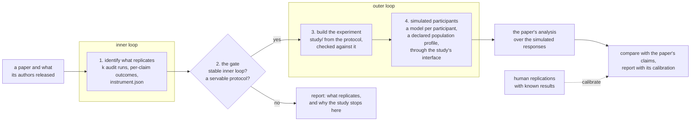

# 050 — The outer loop, simulated

**Status:** draft, for the owner's review. Nothing here is built beyond what the table under *Where it stands* says. Once agreed it becomes `designed` and spawns the child specs listed at the end.

**Scope:** what ReplicHAI is for, end to end: from a paper to a replication of its whole study, the human part included, run with simulated participants. The four stages, the gate between the inner and the outer loop, the experiment the agent builds, the simulated participants and their population profiles, what a simulated replication establishes and how it is calibrated, the benchmark the runs yield, and the copy that states it. It reverses one principle of [007](007-from-reproduction-to-replication.md), [007c](007c-the-synthetic-pilot.md) and [023](023-the-outer-loop-as-a-product.md), and keeps the rest of their design.

**Depends on:** [046](046-one-run-is-one-draw.md) (k runs per paper, the run record, the construct), [007a](007a-the-study-protocol-as-an-artifact.md) (`instrument.json`), [007b](007b-experiments-over-instruments.md) and [007c](007c-the-synthetic-pilot.md) (the experiment engine and the indelible label), [007d](007d-hosting-a-study.md) (the `study/` bundle and its isolated origin), the dispersion model in replichai-experiments (`docs/dispersion-model.md`).

## Problem

The product has been described as *paper in, artifact out*: an agent reproduces the analysis a paper's authors released and returns a verdict. Everything it does happens in the inner loop. The outer loop, the study with people that a paper in human-computer interaction, psychology or social science rests on, has been named, marked out of scope, and described on the landing page, in the README and in the audit's method as something ReplicHAI never simulates.

That was never the goal. The goal is to replicate the study itself: to take a paper's intent, decide what can be replicated, build the experiment the paper ran, run it, and check whether the paper's conclusion holds. Running a study again with real people is slow and expensive, so the outer loop runs with simulated participants: a model, given a population profile, takes part in the experiment the agent built, through the same interface a person would use. That is what closes the outer loop.

The earlier design reached the same machinery and stopped short of it on purpose. [007](007-from-reproduction-to-replication.md) built an instrument and an experiment engine, then ruled that a model cohort is a *synthetic pilot* that "establishes nothing about people" and must never be called a simulation of the outer loop. [007c](007c-the-synthetic-pilot.md) refused population profiles outright. [023](023-the-outer-loop-as-a-product.md) sequenced real participants last and left simulation as a pre-study aid. The caution behind those rules is right: a model's answers are not people's answers, and a number nobody can falsify is the failure this product exists to catch. What this spec changes is the conclusion drawn from it. Instead of refusing to simulate, the outer loop is simulated openly, labeled as simulated, and calibrated against studies where people's answers are known.

## Where it stands

| Stage | What exists |
|---|---|
| 1. Identify what replicates | **Built.** The audit splits a paper into claims and components, places the inner/outer boundary, re-runs the inner loop and records each claim's outcome (findings schema 2). It writes `instrument.json`: the study's protocol, the analysis entry point in `src/`, and whether a machine could serve the study. A study of k runs per paper runs on the local runtime. |
| 2. The gate | **Partly.** The statistics are defined in the dispersion model. The system cannot compute them yet: it needs the claim list frozen per paper and the system, not the agent, deciding whether a number matched ([046](046-one-run-is-one-draw.md) decision 6, designed). Studies cannot run on the hosted runtime yet (046 decision 5). |
| 3. Build the experiment | **Not started.** 007d designed the `study/` bundle and its isolated origin for human participants; nothing writes or serves one. |
| 4. Simulated participants | **Not started.** The experiment engine runs a model cohort through a protocol as text ([007c](007c-the-synthetic-pilot.md), engine half built, unreachable from the app). Nothing drives a built experiment through its interface, and no population profile exists. |

## The pipeline

## Decisions

### 1. The audit does not change

Stage 1 is the audit exactly as it is. Its method still never simulates participants, the golden cases keep their expectations, and `verdict` and `rate` are still written by an audit and nothing else. The one-way firewall of [007](007-from-reproduction-to-replication.md) stands: `internal/audit` never imports the experiment side, so no simulation can inform a verdict by any path. The audit answers *does the analysis reproduce from what was released*; the outer loop answers a different question, and the two are reported apart.

### 2. The gate is a statistic plus two facts, and its threshold is registered

A paper continues to the outer loop when three things hold:

- **The inner loop is stable.** Over k runs, the per-claim reproduction probability *q* and the paper's instability *H* are computed as the dispersion model defines them. A paper whose analysis does not reproduce, or reproduces in some runs and not others, has no trustworthy pipeline to analyze simulated responses with.
- **The protocol is servable.** `instrument.json` declares the study a machine can serve: its conditions, stimuli and measures, with no physical apparatus, confederate or interviewer.
- **There is something to compare against.** The paper reports the effect the simulation will be compared with, and for calibration a human replication of it exists where possible (decision 5).

The cutoffs on *q* and *H* are not set here. The dispersion model fixes them in the study's registration before outcomes are seen, and this spec follows it. A paper that stops at the gate gets a report that says what replicated and which condition stopped it, which is a finding, not a failure.

### 3. The agent builds the experiment as a website

When a paper passes the gate, an agent writes the experiment from the protocol: the stimuli, the conditions, the random assignment, the trial structure and the measures, as the static `study/` bundle 007d designed, served from its own origin under a strict content policy. A built experiment is checked against the protocol before any participant sees it: every declared measure is recorded, every condition is reachable, assignment is balanced, and a scripted participant completes it end to end. An experiment that fails the check is not run.

Simulated participants remove the need for 007d's anonymous public write path for now: they run inside the platform. Hosting the same bundle for real participants stays 007d's design and becomes an optional later source rather than a prerequisite.

### 4. Simulated participants take part through the interface, under a declared profile

Each simulated participant is one model session that uses the experiment through computer use: it sees the pages a person would see and answers through the same controls, so presentation, order and timing reach it the way they reach a person. Its responses are collected through the experiment's own write path, and the paper's analysis (`instrument.analysis`) runs over them unchanged.

A **population profile** describes who is being simulated: the population the paper sampled (age range, region, language, relevant experience, and the traits the study screens on), taken from the paper's own sample description. [007c](007c-the-synthetic-pilot.md) refused profiles. This spec admits them, with the guards that make them sound:

- A profile is declared before a run and recorded as one of its inputs, as 046 records the paper copy and the artifact snapshots.
- A profile is never adjusted to bring the result closer to the paper's. Fitting a profile or a prompt to the target result is fitting the thing under study, and stays out of scope as 007c put it.
- Calibration is per profile and per model (decision 5), so a profile's accuracy is measured rather than assumed.

A text-only path, where the model answers the protocol's questions without the website, stays available as the cheaper contrast. Comparing the two measures what the interface changes.

### 5. What a simulated replication establishes, and how it is calibrated

**The design (A).** A simulated replication is a result about a simulated population. It reports whether the paper's effect appeared among simulated participants of the declared profile, with its direction, size and uncertainty, and it carries the label `simulated` on every path out of the system, as 007c's label does. It is never shown as, or merged with, the audit's verdict. Its weight comes from calibration: for each model and profile, the same pipeline is run on studies whose human replications are known, and the report states how often simulation agreed with people there. A model and profile pair with no calibration is reported as uncalibrated.

The calibration set is a large human replication project that re-ran published social science and psychology studies with people, with its data released, so every one of its studies has a human answer to compare a simulation with. The proof-of-concept papers are chosen from it (*First corpus*, below).

**The alternative (B).** Once a model and profile pair passes a calibration bar, its simulated replication counts as evidence about people, beside the paper's own. This is the stronger claim and it would make the product's headline stronger. Its cost is the credibility the product rests on: a reader cannot check a simulated participant the way they can check a re-run analysis, so a claim about people from simulation alone is the claim a skeptical reviewer attacks first. A keeps that claim conditional on calibration in every sentence; B asserts it. **The owner decides; this draft is written as A.**

### 6. The runs are the benchmark

Every run of the pipeline records what an evaluation of agents needs, so a benchmark can be built from the runs rather than beside them:

- per claim: the audit's outcome, the system's match, and the blocker's cause;
- the gate's inputs and its decision;
- whether the built experiment passed its check, and what failed;
- per profile and model: the simulated effect, the human result where one exists, and the calibration error;
- the dispersion of each of these over k runs, and the cost and time each stage took.

A task in the benchmark is a paper with known answers at each stage: which claims reproduce, whether the study is servable, and what people did. A model is scored stage by stage, so a developer can see where it fails: reading the paper, reproducing the analysis, building the experiment, or behaving like the population. No new schema is fixed here; the child specs add fields to the run record as each stage lands.

### 7. What this reverses, and what it keeps

- **[007](007-from-reproduction-to-replication.md):** the rule that a model cohort is a pilot and must never be described as simulating the outer loop is reversed. Kept: the instrument, the experiment engine, the one-way firewall, `verdict` and `rate` written only by an audit, and the indelible label.
- **[007c](007c-the-synthetic-pilot.md):** population profiles move from refused to admitted under decision 4's guards, and the released-data requirement becomes calibration (decision 5) rather than a refusal. Kept: the label travels on every path, a synthetic comparison reads as a statement about the model, and no fitting to the target.
- **[023](023-the-outer-loop-as-a-product.md):** the sequence that ran real participants last and simulation only as a pilot is replaced by this pipeline. Its census of the earlier corpus (no servable protocol, no released raw data among three papers) described that corpus; the calibration set changes it.

Each of the three carries a note at its top pointing here.

### 8. The copy states the whole pipeline now, and the outer loop as coming soon

The README, the landing page and the docs describe all four stages. Stages 1 and 2 are described as what ReplicHAI does; stages 3 and 4 as coming soon. The audit's own description keeps saying that the audit never simulates participants, because that stays true. Figure 1 keeps its geometry for now (the inner loop closed, the outer loop drawn open, because it does not run yet) and changes its label and caption; it is redrawn when stage 4 ships. The headline question, *Does the paper reproduce?*, stays for now: it is the first stage and it is what ships. It changes, with the share image that carries it, when stage 4 ships.

## First corpus

Three papers from the calibration set, chosen to exercise every stage and to give each stage a known answer: designs that differ (a survey vignette, a choice task, a timed or interactive task), analyses that differ (Python and R), and at least one study that did not replicate with people, so the pipeline is tested on reproducing a null as well as an effect. The selection and its reasons are recorded in replichai-experiments.

## Dependencies outside this spec

- **Environments.** Stage 1 needs the paper's analysis stack (Python or R with its packages); stage 4 needs a sandbox with a browser and a display. Choosing the environment per session is the subject of the environment-profiles design for the Latere sandboxes.
- **Claim matching by the system** (046 decision 6), which the gate needs.
- **Studies on the hosted runtime** (046 decision 5), so the pipeline runs where the app runs.
- **Computer use** on the runtime that drives stage 4.

## Open questions for the owner

1. A or B (decision 5).
2. The gate's cutoffs, fixed in the registration (decision 2).
3. Which model and runtime drives simulated participants, and how many participants per condition a run uses.
4. Where a profile comes from when the paper's sample description is thin.
5. Whether the first release of stage 4 includes the text-only contrast or only the interface path.

## The specs this spawns

| Child | Scope |
|---|---|
| 050a: the gate | compute *q* and *H* from a study's runs, combine them with servability and a comparison target, record the decision |
| 050b: the experiment the agent builds | `study/` written from the protocol, its conformance check, serving it in a sandbox |
| 050c: simulated participants | computer-use participants, population profiles, collection through the experiment's write path, the analysis over the responses |
| 050d: calibration and the report | the calibration set, per-profile calibration, the simulated replication report and its label |
| 050e: the benchmark | the run-record fields and the export that make the runs a benchmark |

## Acceptance criteria

For the whole track, verified as the children land:

1. Every invariant of 007 that decision 7 keeps still holds: the audit never reads an experiment, `verdict` and `rate` are written only by an audit, and a simulated result never reaches a reader without its label.
2. A paper that fails the gate gets a report naming the condition that stopped it, and no experiment is built for it.
3. No simulated participant takes part in an experiment that failed its check against the protocol.
4. Every simulated replication names its model, its profile and its calibration, or says it is uncalibrated.
5. A profile and a prompt are fixed before the run; a test asserts the run record holds both and that a run cannot change them.
6. For each paper of the first corpus, the pipeline runs end to end and its result at every stage can be compared with a known answer.

## Out of scope

Recruiting, paying or screening real participants, and ethics review, as in 007. Longitudinal studies, physical apparatus, confederates and interviewer-led protocols, which the servability criteria exclude. Fitting a profile, a prompt or a model to a study's result. Deciding from simulation alone that a paper's claim about people is true or false; under A the report states what the simulation showed and how well calibrated it is.
